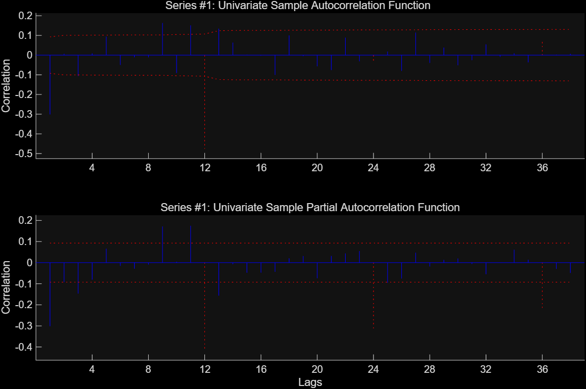
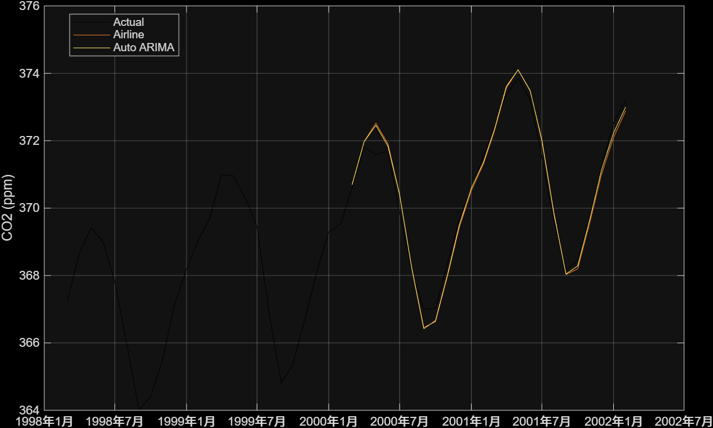
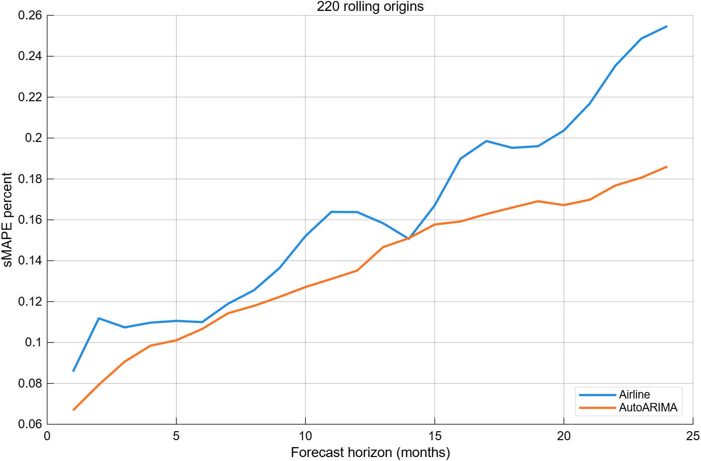
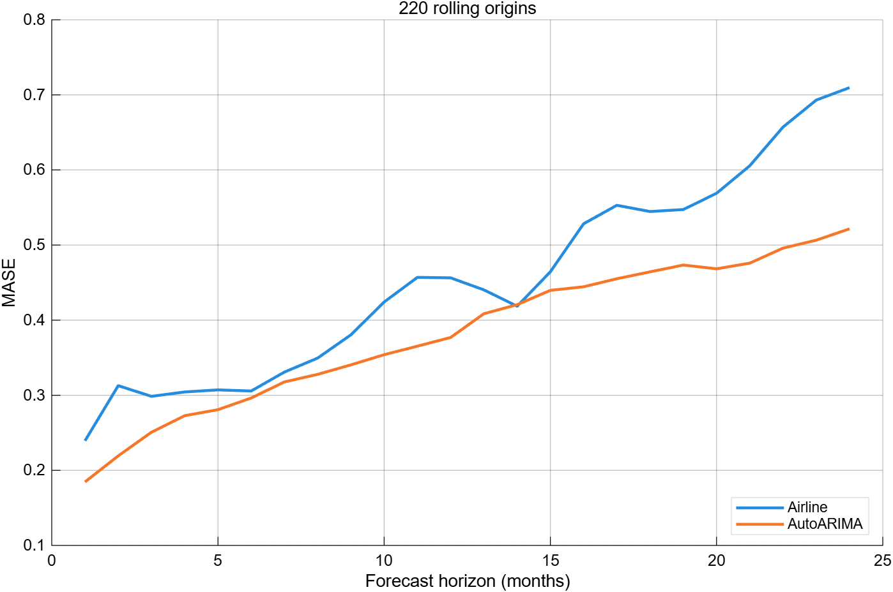

# 成员 B 复现工作总结

> 项目：基于 ECOTOOL 的 Mauna Loa CO₂ 浓度预测复现  
> 负责人：成员 B  
> 状态：两种 ARIMA 模型的单次预测、220 轮滚动实验及核验已完成；论文差异分析、PPT、讲稿和小组代码整合待完成。

## 1. 项目与分工

本项目使用 MATLAB 和论文作者的 ECOTOOL 工具箱，复现论文《Time series analysis and forecasting with ECOTOOL》中的 CO₂ 案例。核心算法调用作者工具箱；本组编写数据调用、实验循环、结果导出与核验程序。

| 成员 | 模型和分析任务 | 整合职责 |
|---|---|---|
| A | 原始序列、趋势与季节性；ETS、Seasonal Naïve；预测与评价 | PPT 整合 |
| **B（本人）** | **差分、ACF/PACF、Airline SARIMA、Auto ARIMA、模型识别、预测与评价** | **MATLAB 代码及运行说明整合** |
| C | UC、趋势分解、评价口径核查、跨模型汇总和论文对照 | 结果与讲稿整合 |

以上是计划分工，不表示 A、C 的任务已经完成。

## 2. 本人应做与已完成内容

| 任务 | 当前状态 | 对应交付 |
|---|---|---|
| 独立读取作者数据 | 已完成 | 两个 MATLAB 入口中的数据读取与检查 |
| Box–Cox 变换 | 已完成 | 单次估计；滚动时逐轮用训练集估计 |
| 普通及季节差分 | 已完成 | 单次诊断程序 |
| ACF/PACF 分析图 | 已生成；理论说明已在讨论中提供 | `results/figures/B_diagnostics_1.png` |
| Airline 拟合与预测 | 已完成 | 单次及滚动结果 |
| Auto ARIMA 识别与预测 | 已完成 | 单次及滚动结果 |
| 模型结构和参数保存 | 已完成 | 模型 MAT 文件及滚动检查点 |
| 单次 24 个月预测 | 已完成，并由本人在 MATLAB 复跑 | 预测 CSV、指标 CSV、预测图 |
| 220 轮滚动预测 | 已完成 | 10560 条预测、48 行指标、2 张误差曲线 |
| 输出与误差核验 | 已通过 | `audit.json`、`mase_audit.txt` |
| 实验代码与结果共享 | 已上传 | GitHub 的 `member-b-arima` 分支 |
| 论文数值差异分析 | 待完善 | 当前数值尚未完全还原 Table 4 |
| 本人 PPT 第 5～7 页及讲稿 | 待完成 | `presentation/` 后续交付 |
| 小组三人 MATLAB 代码整合 | 待其他成员代码到齐后完成 | 统一入口、依赖和输出说明 |

## 3. 各模型及分析工具做了什么

### 3.1 Airline SARIMA：固定结构预测

结构为 `ARIMA(0,1,1) × (0,1,1)₁₂`。

- 一次普通差分削弱趋势，一次 12 个月季节差分削弱年度季节性。
- 使用非季节与季节 MA 项描述扰动的时间依赖。
- 每轮保持模型结构不变，重新估计参数。
- 输入外部 Box–Cox 变换后的数据，通过 `modelTF` 拟合。
- 输出预测后逆变换回原始 ppm 尺度。

研究作用：作为结构固定、较简洁的季节 ARIMA，与自动识别方法比较。

### 3.2 Auto ARIMA：自动识别预测

- 通过作者的 `modelAUTO` 自动识别 ARIMA 结构并估计参数。
- 输入原始训练数据，内部处理变换识别。
- 每轮重新识别结构、估计参数；不保证每轮都选择 Airline。
- 实测当前工具箱版本的 `auto.py` 已是原始 ppm，不能重复逆变换。

研究作用：检验根据新增数据自动调整模型是否有助于预测。

### 3.3 其他分析操作

| 操作 | 作用 | 是否独立预测模型 |
|---|---|---|
| Box–Cox | 尝试稳定波动尺度 | 否 |
| 普通差分 | 分析相邻月份变化，削弱趋势 | 否 |
| 12 个月季节差分 | 分析同比变化，削弱季节性 | 否 |
| ACF/PACF | 检查滞后相关，辅助结构识别 | 否 |
| 扩展窗口滚动预测 | 在多个历史起点检验预测能力 | 否，是实验设计 |

诊断时单独差分；Airline 建模时输入未差分的变换序列，模型内部已包含差分，避免重复差分。

## 4. 数据与实验设置

数据来源：作者 ECOTOOL 仓库的 `dataPLOSpaper.mat`，变量为 **CO2 单列向量**，共 723 个观测。月份按论文的 1958-03 至 2018-05 映射，单位 ppm。

### 4.1 单次预测

- 训练：`CO2(25:504)`，1960-03 至 2000-02，共 480 个月。
- 测试：`CO2(505:528)`，2000-03 至 2002-02，共 24 个月。
- 用于流程验证和展示预测曲线。

### 4.2 220 轮扩展窗口预测

训练起点固定，每轮增加一个月，不删除早期数据。

| 轮次 | 训练索引 | 测试索引 |
|---|---|---|
| 1 | 1:480 | 481:504 |
| 2 | 1:481 | 482:505 |
| 220 | 1:699 | 700:723 |

- 第一轮预测起点（最后可见训练月）：1998-02；第一目标月：1998-03。
- 最后一轮预测起点：2016-05；最后目标月：2018-05。
- 轮数：`723 − 480 − 24 + 1 = 220`。
- 每轮只用当轮训练数据估计变换和模型。
- 两种模型 × 220 轮 × 24 步 = **10560 条预测记录**。
- 累计模型计算耗时约 **624.4 秒**，MATLAB R2026a Update 5。

注意：滚动实验不沿用单次示例跳过前 24 个月的设置。相邻轮次测试区间重叠，预测误差并非相互独立。

## 5. 实际结果与解释

### 5.1 单次 24 个月平均误差

| 模型 | sMAPE (%) | MASE |
|---|---:|---:|
| Airline | 0.07949 | 0.22235 |
| Auto ARIMA | 0.06909 | 0.19325 |

两种模型都能跟随季节起伏；本次单个预测起点上，Auto 误差更小。

### 5.2 滚动实验：固定步长的跨 220 轮平均误差

| 步长 | Airline sMAPE (%) | Auto sMAPE (%) | Airline MASE | Auto MASE |
|---|---:|---:|---:|---:|
| 1 个月 | 0.08574 | 0.06681 | 0.23935 | 0.18453 |
| 6 个月 | 0.10997 | 0.10662 | 0.30565 | 0.29633 |
| 12 个月 | 0.16378 | 0.13519 | 0.45634 | 0.37694 |
| 24 个月 | 0.25474 | 0.18605 | 0.70962 | 0.52160 |

- 误差总体随预测步长增加。
- Auto 在本次实验的大多数步长上误差更低，并非所有步长均更低。
- 第 24 步是“第 24 个月”的平均误差，不是前 24 个月累计平均。
- MASE 低于 1 表示低于当前训练季节朴素误差尺度；不等于已与 A 的样本外 Naïve 结果完成比较。
- 不能将单次预测误差与滚动误差直接排名。

### 5.3 指标口径

- sMAPE：每条预测计算 `200 × |真实值−预测值| / (|真实值|+|预测值|)`，固定步长后跨轮平均，单位为百分数。
- MASE：绝对预测误差除以当轮训练集的 12 阶季节差分绝对值均值，再固定步长跨轮平均，无单位。
- 两项指标均越小越好。

## 6. 图片

### 差分后的 ACF/PACF



用于分析差分后仍存在的时间相关结构，不是模型残差白噪声检验。

### 单次预测



两种模型与真实值的对比。当前深色图中真实值黑线不清楚，正式汇报前应优化配色。

### 滚动 sMAPE



### 滚动 MASE



`B_diagnostics_2.png` 是空白窗口导出，不作为实验成果。

## 7. 交付物位置

| 路径 | 内容与用途 |
|---|---|
| `src/run_member_b.m` | 单次预测、变换、诊断与结果导出 |
| `src/run_member_b_rolling.m` | 220 轮滚动实验，逐轮保存，可续跑 |
| `src/audit_member_b_rolling.py` | 独立核验 CSV 完整性、日期和 sMAPE |
| `docs/member_b_run.md` | 单次运行说明 |
| `docs/member_b_rolling.md` | 滚动协议、运行方法与结果说明 |
| `results/tables/B_single_predictions.csv` | 单次逐月真实值和预测值 |
| `results/tables/B_single_metrics.csv` | 单次平均误差 |
| `results/tables/B_single_models.mat` | 单次模型结构、参数与变换信息 |
| `results/tables/B_environment.txt` | 单次环境和模型记录 |
| `results/figures/` | 单次预测与相关分析图 |
| `results/rolling_b/predictions.csv` | 10560 条完整滚动预测 |
| `results/rolling_b/metrics_by_horizon.csv` | 两模型 × 24 步，共 48 行指标 |
| `results/rolling_b/checkpoint.mat` | 逐轮预测、模型参数、lambda、耗时与完成标记 |
| `results/rolling_b/status.txt` | 完成状态、起止点和耗时 |
| `results/rolling_b/audit.json` | 完整性、日期、sMAPE 核验通过记录 |
| `results/rolling_b/mase_audit.txt` | 220 个训练尺度、真实值索引和 48 项 MASE 重算通过记录 |

预测 CSV 包含：`model`、`round`、`forecast_origin`、`target_month`、`horizon`、`actual`、`predicted`。

## 8. 如何运行

在本机 MATLAB 进入项目目录后：

```matlab
addpath('src');
run_member_b                 % 单次实验
run_member_b_rolling(3)      % 最多跑至第 3 轮，已有检查点则跳过
run_member_b_rolling         % 运行或继续至 220 轮
winopen(fullfile(pwd,'results','rolling_b'))
```

其他电脑需先准备作者工具箱和数据，传入路径：

```matlab
run_member_b('工具箱的 fsroot 路径','dataPLOSpaper.mat 完整路径');
run_member_b_rolling(220,'工具箱的 fsroot 路径','dataPLOSpaper.mat 完整路径');
```

现有 220 轮检查点时不会重新拟合，只重新导出结果。若需从零运行，先备份或重命名 `results/rolling_b`。不要同时运行两份滚动程序。

独立 CSV 核验：

```powershell
python src/audit_member_b_rolling.py
```

## 9. GitHub 共享与成员 C 交接

- 共享分支：[member-b-arima](https://github.com/41423577arc-lab/ECOTOOL-Mauna-Loa-Reproduction/tree/member-b-arima)。
- 不应假定这些内容已经合并至 `main`。
- 交给 C 的核心文件：滚动 `predictions.csv`、`metrics_by_horizon.csv`、两张误差曲线及 `docs/member_b_rolling.md`。
- C 汇总前必须核对 A、C 是否使用相同数据、训练范围、预测起点、尺度和指标。若只完成单次实验，应单独汇总单次结果。

## 10. 完成范围与后续工作

**已完成：两种 ARIMA 的可运行实验流程、单次预测、完整 220 轮滚动预测、结果导出和核验。**

尚不能称为“论文 Table 4 数值完全复现”。需继续核对变换策略、估计选项、异常值处理及年度汇总口径；当前 Airline 使用默认 EML，Auto 使用默认 CML，不把差异全部归因于自动选阶。

后续交付：

- [ ] 将已有原理与结果整理为正式分析说明。
- [ ] 完成论文结果差异分析。
- [ ] 完成本人 PPT 第 5～7 页及约 4 分半钟讲稿。
- [ ] 与 A、C 对齐实验协议并汇总结果。
- [ ] 整理小组统一代码入口与运行说明。

## 11. 参考资源

- [原论文](https://journals.plos.org/plosone/article?id=10.1371/journal.pone.0221238)
- [作者 ECOTOOL 仓库](https://github.com/djpedregal/ECOTOOL)
- 本次使用的作者仓库提交：`8de5e85af0a9ffe852a9cab71b44bfc063175cb2`。

第三方工具箱和原始 MAT 数据未作为独立依赖文件重复上传；滚动检查点包含核验与续跑所需的浓度数据快照。
