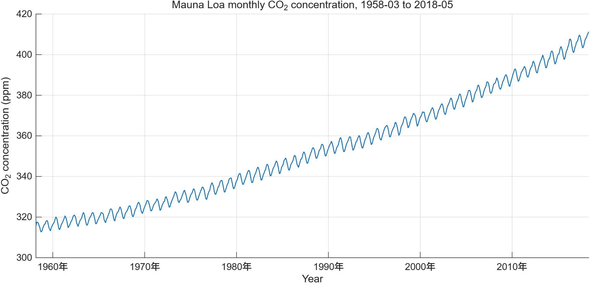
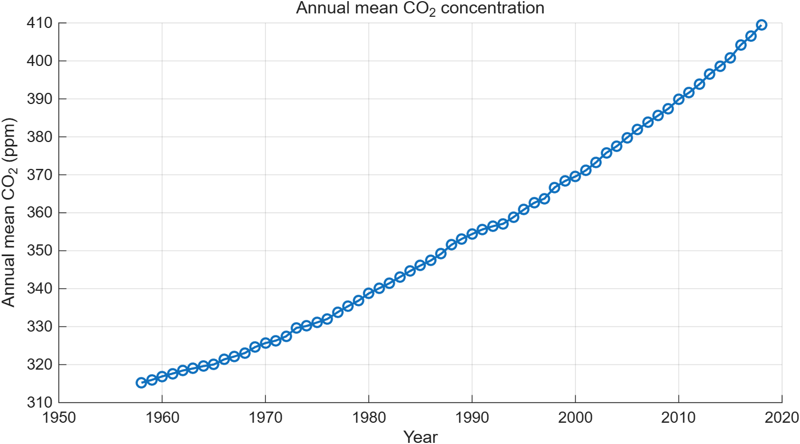
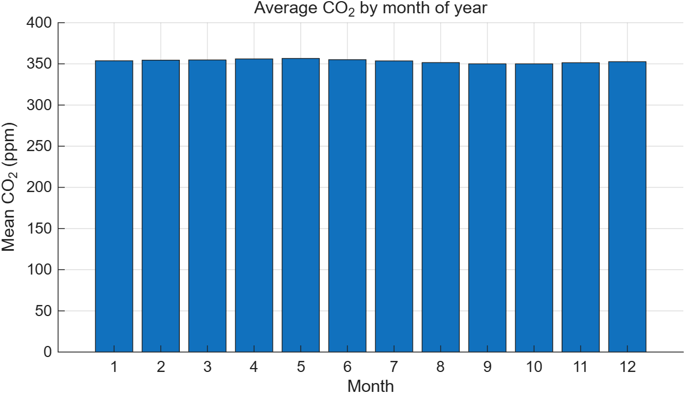
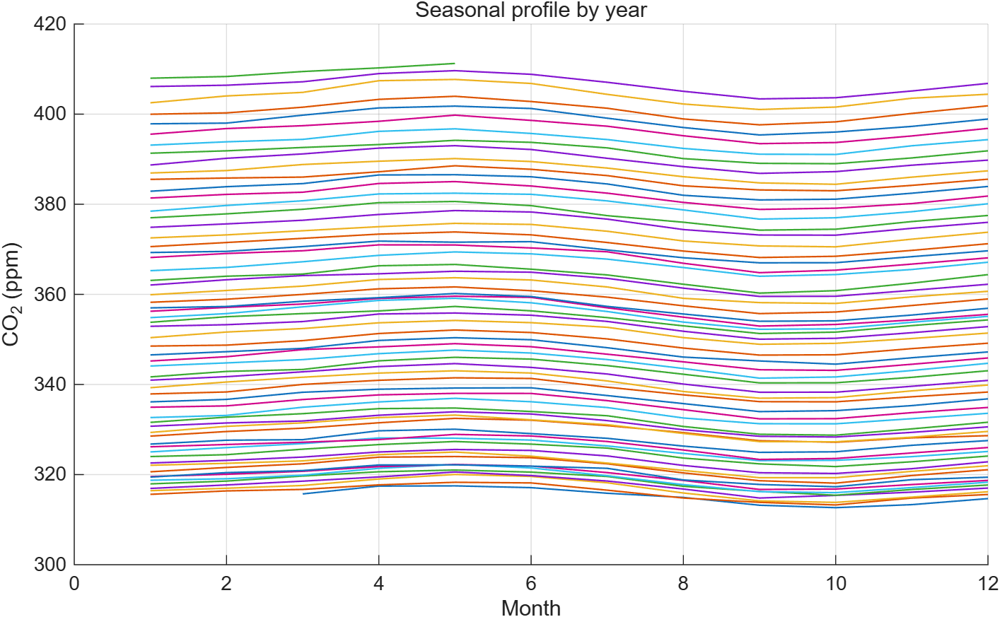
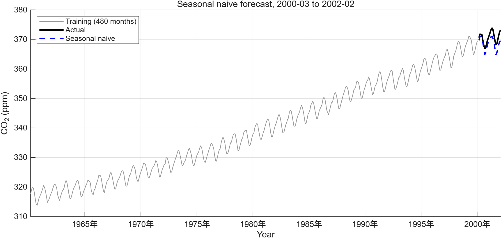
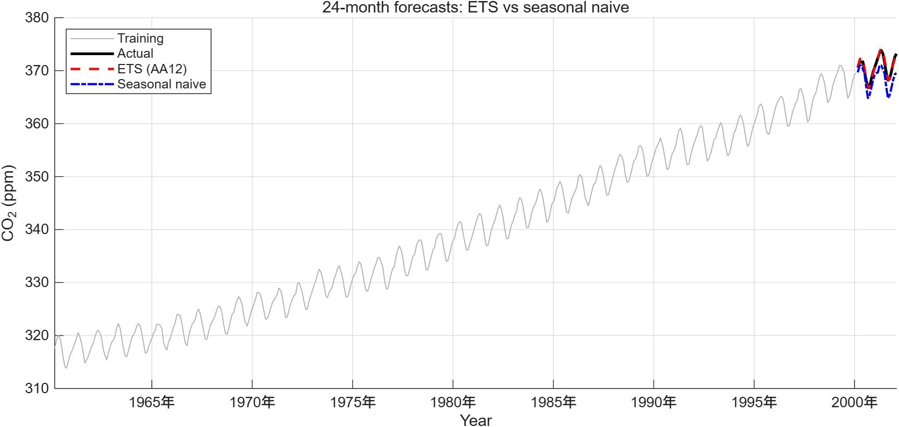
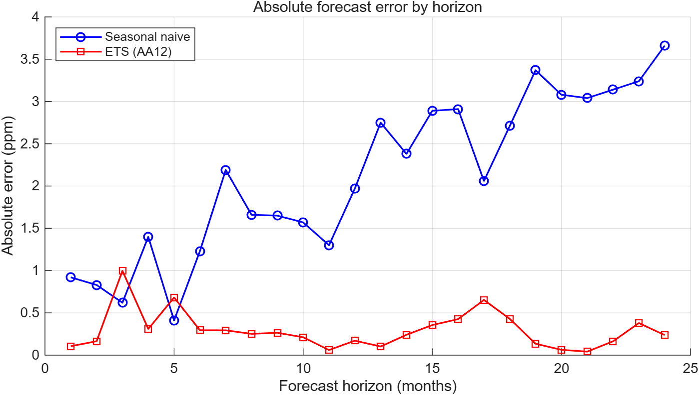

# 成员A实验记录

> **用途**：复现过程留痕 + 报告与 PPT 文字素材
> **维护方式**：每完成一步由 Claude 更新；用户报告的结果标"已验证"，未运行的标"待确认"
> **最后更新**：2026-11-16

---

## 1. 实验环境

| 项目 | 内容 | 状态 |
|---|---|---|
| MATLAB 版本 | R2026a | 已验证 |
| ECOTOOL 版本 | 待安装后记录 | 待确认 |
| 数据文件 | `data/dataPLOSpaper.mat` | 已验证 |
| 数据来源 | ECOTOOL 官方仓库 `djpedregal/ECOTOOL` | 已验证 |

---

## 2. 数据检查（A1）

### 2.1 文件结构（已验证）

`dataPLOSpaper.mat` 包含 3 个变量：

| 变量 | 尺寸 | 用途 |
|---|---|---|
| `CO2` | 723×1 | 本项目使用的 Mauna Loa CO₂ 序列 |
| `Sun` | 158544×1 | 论文太阳辐照度案例，本项目不用 |
| `electricity` | 12672×1 | 论文西班牙电力负荷案例，本项目不用 |

> 注意：论文第 11 页代码写作 `maunaLoa(25:504,5)`，那是作者自己那份 NOAA 多列原始文件；本仓库的 `.mat` 已把 CO₂ 提成一列 `CO2`，因此本项目直接使用 `S.CO2`。

### 2.2 序列基本统计（已验证）

| 指标 | 数值 |
|---|---|
| 观测数 | 723 个月 |
| 时间范围 | 1958-03 ～ 2018-05 |
| 缺失值 | 0 |
| 最小值 | 312.66 ppm（第 8 行，1958-10） |
| 最大值 | 411.25 ppm（第 723 行，2018-05） |
| 单位 | ppm |

### 2.3 行号与日期对应（已验证，MATLAB 输出）

| 行号 | 日期 |
|---|---|
| 1 | 1958-03 |
| 25 | 1960-03 |
| 504 | 2000-02 |
| 505 | 2000-03 |
| 723 | 2018-05 |

由此确定本项目的样本划分：

- **训练集** `25:504` = 1960-03 ～ 2000-02（480 个月）
- **预测集** `505:528` = 2000-03 ～ 2002-02（24 个月）

---

## 3. 时间序列特征分析（A2）

### 3.1 数值结果

| 指标 | 数值 | 状态 |
|---|---|---|
| 全期线性趋势 | 1.546 ppm/年 | 已验证 |
| 2000-03 起线性趋势 | 2.148 ppm/年 | 已验证 |
| 季节峰值 | 5 月，356.57 ppm | 已验证 |
| 季节谷值 | 9 月，350.02 ppm | 已验证 |
| 季节振幅 | 6.56 ppm | 已验证 |
| 1958 年均值 | 315.37 ppm | 已验证 |
| 2018 年均值 | 410.32 ppm | 已验证 |

> 以上数值均已由本人在 MATLAB 中运行得到。

> **复现范围说明**：本节的 Fig.1（原始序列）对应论文 p.10 的 Fig.1，属于直接复现；年均值、趋势斜率、月度季节均值、逐年叠加图属于**补充的描述性分析**，论文正文只用文字描述趋势与季节性，并说明用伪周期图/AR 伪谱检查（未在论文中展示）。报告中应把两者区分表述，不把补充分析说成论文原图。

### 3.2 图表

| 文件 | 内容 | 状态 |
|---|---|---|
| `results/figures/A_fig1_co2_series.png` | 原始序列（对应论文 Fig.1） | 已生成 |
| `results/figures/A_annual_mean.png` | 年均值趋势 | 已生成 |
| `results/figures/A_seasonal_monthly.png` | 月度季节均值柱状图 | 已生成 |
| `results/figures/A_seasonal_overlay.png` | 逐年季节曲线叠加 | 已生成 |

**图 1：原始序列（对应论文 Fig.1）**

**图 2：年均值趋势**

**图 3：月度季节均值**

**图 4：逐年季节曲线叠加**

### 3.3 可直接用于报告/PPT 的文字

**数据描述**

> 本研究使用 Pedregal（2019）提供的固定版本数据 `dataPLOSpaper.mat`，包含 Mauna Loa 观测站 1958 年 3 月至 2018 年 5 月共 723 个月的 CO₂ 浓度观测，单位为 ppm，无缺失值。序列最小值为 312.66 ppm（1958 年 10 月），最大值为 411.25 ppm（2018 年 5 月）。

**趋势**

> 原始序列呈现持续上升的长期趋势。全期线性拟合斜率约为 1.55 ppm/年；而 2000 年 3 月以后的局部斜率约为 2.15 ppm/年，高于全期平均，说明后期上升速度更快。这意味着简单用一条直线外推，可能低估后期的浓度增长。

**季节性**

> 月度均值呈现稳定的 12 个月周期：5 月最高（356.57 ppm），9 月最低（350.02 ppm），峰谷差约 6.56 ppm。逐年季节曲线叠加显示，每年的波形形状基本一致，而整体水平逐年上移。这一形态支持"趋势项 + 季节项"的加法结构，也正是 ETS 模型 AA12 设定的假设基础。

**方法意义**

> 季节朴素法以"去年同月"作为预测，已经包含季节性信息但不含趋势；ETS（AA12）则同时估计水平、趋势和季节三个成分。两者对比可以回答：在基准方法之上，显式建模趋势能带来多少改进。

### 3.4 记录说明

- 月度均值是把 60 年同月数据平均，会混入少量趋势倾斜（约 0.5 ppm 量级），因此严格来说不是纯季节成分；报告时按"月度均值"表述，不称"纯季节振幅"。
- 逐年叠加图（`A_seasonal_overlay.png`）能更直观地展示季节形状的稳定性。

---

## 4. 模型结果（A3–A5）

> 待完成

### 4.1 Seasonal Naïve

| 项目 | 内容 |
|---|---|
| 模型设定 | 季节朴素，第 3 列输出，周期 12 |
| Box-Cox | 已做（论文 p.11 口径，训练样本 480 个月） |
| lambda | 0.2461（MATLAB `vboxcox` 运行得到） |
| 预测区间 | 2000-03 ～ 2002-02（24 个月） |
| 预测范围 | 364.81 ～ 370.99 ppm |
| 预测前 3 个月 | 369.68 / 370.99 / 370.96 |
| 实际前 3 个月 | 370.60 / 371.82 / 371.58 |
| 24 个月 sMAPE | 0.575% |
| 24 个月 MASE | 1.603 |

### 4.2 ETS（AA12）

| 项目 | 内容 |
|---|---|
| 模型设定 | AA12（加法趋势 + 加法季节），周期 12 |
| Box-Cox | 已做，沿用 A3 的 lambda = 0.2461 |
| 平滑参数 | level 0.62428；slope 0.00633；seasonal 0.03190 |
| 拟合优度 | Corrected R² = 0.99952；AIC = −10.9122 |
| 预测区间 | 2000-03 ～ 2002-02（24 个月） |
| 预测范围 | 366.71 ～ 374.21 ppm |
| 预测前 3 个月 | 370.71 / 371.98 / 372.58 |
| 24 个月 sMAPE | 0.079% |
| 24 个月 MASE | 0.221 |

> 参数估计表（MATLAB `mE.table`）：level 0.62428（t=11.14，p<0.001）、slope 0.00633（t=1.53，p=0.127）、seasonal 0.03190（t=0.92，p=0.360）。

### 4.3 论文 Table 4 对照值（ETS / Naïve）

| 步长 | ETS sMAPE | ETS MASE | Naïve sMAPE | Naïve MASE |
|---|---|---|---|---|
| 1 | 0.067 | 0.170 | 0.549 | 1.386 |
| 6 | 0.094 | 0.238 | 0.550 | 1.381 |
| 1 年 | 0.118 | 0.299 | 0.547 | 2.068 |
| 2 年 | 0.168 | 0.426 | 0.818 | 见原表 |

> 来源：论文 Table 4（p.12–13），仅列与 A 相关的两列。数值为百分数。

### 4.4 本组结果小结（单次 24 个月预测）

| 模型 | sMAPE | MASE |
|---|---|---|
| Seasonal Naïve | 0.575% | 1.603 |
| ETS (AA12) | 0.079% | 0.221 |

> **口径说明**：上表是**单次预测**（起点 2000-03，预测未来 24 个月）的平均指标，不能与 Table 4 的 220 轮滚动平均值直接比较。可比的只有方向：ETS 明显优于季节朴素，与论文"2 年步长上 ETS 0.168、朴素 0.818"的结论一致。

**可用于报告的文字**

> 在单次 24 个月预测中，季节朴素法的 sMAPE 为 0.575%、MASE 为 1.603；ETS（AA12）的 sMAPE 降至 0.079%、MASE 降至 0.221。MASE 从大于 1 降到远小于 1，说明显式建模趋势带来了实质性改进；季节朴素法因为只重复去年同期、不含趋势，预测线系统性偏低。

**可用于 PPT 的讲法**

> "季节朴素法已经拿到了季节性，但它完全不管趋势，所以越往后偏得越多；ETS 把水平、趋势、季节三个成分分开估计，误差降到原来的 1/7 左右。"

### 4.5 结果文件

| 文件 | 内容 |
|---|---|
| `results/tables/A_forecast_ETS_Naive.csv` | 48 行（ETS 24 + Naïve 24），六字段：model / forecast_origin / target_month / horizon / actual / predicted |
| `results/tables/A_model_metrics.csv` | 两模型的 sMAPE 与 MASE |
| `results/tables/A_rolling_summary.csv` | 220 轮滚动汇总（与论文 Table 4 同格式，累计平均） |
| `results/tables/A_rolling_by_horizon.csv` | 220 轮滚动、24 个步长的逐项均值 |
| `results/figures/A_error_by_horizon.png` | 绝对误差随步长变化 |

> 字段核对：`forecast_origin` 为 2000-02-01（最后一个训练观测），`target_month` 从 2000-03-01 到 2002-02-01；`predicted` 与 `actual` 均为 ppm 尺度。

### 4.6 滚动预测（220 轮，第 4–5 天任务）

**协议**（论文 p.12 只有文字描述，代码未公开；以下是实现假设，需在报告中注明）

| 项目 | 设定 | 说明 |
|---|---|---|
| 训练长度 | 480 个月 | 固定 |
| 训练起点 | 第 1 行（1958-03） | 由 `480 + 220 + 24 − 1 = 723` 反推 |
| 滚动方式 | 每轮起点后移 1 个月 | |
| 轮数 | 220 | |
| 预测步长 | 24 | |
| Box-Cox λ | 固定 0.2461（初始样本估计） | 论文未说明是否每轮重估 |
| MASE 分母 | 每轮用当轮训练样本重算 | n = 480, s = 12 |
| 汇总方式 | 每个步长在 220 轮上平均；"1 年/2 年"为 1..12 / 1..24 的累计平均 | 由 Naïve 列验证 |

**协议验证：用 Naïve 列对照论文 Table 4**

| 指标 | 本组独立复算 | 论文 Table 4 |
|---|---|---|
| h = 1 sMAPE | 0.549 | 0.549 |
| h = 1 MASE | 1.386 | 1.386 |
| 1 年 sMAPE（1..12） | 0.547 | 0.547 |
| 2 年 sMAPE（1..24） | 0.818 | 0.818 |

> Naïve 列几乎完全复现，说明起点、轮数、λ、指标口径与汇总方式均正确。

**运行结果（220 轮已完成，耗时 230.7 秒）**

| 行 | ETS sMAPE 本组 / 论文 | ETS MASE 本组 / 论文 | Naïve sMAPE 本组 / 论文 | Naïve MASE 本组 / 论文 |
|---|---|---|---|---|
| h1 | 0.0679 / 0.067 | 0.1719 / 0.170 | 0.5489 / 0.549 | 1.3862 / 1.386 |
| h2 | 0.0758 / 0.077 | 0.1920 / 0.194 | 0.5489 / 0.549 | 1.3864 / 1.387 |
| h3 | 0.0833 / 0.084 | 0.2111 / 0.213 | 0.5493 / 0.549 | 1.3874 / 1.388 |
| h4 | 0.0893 / 0.090 | 0.2266 / 0.227 | 0.5495 / 0.550 | 1.3882 / 1.388 |
| h5 | 0.0941 / 0.095 | 0.2392 / 0.240 | 0.5496 / 0.550 | 1.3883 / 1.388 |
| h6 | 0.0982 / 0.099 | 0.2499 / 0.250 | 0.5495 / 0.550 | 1.3881 / — |
| 1 年 | 0.1167 / 0.118 | 0.2976 / 0.299 | 0.5470 / 0.547 | 1.3813 / 1.381 |
| 2 年 | 0.1579 / 0.168 | 0.4023 / 0.426 | 0.8182 / 0.818 | 2.0679 / 2.068 |

> **重要口径发现**：Table 4 的每一行都是"前 1..h 步的累计平均"，不是单一步长。例如本组前 6 步的累计平均为 0.0679、0.0758、0.0833、0.0893、0.0941、0.0982，与论文 0.067～0.099 逐行吻合。此结论由复现结果反推确认。

**差异分析**

- h1～1 年：与论文差异均在 0.002 以内，可视为完全复现。
- 2 年行：本组 ETS sMAPE 0.1579（论文 0.168）、MASE 0.4023（论文 0.426），略低于论文。可能原因：
  1. 本组 λ 固定为初始 480 个月的估计值，论文未说明是否每轮重估；
  2. ECOTOOL 版本与作者当年不同，`modelETS` 的优化器/初值行为可能有差异；
  3. 数据版本（NOAA 会回溯修订）；
  4. 末轮训练样本只到 2018-05。

**状态**：已完成（220 轮，ETS 230.7 秒）。

**可用于报告的文字（滚动部分）**

> 按论文协议（初始训练 480 个月、每轮增加 1 个月、共 220 轮、24 步预测）完成滚动实验后，ETS（AA12）在 1 年以内的 sMAPE 与 MASE 同论文 Table 4 的差异均在 0.002 以内；2 年步长上 sMAPE 为 0.158%（论文 0.168%）、MASE 为 0.402（论文 0.426），略优于原文。季节朴素法的 2 年 sMAPE 为 0.818%，与论文完全一致。这说明复现流程与论文一致；2 年行的小幅差异可能来自 Box-Cox 参数处理方式、ECOTOOL 版本差异以及 NOAA 数据修订。

---

## 5. 待确认事项

| # | 事项 | 说明 | 状态 |
|---|---|---|---|
| 1 | ECOTOOL 版本 | 安装后用 `ver` 记录 | 待确认 |
| 2 | Box-Cox 是否用于 ETS/Naïve | 论文代码显示使用，需组内统一 | 待确认 |
| 3 | 单次预测窗口 | 本项目按论文示例 `25:504` | 已确定 |
| 4 | 滚动预测起点 | 论文正文（第1行）与示例代码（第25行）不一致，算术上 220 轮只支持从第 1 行开始 | 待组内确认 |
| 5 | MASE 分母尺度 | 建议用原始尺度 `y`，需与 B、C 统一 | 待确认 |
| 6 | lambda 是否每轮重估 | 论文未说明 | 待确认 |

---

## 6. 实验日志

| 日期 | 完成内容 | 结果 |
|---|---|---|
| 2026-11-15 | 下载论文、数据、ECOTOOL 工具箱；核对论文与仓库文档差异 | 发现数据文件变量为 `CO2` 而非 `maunaLoa` |
| 2026-11-16 | 克隆仓库；整理目录；MATLAB 读取数据并核对时间轴 | 723×1，无缺失，时间轴与论文一致 |
| 2026-11-16 | 编写任务指南与实验记录模板 | `docs/A_task_guide.md`、`docs/A_experiment_record.md` |
| 2026-11-16 | 运行 A2 趋势拟合 | 全期 1.546 ppm/年；2000-03 起 2.148 ppm/年 |
| 2026-11-16 | 运行 A2 季节分析与出图 | 峰值 5 月 356.57、谷值 9 月 350.02、振幅 6.56；4 张图已生成 |
| 2026-11-16 | 安装 ECOTOOL；运行 A3 季节朴素 | lambda=0.2461；预测 364.81～370.99 ppm；`A_naive_forecast.png` 已生成 |
| 2026-11-16 | 运行 A4 ETS(AA12) | 预测 366.71～374.21 ppm；R²=0.99952 |
| 2026-11-16 | 运行 A5 指标计算 | Naïve sMAPE 0.575 / MASE 1.603；ETS sMAPE 0.079 / MASE 0.221 |
| 2026-11-16 | 导出误差图、保存预测与指标 CSV | `A_forecast_ETS_Naive.csv`（48 行）、`A_model_metrics.csv`、`A_error_by_horizon.png` |
| 2026-11-16 | 完成 A6 材料 | `presentation/A_slides_outline.md`、`presentation/A_speech.md` |
| 2026-11-16 | 完成 220 轮滚动预测 | ETS 230.7 秒；h1～1 年与论文 Table 4 差异 ≤0.002；2 年行略低 |
| 待填 | 制作 PPT、全组格式统一、12 分钟彩排 | — |

---

*本记录只写实际完成的内容；未运行的数值一律标为"待确认"，不当作已复现结果。*
