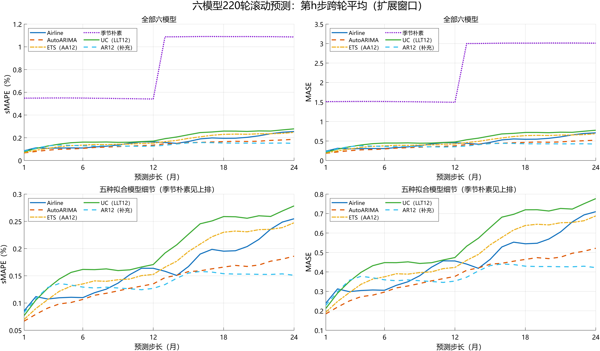

# 六模型统一实验与PPT第8—10页素材

## 实验依据与复核方法

在`member-c-uc-ar`上继续`1a260c5`。已检查远端最新`main`、`Ariel`、`member-b-arima`，A/B提交仍分别为`f8dabd8778ac9f277cbdd99cd7cfd9f94e513cf6`、`9225da80af22d5bbb2ddf6d727cc9db51a82968c`。未改动组员分支或原始成果。

统一采用作者`dataPLOSpaper.mat`的723个月CO2：第r轮训练`CO2(1:479+r)`，预测`CO2(480+r:503+r)`，r=1,...,220，每轮24步。最后训练月记作`forecast_origin`。首轮起点1998-02、末轮2016-05，末目标2018-05。所有误差在原始ppm尺度计算。

原A为固定480月滑动窗口、固定lambda=0.2461。A入口没有窗口/变换策略参数，因此在C分支独立编写适配，保留`modelETS(ty, [], 'AA12', 24)`和`modelNAIVE(ty,24,12).py(:,3)`，仅改为扩展窗口及每轮用训练集重新估计lambda。两者输出都需逆变换；季节朴素逆变换后应严格等于训练末12个月重复两遍。由于这一恒等关系，改变lambda不改变季节朴素预测，改变训练窗口会改变其MASE分母。

B/C四模型读取已有预测、指标与检查点，不重新训练。Airline、ETS、UC由训练期Box-Cox变换建模并逆变换；AutoARIMA输入原始训练序列，由ECOTOOL内部处理变换，输出已为ppm，不能再次逆变换；AR12在原始ppm尺度含截距OLS估计并递推。

**实际完成状态：**2026-11-17六模型均有220轮×24步，合计31,680条预测、144行逐步长指标、48行论文对照；独立核验PASS。A先验证3轮，中断时保存79轮，续跑从第80轮开始，累计模型耗时699.543秒。B/C预测和原始结果文件未修改。

免重估续跑实测通过：A再次运行后预测、耗时和完成标记不变。临时副本中的重复键、错误scale、错误MASE均被独立核验按预期原因拒绝，临时文件已清理；A保存日志未发现warning、maximum number或failed关键词，但这不是优化收敛的充分证明。

MATLAB R2026a Update 5，ECOTOOL 1.0。A实际估计表报告ETS使用EML；原UC估计表为条件平方和，尽管包装器method字段显示EML；B保留其既有默认估计。统一的是数据、训练边界、目标月份及评价定义，并非强迫不同模型采用同一估计器。不调整默认配置来追赶论文数字。

```matlab
addpath('src');
run_member_a_unified(3);    % 新目录可先做3轮；已有检查点时跳过已完成轮次
run_member_a_unified(220);  % 只估计尚未完成的A模型
integrate_all_models;      % 读取已有B/C，导出六模型结果并核验
audit_all_models;          % 独立复核全部结果，不重新拟合预测模型
```

以上函数均可指定原始MAT路径；A入口还可指定ECOTOOL目录及输出目录。详见函数参数。不要同时向同一目录运行两份A入口。

正式输出在`results/comparison/`，仅保留：

| 文件 | 内容 |
|---|---|
| `a_checkpoint.mat` | A统一实验预测、真实值、scale、lambda、参数、实际估计表、日志、耗时、完成标记及依赖指纹 |
| `all_models_predictions.csv` | 六模型每个5280条，合计31680条；包含每轮训练期scale |
| `all_models_metrics.csv` | 六模型每步跨220轮平均，共144行 |
| `table4_comparison.csv` | 六模型×8个论文期限，分别列逐步值、累计值、论文值及累计差值；AR12论文列为空 |
| `model_comparison.png` | 中文六模型比较图；上排全部六模型，下排放大五种拟合模型，均为线性轴 |
| `audit.txt` | 独立核验PASS/FAIL、检查项、偏差诊断、证据范围及版本来源 |

原始数据SHA-256：`4227a1d932b5765418957df172b767e5a9db3422979be01e5e56eb4ad7d25092`。B文件通过固定Git对象只读，临时文件用完清理；本机原有未跟踪数据、单次UC脚本/CSV/图不覆盖、不纳入本轮提交。

## PPT第8页：UC结构与两种预测实验

**标题建议：UC把CO2分为趋势、季节和不规则波动。**

模型表示为`y(t)=水平(t)+季节(t)+不规则项(t)`。LLT允许水平和斜率随时间变化；12个月季节项表示年度周期。模型在Box-Cox尺度估计，预测再恢复为ppm。原有成分图显示长期上升水平、年度季节起伏及幅度较小的不规则成分；不能把变换后成分直接当作ppm增量。

单次实验使用`CO2(25:504)`训练，只在一个起点预测24个月；原UC单次前24步均值为sMAPE **0.089602%**、MASE **0.250611**。滚动实验改为从`CO2(1:480)`开始扩展，每轮重新估计，形成220个预测起点。它检验的是多个时期的预测表现，不能拿单次均值替代滚动结果。

**图示建议：**使用原有`results/figures/uc_components.png`；它是变换后成分图。原`uc_estimation_results.png`为空白，不作为PPT图使用。原预测图与CSV保留，不重新生成。

## PPT第9页：同协议比较

**表格口径：第h步跨220轮平均；每格为sMAPE (%) / MASE。**

| 模型 | 第1步 | 第12步 | 第24步 |
|---|---:|---:|---:|
| Airline | 0.085743 / 0.239349 | 0.163780 / 0.456342 | 0.254743 / 0.709621 |
| AutoARIMA | **0.066814 / 0.184526** | 0.135186 / 0.376942 | 0.186053 / 0.521602 |
| ETS（AA12） | 0.069952 / 0.193116 | 0.152526 / 0.422930 | 0.247415 / 0.687857 |
| Seasonal Naïve | 0.548893 / 1.510911 | 0.540873 / 1.494421 | 1.086960 / 3.011240 |
| UC（LLT12） | 0.077067 / 0.212451 | 0.170657 / 0.473926 | 0.278363 / 0.776801 |
| AR12（补充） | 0.082719 / 0.228796 | **0.126848 / 0.352756** | **0.150973 / 0.422239** |

**可直接放入PPT的结论：**第1步AutoARIMA误差最小，ETS次之；第12、24步AR12误差最小、AutoARIMA次之。其余模型在这三个步长均明显优于季节朴素，说明显式建模趋势有实际价值。UC和ETS在较长步长下误差总体上升。这里的“最小”仅为描述性排序，不能表述为显著优于其他模型。

**图示：**



**AR12与UC的长期差异：**第24步UC的MAE为1.081437 ppm、平均有符号误差为−0.367011 ppm；AR12分别为0.584471 ppm和+0.057393 ppm。本次AR12不仅MASE较低，原始ppm绝对误差也较低。可能解释是，含截距AR12利用整个训练期拟合滞后关系，而UC的局部斜率外推对近期状态估计较敏感，误差可随步长累积；这是与本次误差表现相容的机制解释，尚未进行状态/参数扰动实验，不能认定因果。单次24步均值恰好是UC优于AR12，进一步说明结论依赖预测起点与汇总范围。

## PPT第10页：论文对照与复现边界

**关键更正：论文有明确的累计指标公式。** [原论文](https://journals.plos.org/plosone/article/file?id=10.1371/journal.pone.0221238&type=printable)第9页式(8)、(9)都对i=1,...,h的逐步误差求平均；Table 4在第13页，行标为1—6、1 year、2 years。因此年度行分别对应前12、24步累计平均；表中没有另外列出第12、24步的点预测误差。上轮将其列为待确认，原因是漏看了第9页公式，本轮已更正。

设每轮逐步误差为`e(r,h)`：

- 第h步跨轮平均：`P(h)=mean_r(e(r,h))`，用于主比较表与曲线。
- 前1至h步累计平均：`C(h)=mean(P(1:h))`，在各步都是220轮时等于对全部220×h个误差等权平均，用于Table 4对照。
- 单次24个月均值：只平均一个起点的24步；既不是P(24)，也不是本次220轮的C(24)。

逐步误差定义为`200*abs(actual-predicted)/(abs(actual)+abs(predicted))`，以及`abs(actual-predicted)/scale(r)`；`scale(r)=mean(abs(y(13:end)-y(1:end-12)))`，y只含当轮训练集。

**年度累计对照，每格为“本次 / 论文”，不是第12、24步点误差：**

| 模型 | 前12步sMAPE (%) | 前24步sMAPE (%) | 前12步MASE | 前24步MASE |
|---|---:|---:|---:|---:|
| Airline | 0.124667 / 0.107 | 0.162965 / 0.139 | 0.347179 / 0.273 | 0.454048 / 0.355 |
| AutoARIMA | 0.107575 / 0.107 | 0.136829 / 0.137 | 0.298894 / 0.274 | 0.381714 / 0.351 |
| ETS | 0.127017 / 0.118 | 0.172504 / 0.168 | 0.352108 / 0.299 | 0.478765 / 0.426 |
| Seasonal Naïve | 0.547005 / 0.547 | 0.818179 / 0.818 | 1.508542 / 1.381 | 2.259614 / 2.068 |
| UC | 0.146095 / 0.114 | 0.196406 / 0.145 | 0.404781 / 0.290 | 0.545723 / 0.371 |
| AR12（补充） | 0.123253 / — | 0.137427 / — | 0.342453 / — | 0.382849 / — |

**口径会改变排序：**第24步AR12优于AutoARIMA，但前24步累计平均由AutoARIMA略低；其累计sMAPE为0.136829%，AR12为0.137427%。前12步累计也是AutoARIMA最低。不能将点预测优势扩展为整个两年预测期平均优势。

**与论文的差异：**AutoARIMA两年累计sMAPE按三位小数与论文一致，ETS略高；UC两年累计sMAPE为0.196406%，高于论文0.145%，MASE也高于论文。故不能说六模型全部严格复现论文数字。原A的ETS两年累计sMAPE约0.157911%，统一后为0.172504%；变化来自窗口与逐轮变换策略共同变化，不能仅据此判断哪个协议“更好”。

**数值一致性诊断（事实与推断分开）：**季节朴素的年度累计sMAPE分别为0.547005%、0.818179%，与论文0.547%、0.818%一致；逐步值0.540873%、1.086960%则不应拿去与年度行比较。将同一组朴素预测仅改用每轮固定480月滑动窗口的训练期分母，年度累计MASE变为1.381332、2.067852，与论文1.381、2.068按三位小数一致。全部8行累计sMAPE及该诊断MASE与论文的最大绝对差分别为0.000481、0.000420，都小于0.0005。

这一事实**支持作者MASE可能采用固定480月窗口的推断**，但不能唯一识别ETS/UC等模型的估计窗口，更不能用朴素法验证lambda策略（其预测对可逆变换不变）。正式比较仍坚持统一扩展窗口分母，诊断列不参与排名。原论文未公开完整滚动程序，因此窗口推断仍需与作者代码进一步确认。

**可直接使用的复现边界说明：**本次完成同数据、同训练边界、同目标月份及同评价公式的六模型实验。Airline、AutoARIMA、ETS、UC、Seasonal Naïve使用论文对应模型接口；AR12是新增固定阶数补充基准，论文AR是自动识别的专用方法，不能视为严格复现。数值接近不等于模型设置完全相同，不能通过修改配置来使结果接近论文。

论文给出初始样本480月、24步预测、220轮及逐月更新，但未公开足以逐项确认左边界、每轮lambda、优化初值/方法与异常值处理的完整滚动实现。统一扩展窗口是本项目明确采用的协议；不能宣称与作者全部估计设置完全一致。后端为加密P代码，核验PASS不等于证明优化器收敛。

尚需人工检查：PPT使用哪一种口径、中文图在最终版式中的字号、组内是否同意用此统一扩展窗口作为正式比较。模型排名只是本样本的描述性结果，未进行预测差异显著性检验，也不说明普遍优劣。
