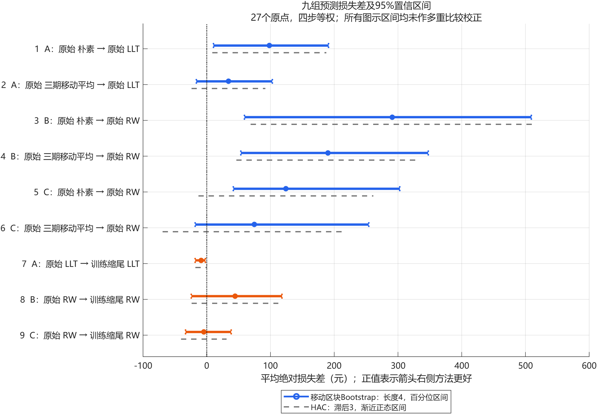

# 预测性能显著性检验报告

2026年11月23日｜A、B、C｜已有27原点四步预测的统计推断

## 1. 主要结论

九组预先指定比较中，Holm校正后模型2显著更优0组、模型1显著更优0组，其余9组未达到0.05显著性水平。UC相对基准的显著优势为0/6组，缩尾相对原选UC的显著改善为0/3组。主判断固定使用HAC滞后3的双侧渐近正态p值及九组Holm校正。

本轮没有任何比较可表述为“经Holm校正后存在统计显著的模型2预测优势”。

仅有MAE数值改善、未达到校正后显著：1（A：原始 朴素→原始 LLT）；2（A：原始 三期移动平均→原始 LLT）；3（B：原始 朴素→原始 RW）；4（B：原始 三期移动平均→原始 RW）；5（C：原始 朴素→原始 RW）；6（C：原始 三期移动平均→原始 RW）；8（B：原始 RW→训练缩尾 RW）。

未经校正时显著3组，其中3组在Holm校正后不再显著。普通Bootstrap百分位95%区间有5组排除0；这不是经过九组多重校正的置信区间，不能替代主检验。

在可比较的未校正0.05层面，主HAC与主Bootstrap的方向/是否排除0分类一致7/9组。改变预定HAC滞后2、3、4、6时，原始显著性分类改变1组、Holm分类改变0组；区块长度3、4、5的区间方向或是否包含0分类改变0组。不同方法给出的证据须分别解读，不能将Bootstrap区间当成HAC的p值。

主HAC与主Bootstrap分类不一致：5（C：原始 朴素→原始 RW）；7（A：原始 LLT→训练缩尾 LLT）；应保留这种差异，谨慎解释。

比较5：HAC原始p=0.07603；Bootstrap区间[41.70, 302.97]，原始均值124.20元、重采样均值149.56元。重采样分布的偏斜及非环绕端点权重差异可能影响区间，不能仅根据排除0升级为经Holm校正的显著结论。

比较7：HAC原始p=0.05570；Bootstrap区间[-18.17, -2.14]，原始均值-8.83元、重采样均值-10.79元。重采样分布的偏斜及非环绕端点权重差异可能影响区间，不能仅根据排除0升级为经Holm校正的显著结论。

本次是选择后探索性比较，不能把校正后的p值解释为已消除模型选择偏差。所有推断仍依赖短序列的近似条件；本实验不据此改写A用LLT、B/C用RW的正式选择，也不统一采用缩尾。

## 2. 九组预测损失差异检验结果

损失差=对照绝对误差−比较方法绝对误差；正值支持模型2。MAE、损失差、标准误及区间单位为元。统计量是渐近z统计量，不是带26自由度的普通t统计量。改善率=100×(对照MAE−比较MAE)/对照MAE。

| 编号 | 成员 | 对照模型 | 比较模型 | 对照MAE | 比较MAE | 改善率% | 平均损失差 | HAC标准误 | z | 原始p | Holm p | 原始显著 | Holm显著 | MBB 95%区间 | 结论 |
|---|---|---|---|---:|---:|---:|---:|---:|---:|---:|---:|---|---|---|---|
| 1 | A | 原始 朴素 | 原始 LLT | 615.94 | 517.84 | 15.93 | 98.10 | 45.65 | 2.149 | 0.03164 | 0.22149 | 是 | 否 | [10.50, 191.14] | 未达到Holm校正后显著 |
| 2 | A | 原始 三期移动平均 | 原始 LLT | 551.87 | 517.84 | 6.17 | 34.03 | 29.55 | 1.152 | 0.24952 | 0.80952 | 否 | 否 | [-16.47, 102.74] | 未达到Holm校正后显著 |
| 3 | B | 原始 朴素 | 原始 RW | 1131.99 | 840.79 | 25.72 | 291.19 | 113.47 | 2.566 | 0.01028 | 0.08570 | 是 | 否 | [59.16, 509.45] | 未达到Holm校正后显著 |
| 4 | B | 原始 三期移动平均 | 原始 RW | 1030.95 | 840.79 | 18.44 | 190.15 | 73.34 | 2.593 | 0.00952 | 0.08570 | 是 | 否 | [53.48, 347.38] | 未达到Holm校正后显著 |
| 5 | C | 原始 朴素 | 原始 RW | 579.84 | 455.64 | 21.42 | 124.20 | 70.00 | 1.774 | 0.07603 | 0.38013 | 否 | 否 | [41.70, 302.97] | 未达到Holm校正后显著 |
| 6 | C | 原始 三期移动平均 | 原始 RW | 530.14 | 455.64 | 14.05 | 74.50 | 73.38 | 1.015 | 0.30997 | 0.80952 | 否 | 否 | [-17.99, 254.03] | 未达到Holm校正后显著 |
| 7 | A | 原始 LLT | 训练缩尾 LLT | 517.84 | 526.67 | -1.70 | -8.83 | 4.61 | -1.913 | 0.05570 | 0.33417 | 否 | 否 | [-18.17, -2.14] | 未达到Holm校正后显著 |
| 8 | B | 原始 RW | 训练缩尾 RW | 840.79 | 796.55 | 5.26 | 44.25 | 34.71 | 1.275 | 0.20238 | 0.80952 | 否 | 否 | [-24.12, 118.17] | 未达到Holm校正后显著 |
| 9 | C | 原始 RW | 训练缩尾 RW | 455.64 | 460.25 | -1.01 | -4.61 | 18.21 | -0.253 | 0.80027 | 0.80952 | 否 | 否 | [-33.34, 38.35] | 未达到Holm校正后显著 |

图中点为平均损失差，实线为区块长度4的Bootstrap百分位区间，灰色虚线为HAC滞后3的渐近正态区间；两种区间均未作多重比较校正，显著性主结论查上表Holm列。

## 3. 分成员分析

### 成员A

原始 LLT相对原始 朴素，MAE下降98.10元（改善率15.93%），Holm p=0.22149，未达到Holm校正后显著；主Bootstrap区间[10.50, 191.14]，区间完全为正。

原始 LLT相对原始 三期移动平均，MAE下降34.03元（改善率6.17%），Holm p=0.80952，未达到Holm校正后显著；主Bootstrap区间[-16.47, 102.74]，区间包含0。

训练缩尾 LLT相对原始 LLT，MAE上升8.83元（改善率-1.70%），Holm p=0.33417，未达到Holm校正后显著；主Bootstrap区间[-18.17, -2.14]，区间完全为负。

相对两个简单基准均未获得Holm校正后显著优势；可以报告MAE变化，但不能声称已证实该UC更准确，也不能据此证明方法等效。

### 成员B

原始 RW相对原始 朴素，MAE下降291.19元（改善率25.72%），Holm p=0.08570，未达到Holm校正后显著；主Bootstrap区间[59.16, 509.45]，区间完全为正。

原始 RW相对原始 三期移动平均，MAE下降190.15元（改善率18.44%），Holm p=0.08570，未达到Holm校正后显著；主Bootstrap区间[53.48, 347.38]，区间完全为正。

训练缩尾 RW相对原始 RW，MAE下降44.25元（改善率5.26%），Holm p=0.80952，未达到Holm校正后显著；主Bootstrap区间[-24.12, 118.17]，区间包含0。

相对两个简单基准均未获得Holm校正后显著优势；可以报告MAE变化，但不能声称已证实该UC更准确，也不能据此证明方法等效。

### 成员C

原始 RW相对原始 朴素，MAE下降124.20元（改善率21.42%），Holm p=0.38013，未达到Holm校正后显著；主Bootstrap区间[41.70, 302.97]，区间完全为正。

原始 RW相对原始 三期移动平均，MAE下降74.50元（改善率14.05%），Holm p=0.80952，未达到Holm校正后显著；主Bootstrap区间[-17.99, 254.03]，区间包含0。

训练缩尾 RW相对原始 RW，MAE上升4.61元（改善率-1.01%），Holm p=0.80952，未达到Holm校正后显著；主Bootstrap区间[-33.34, 38.35]，区间包含0。

相对两个简单基准均未获得Holm校正后显著优势；可以报告MAE变化，但不能声称已证实该UC更准确，也不能据此证明方法等效。

## 4. 预先固定参数的稳健性检查

### HAC滞后2、3、4、6

每个滞后均对相同九组比较单独计算Holm校正，仅作敏感性描述，不将四组滞后结果当作额外四套主要结论，也不挑选最小p值。下表完整列原始p值及四种滞后的Holm显著性。

| 编号 | 滞后2原始p | 滞后3原始p（主） | 滞后4原始p | 滞后6原始p | Holm显著：2/3/4/6 | 原始分类对滞后敏感 | Holm分类对滞后敏感 |
|---|---:|---:|---:|---:|---|---|---|
| 1 | 0.02643 | 0.03164 | 0.03113 | 0.02489 | false/false/false/false | 否 | 否 |
| 2 | 0.25346 | 0.24952 | 0.22578 | 0.18437 | false/false/false/false | 否 | 否 |
| 3 | 0.01506 | 0.01028 | 0.01489 | 0.02370 | false/false/false/false | 否 | 否 |
| 4 | 0.00738 | 0.00952 | 0.01413 | 0.01835 | false/false/false/false | 否 | 否 |
| 5 | 0.09598 | 0.07603 | 0.06441 | 0.05685 | false/false/false/false | 否 | 否 |
| 6 | 0.30167 | 0.30997 | 0.31775 | 0.32796 | false/false/false/false | 否 | 否 |
| 7 | 0.04557 | 0.05570 | 0.05631 | 0.04545 | false/false/false/false | 是 | 否 |
| 8 | 0.16018 | 0.20238 | 0.22963 | 0.25329 | false/false/false/false | 否 | 否 |
| 9 | 0.78861 | 0.80027 | 0.80193 | 0.79244 | false/false/false/false | 否 | 否 |

### Moving Block Bootstrap区块长度3、4、5

| 编号 | 长度3的95%区间 | 长度4的95%区间（主） | 长度5的95%区间 | 区间分类对长度敏感 |
|---|---|---|---|---|
| 1 | [12.22, 191.10] | [10.50, 191.14] | [5.06, 192.63] | 否 |
| 2 | [-16.79, 102.54] | [-16.47, 102.74] | [-14.12, 100.74] | 否 |
| 3 | [55.48, 522.85] | [59.16, 509.45] | [54.20, 536.40] | 否 |
| 4 | [57.50, 346.01] | [53.48, 347.38] | [43.63, 361.58] | 否 |
| 5 | [29.93, 309.44] | [41.70, 302.97] | [49.59, 300.52] | 否 |
| 6 | [-26.12, 248.33] | [-17.99, 254.03] | [-20.59, 259.15] | 否 |
| 7 | [-17.51, -0.75] | [-18.17, -2.14] | [-18.38, -3.95] | 否 |
| 8 | [-18.96, 107.02] | [-24.12, 118.17] | [-26.43, 121.87] | 否 |
| 9 | [-34.72, 33.38] | [-33.34, 38.35] | [-28.87, 38.50] | 否 |

## 5. 方法说明与局限

### 配对、统计对象和信息边界

每组按成员、原点、步长和目标周一一配对，定义d(o,h)=|e1(o,h)|−|e2(o,h)|。每个原点先将四步损失差等权取平均，再用按时间排序的27个原点级均值推断。原点为78至104、目标为79至108，均在原108周训练期内部；未使用第109至112周的保留测试数据参与统计。每组108条逐项差值只是核验记录，不能作为108个独立样本。

输入核验涵盖缺失/非有限值、重复键、完整27×4覆盖、目标索引/日期、同目标实际金额一致、两实验原始UC预测一致、MAE复算与既有结果表一致。该流程只读CSV/既有核验JSON，不重训模型，不调用ECOTOOL，不复制既有预测值或实际金额到新明细。

### HAC/Newey–West：固定截断与渐近近似

令u(o)=d̄(o)−mean(d̄)，γ̂(k)=Σ[o=k+1…N]u(o)u(o−k)/N，N=27。长期方差估计为Ω̂=γ̂(0)+2Σ[k=1…L](1−k/(L+1))γ̂(k)，主L=3；SE=sqrt(Ω̂/N)，z=mean(d̄)/SE，双侧p=2Φ(−|z|)。使用Bartlett权重，不作N/(N−1)自由度修正，不使用普通独立样本t检验，也不宣称这是小样本精确分布。公式按[1]的Newey–West框架自行透明实现。

该正态近似通常需要损失差的稳定均值、适当矩条件和弱依赖等条件。异方差与短程自相关由HAC处理，但固定滞后3不保证涵盖所有依赖：扩展窗口共同训练史、四步预测窗口重叠、大额消费冲击或结构变化可能造成更长或不稳定的依赖。一般HAC一致性还涉及随样本增长的截断选择；本次固定小样本截断是预定近似，不能保证稳健标准误充分。仅27个原点，无法充分验证这些条件，检验功效可能不足；滞后2、4、6结果用于暴露敏感性，而非优化显著性。

### 非环绕重叠移动区块Bootstrap

对27个按时间排序的原点级损失差，构造N−b+1个长度b的重叠块，等概率有放回抽取ceil(N/b)块、依次拼接并截取前27点，不首尾环绕。每块包含连续原点；每个原点始终带着其四步配对均值，绝不拆分四个步长。主b=4，另固定b=3、5，均重复10000次；随机数为MATLAB twister，种子=20261123+1000×比较编号+b，运行后恢复调用前RNG状态。采用重采样均值分布的2.5%和97.5%百分位区间（MATLAB prctile默认插值），不作学生化、BCa或端点偏差校正，不输出Bootstrap p值。[2]

该Bootstrap依赖足够稳定的时间过程和区块能够描述主要依赖；27点只提供少量有效区块，置信区间覆盖率并无有限样本保证。非环绕方案对边缘原点的抽样权重不完全相等，Bootstrap均值可能偏离原始均值，已在区块长度敏感性CSV保留。区间排除0是补充证据，普通95%区间不自动具有九组同时覆盖率；HAC p值、Holm校正和Bootstrap区间不是同一种检验。

### 多重比较、模型选择与结论边界

九组主检验整体构成一个检验家族，不将六组基准比较与三组缩尾比较分开校正。原始p值升序排列后，Holm调整p为min[1,max(j≤i){(9−j+1)p(j)}]，再还原原顺序；原始与调整p均完整保留。[3] Holm能够处理检验间依赖，但不能修复原始p值近似失真或消除选择偏差。

原正式UC此前根据部分相同历史数据选定，本轮属于探索性的选择后比较，并非独立预注册验证；报告中的“预先指定”只表示本次推断未再挑选九组以外的比较。最后4周保留测试数据已在此前研究中被观察，不属于全新盲测，本实验也没有使用这4周数据来作显著性计算。

未拒绝预测损失相等的原假设，不代表证明两个模型一样好。统计显著不自动代表改善幅度具有实际意义，应同时读元尺度损失差、改善率、区间宽度和跨原点稳定性。残差通过Ljung–Box检验只关乎指定残差自相关诊断，不能当作预测精度差异显著的依据。双侧检验显著时仍须看损失差方向，不能将显著变差写成显著改善。

### 资料与可复现性

- [1] [MathWorks：HAC/Newey–West及Bartlett核说明](https://www.mathworks.com/help/econ/hac.html)。本项目明确采用上述有限滞后、1/N自协方差公式，避免依赖工具默认带宽或缩放。

- [2] [R boot官方文档：时间序列固定长度区块重采样](https://stat.ethz.ch/R-manual/R-devel/library/boot/html/tsboot.html)。本项目实现和端点方案以上述段落为准，并未调用R。

- [3] [R stats官方文档：Holm多重检验校正](https://stat.ethz.ch/R-manual/R-devel/library/stats/html/p.adjust.html)。

- 输入只读`../multi_origin_4step/results/多原点四步预测明细.csv`与`../outlier_sensitivity/results/多原点四步预测明细.csv`及两实验的指标/核验表；CSV相对路径以本实验目录为基准。原始预测仍在原位置。

- 新输出：`预测损失差异检验.csv`（9组主结果）、`原点级预测损失差.csv`（243条）、`不同预测步长损失差.csv`（972条）、`HAC滞后稳健性.csv`、`区块长度敏感性.csv`及`统计检验完整结果.mat`。MAT只存派生统计量、损失记录、Bootstrap均值和配置，不重复保存预测明细。

- 根目录运行`addpath(fullfile(pwd,'experiments','forecast_significance')); run_forecast_significance`。独立核验为`verify_significance`：重新配对并通过矩阵二次型核验HAC，独立复算Holm及区块抽样/百分位数，核对输入SHA256、图表引用和方法限制。全部通过后写入`实验核验.json`。
