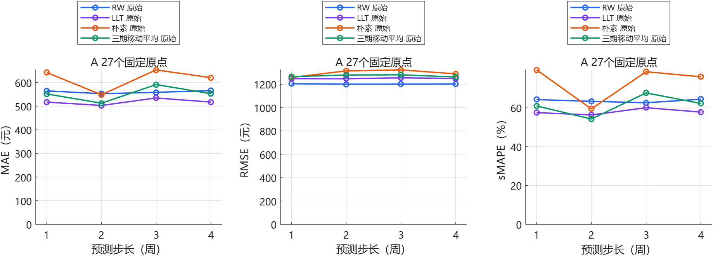
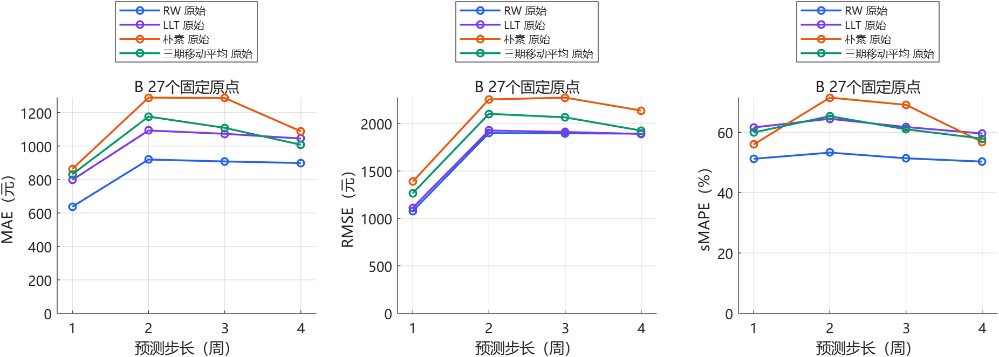
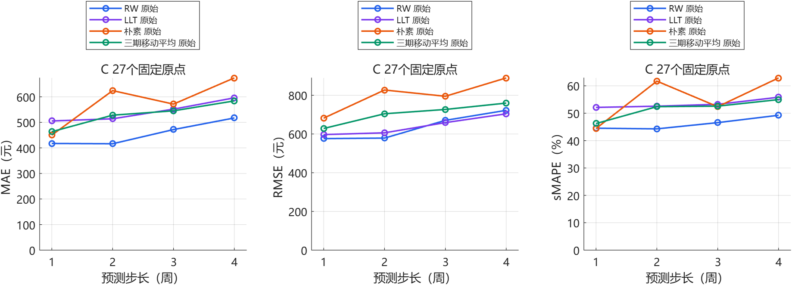

# 多个固定原点四步回测分析报告

2026年11月23日｜成员A、B、C

## 主要结论

A：原始组四步回测选择LLT，总体MAE 517.84元；原正式一步流程选择LLT，本次一致。四方法中总体MAE最佳为LLT。

B：原始组四步回测选择RW，总体MAE 840.79元；原正式一步流程选择RW，本次一致。四方法中总体MAE最佳为RW。

C：原始组四步回测选择RW，总体MAE 455.64元；原正式一步流程选择RW，本次一致。四方法中总体MAE最佳为RW。

总体指标与单个原点的胜出次数衡量不同方面。总体MAE用于原规则选模；RMSE反映较大误差的影响，逐原点胜出次数反映相对表现的分布。应结合下表与误差图判断稳定性，不应声称某模型在每个未来原点均最优。

## 训练集内部的总体表现

| 成员 | 组别 | 模型 | 误差数 | MAE 元 | RMSE 元 | sMAPE % |
| --- | --- | --- | --- | --- | --- | --- |
| A | 原始 | LLT | 108 | 517.84 | 1,250.20 | 57.93 |
| A | 原始 | RW | 108 | 560.25 | 1,201.99 | 63.66 |
| A | 原始 | 三期移动平均 | 108 | 551.87 | 1,272.12 | 61.28 |
| A | 原始 | 朴素 | 108 | 615.94 | 1,296.63 | 73.39 |
| B | 原始 | LLT | 108 | 1,002.17 | 1,743.93 | 61.86 |
| B | 原始 | RW | 108 | 840.79 | 1,728.10 | 51.55 |
| B | 原始 | 三期移动平均 | 108 | 1,030.95 | 1,869.83 | 61.06 |
| B | 原始 | 朴素 | 108 | 1,131.99 | 2,044.95 | 63.34 |
| C | 原始 | LLT | 108 | 541.75 | 643.07 | 53.44 |
| C | 原始 | RW | 108 | 455.64 | 640.07 | 46.16 |
| C | 原始 | 三期移动平均 | 108 | 530.14 | 706.64 | 51.54 |
| C | 原始 | 朴素 | 108 | 579.84 | 802.12 | 55.35 |

## 选择是否稳定

| 成员 | 组别 | 原正式UC | 四步纯MAE最佳UC | 四步按原规则选择 | 本实验方法中MAE最佳 |
| --- | --- | --- | --- | --- | --- |
| A | 原始 | LLT | LLT | LLT | LLT |
| B | 原始 | RW | RW | RW | RW |
| C | 原始 | RW | RW | RW | RW |

逐原点按该原点4步平均MAE取最佳，平局按RMSE及模型名确定；胜出次数描述稳定性，不是独立显著性检验。

| 成员 | 组别 | 模型 | 27原点胜出次数 |
| --- | --- | --- | --- |
| A | 原始 | LLT | 12 |
| A | 原始 | RW | 7 |
| A | 原始 | 三期移动平均 | 3 |
| A | 原始 | 朴素 | 5 |
| B | 原始 | LLT | 5 |
| B | 原始 | RW | 6 |
| B | 原始 | 三期移动平均 | 4 |
| B | 原始 | 朴素 | 12 |
| C | 原始 | LLT | 5 |
| C | 原始 | RW | 7 |
| C | 原始 | 三期移动平均 | 9 |
| C | 原始 | 朴素 | 6 |

## 不同预测步长的误差

### 成员A

| 组别 | 模型 | 预测第几周 | MAE 元 | RMSE 元 | sMAPE % |
| --- | --- | --- | --- | --- | --- |
| 原始 | LLT | 1 | 516.97 | 1,247.87 | 57.53 |
| 原始 | LLT | 2 | 502.87 | 1,247.61 | 56.34 |
| 原始 | LLT | 3 | 534.44 | 1,255.18 | 60.06 |
| 原始 | LLT | 4 | 517.08 | 1,250.12 | 57.80 |
| 原始 | RW | 1 | 564.52 | 1,204.49 | 64.23 |
| 原始 | RW | 2 | 552.58 | 1,200.72 | 63.35 |
| 原始 | RW | 3 | 558.35 | 1,201.14 | 62.61 |
| 原始 | RW | 4 | 565.53 | 1,201.61 | 64.43 |
| 原始 | 三期移动平均 | 1 | 551.55 | 1,265.39 | 60.97 |
| 原始 | 三期移动平均 | 2 | 512.44 | 1,279.35 | 54.25 |
| 原始 | 三期移动平均 | 3 | 591.17 | 1,280.85 | 67.68 |
| 原始 | 三期移动平均 | 4 | 552.33 | 1,262.77 | 62.24 |
| 原始 | 朴素 | 1 | 642.17 | 1,258.66 | 79.53 |
| 原始 | 朴素 | 2 | 548.04 | 1,314.60 | 59.47 |
| 原始 | 朴素 | 3 | 653.24 | 1,323.24 | 78.59 |
| 原始 | 朴素 | 4 | 620.30 | 1,289.06 | 75.98 |

### 成员B

| 组别 | 模型 | 预测第几周 | MAE 元 | RMSE 元 | sMAPE % |
| --- | --- | --- | --- | --- | --- |
| 原始 | LLT | 1 | 797.64 | 1,111.87 | 61.61 |
| 原始 | LLT | 2 | 1,092.99 | 1,925.95 | 64.49 |
| 原始 | LLT | 3 | 1,073.16 | 1,910.34 | 61.75 |
| 原始 | LLT | 4 | 1,044.87 | 1,889.52 | 59.61 |
| 原始 | RW | 1 | 637.49 | 1,077.42 | 51.23 |
| 原始 | RW | 2 | 919.36 | 1,898.75 | 53.28 |
| 原始 | RW | 3 | 907.83 | 1,896.24 | 51.39 |
| 原始 | RW | 4 | 898.49 | 1,893.00 | 50.30 |
| 原始 | 三期移动平均 | 1 | 831.30 | 1,265.54 | 59.95 |
| 原始 | 三期移动平均 | 2 | 1,176.07 | 2,101.54 | 65.36 |
| 原始 | 三期移动平均 | 3 | 1,108.76 | 2,064.65 | 61.00 |
| 原始 | 三期移动平均 | 4 | 1,007.66 | 1,924.65 | 57.92 |
| 原始 | 朴素 | 1 | 863.39 | 1,387.73 | 55.96 |
| 原始 | 朴素 | 2 | 1,289.47 | 2,252.95 | 71.51 |
| 原始 | 朴素 | 3 | 1,287.00 | 2,272.36 | 69.11 |
| 原始 | 朴素 | 4 | 1,088.10 | 2,135.90 | 56.81 |

### 成员C

| 组别 | 模型 | 预测第几周 | MAE 元 | RMSE 元 | sMAPE % |
| --- | --- | --- | --- | --- | --- |
| 原始 | LLT | 1 | 505.40 | 597.06 | 52.12 |
| 原始 | LLT | 2 | 513.97 | 606.16 | 52.57 |
| 原始 | LLT | 3 | 551.71 | 658.90 | 53.25 |
| 原始 | LLT | 4 | 595.89 | 704.35 | 55.83 |
| 原始 | RW | 1 | 417.35 | 576.32 | 44.52 |
| 原始 | RW | 2 | 416.28 | 578.87 | 44.29 |
| 原始 | RW | 3 | 471.74 | 670.62 | 46.56 |
| 原始 | RW | 4 | 517.19 | 722.34 | 49.25 |
| 原始 | 三期移动平均 | 1 | 463.51 | 628.64 | 46.23 |
| 原始 | 三期移动平均 | 2 | 528.10 | 704.64 | 52.39 |
| 原始 | 三期移动平均 | 3 | 545.09 | 726.93 | 52.59 |
| 原始 | 三期移动平均 | 4 | 583.85 | 759.74 | 54.97 |
| 原始 | 朴素 | 1 | 449.93 | 682.08 | 44.42 |
| 原始 | 朴素 | 2 | 624.21 | 827.41 | 61.72 |
| 原始 | 朴素 | 3 | 571.35 | 794.98 | 52.39 |
| 原始 | 朴素 | 4 | 673.85 | 889.82 | 62.89 |

## 最后查看原来保留的4周

以下结果只作已锁定模型的外部检查，不反馈训练内选模。每模型仅4个目标，不能据此保证后续预测稳定。

| 成员 | 组别 | 模型 | 误差数 | MAE 元 | RMSE 元 | sMAPE % |
| --- | --- | --- | --- | --- | --- | --- |
| A | 原始 | LLT | 4 | 598.04 | 636.82 | 81.01 |
| A | 原始 | RW | 4 | 333.18 | 375.48 | 57.61 |
| A | 原始 | 三期移动平均 | 4 | 289.64 | 341.57 | 51.94 |
| A | 原始 | 朴素 | 4 | 173.46 | 258.12 | 34.49 |
| B | 原始 | LLT | 4 | 636.32 | 672.06 | 46.72 |
| B | 原始 | RW | 4 | 167.54 | 201.26 | 16.12 |
| B | 原始 | 三期移动平均 | 4 | 1,447.80 | 1,600.14 | 77.29 |
| B | 原始 | 朴素 | 4 | 271.76 | 306.13 | 27.00 |
| C | 原始 | LLT | 4 | 607.46 | 663.93 | 60.03 |
| C | 原始 | RW | 4 | 353.73 | 444.54 | 40.01 |
| C | 原始 | 三期移动平均 | 4 | 1,156.07 | 1,216.27 | 85.35 |
| C | 原始 | 朴素 | 4 | 1,302.91 | 1,376.59 | 90.51 |

A 原始组：训练内锁定LLT，保留测试MAE为598.04元；本实验该组方法中测试MAE最低为朴素（173.46元）。这只是事后对照，不改选模型。

B 原始组：训练内锁定RW，保留测试MAE为167.54元；本实验该组方法中测试MAE最低为RW（167.54元）。这只是事后对照，不改选模型。

C 原始组：训练内锁定RW，保留测试MAE为353.73元；本实验该组方法中测试MAE最低为RW（353.73元）。这只是事后对照，不改选模型。

## 实验口径与限制

三位成员均沿用112周原始建模数据：前108周训练，最后4周（2026-09-28至2026-10-25）保留测试。训练截止索引为78、79、…、104，共27个固定原点，每个原点一次预测后续4周，中途不吸收真实测试金额。MA3从第2步起递归加入自身预测；朴素预测始终使用当时最后一个观测。RW、LLT沿用ECOTOOL四参数位置调用，实际为CML，无季节项。

每个步长有27条误差；总体指标按108个“原点×步长”预测等权计算，RMSE先汇总平方误差再开方。108条误差只覆盖30个不同目标周，同一周可被不同原点重复预测；窗口和误差相关，27个原点并非27次独立实验。本实验报告描述性变化，不宣称统计显著性或因果作用，也不直接混合三人的元尺度误差排名。

误差=预测−原始实际金额。MAE、RMSE单位为元；sMAPE=平均[200×|误差|/(|预测|+|实际|)]，双方均为0时记0，单位为%。小额周会提高相对误差。预测不截断、不事后校准区间。

UC按总体MAE、RMSE依次排序，同时沿用正式流程的诊断优先规则：完整108周训练残差在滞后3、6的Ljung–Box检验仅有一个模型通过时优先选该模型，否则按上述排序。报告同时给出纯误差最佳UC与该规则选择结果。实验一的基准模型不参加UC二选一，但参与四方法比较；实验二仅比较两种UC及其训练处理。所有选模和108周起点的预测先写入锁定MAT/CSV，随后才读取保留4周金额；原保留集已在此前分析中观察，本轮不构成全新盲测，测试成绩不反向改选模型。

## 数据与复现依据

- 输入：根目录`data/A_个人总支付_自然周.xlsx`、B及C同名输入；口径沿用正式分析。A为总支付，B为既有净消费汇总，C为既有个人总支付，三人清洗口径有差别。
- 本目录`多原点四步预测明细.csv`、`多步预测误差对比.csv`：27原点的每条预测及分步长/总体指标；Horizon=0表示总体。
- `各原点模型参数.csv`、`各原点异常阈值.csv`、`训练内选模结果.csv`与`108周训练残差诊断.csv`：可检查拟合、阈值和选模；完整模型保存在锁定MAT中。
- `保留四周测试预测.csv`、`保留四周测试指标.csv`：最终固定原点结果；`测试预测锁定.csv`不含实际测试金额。
- 在对应实验目录执行`run_experiment`；也可在根目录`addpath('experiments')`后调用`run_uc_backtests(string(pwd),'本实验目录名')`。需与正式流程相同的MATLAB及ECOTOOL环境。
- 根目录运行`python experiments/analyze_results.py`独立复算指标、阈值、选择、原始组对正式预测的复现，并重建本报告。`实验核验.json`记录输入SHA256与检查状态。原始账单只供本机核对，不复制逐笔消费内容到报告。
