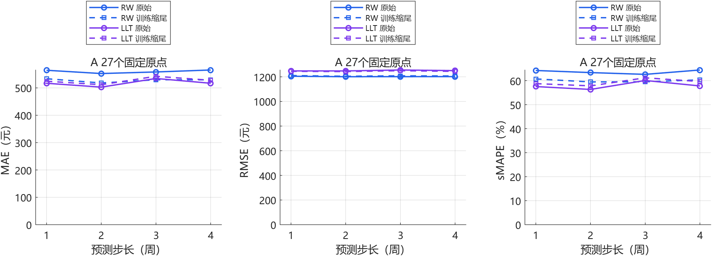
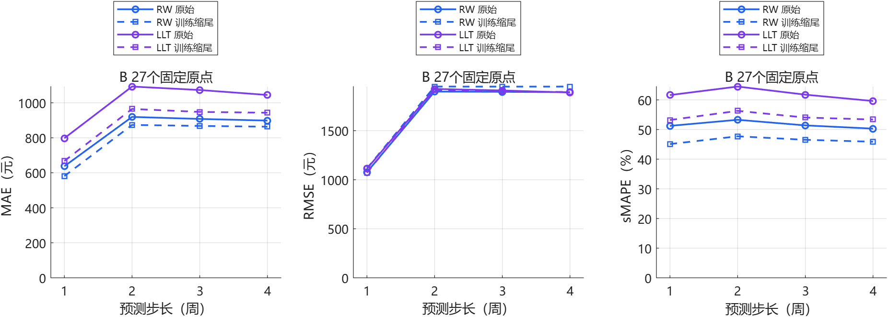
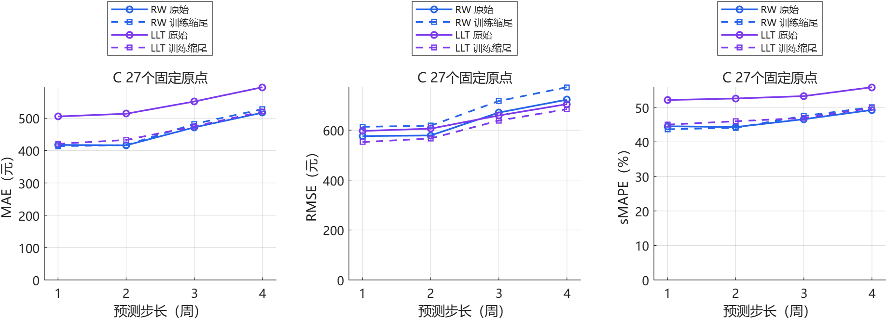

# 异常大额支出敏感性分析报告

2026年11月23日｜成员A、B、C

## 主要结论

A：原始组四步回测选择LLT，总体MAE 517.84元；原正式一步流程选择LLT，本次一致。两种UC模型中总体MAE最佳为LLT。

B：原始组四步回测选择RW，总体MAE 840.79元；原正式一步流程选择RW，本次一致。两种UC模型中总体MAE最佳为RW。

C：原始组四步回测选择RW，总体MAE 455.64元；原正式一步流程选择RW，本次一致。两种UC模型中总体MAE最佳为RW。

A：缩尾后RW MAE 560.25→527.77元（改善5.80%）；LLT MAE 517.84→526.67元（改善-1.70%）。

B：缩尾后RW MAE 840.79→796.55元（改善5.26%）；LLT MAE 1,002.17→880.94元（改善12.10%）。

C：缩尾后RW MAE 455.64→460.25元（改善-1.01%）；LLT MAE 541.75→462.32元（改善14.66%）。

缩尾属于训练扰动实验，未更改原数据或正式模型；负的改善率表示变差。是否保留该处理应以训练内结果为依据，不能根据4周测试挑选。大额周不自动等同于错误，有限样本的变化也不能证明统计显著。

A：原选LLT缩尾后回测MAE改善-1.70%，RMSE改善0.42%；缩尾组纯MAE最佳UC为LLT，按诊断优先规则选择LLT（RW通过=1，LLT通过=1）。

B：原选RW缩尾后回测MAE改善5.26%，RMSE改善-2.92%；缩尾组纯MAE最佳UC为RW，按诊断优先规则选择RW（RW通过=1，LLT通过=1）。

C：原选RW缩尾后回测MAE改善-1.01%，RMSE改善-6.78%；缩尾组纯MAE最佳UC为RW，按诊断优先规则选择LLT（RW通过=0，LLT通过=1）。

本轮不建议统一采用缩尾：各成员原选模型的MAE和RMSE未同时一致改善。平均绝对偏差改善不一定意味着大误差风险降低，选模变化也需要与诊断结果一同解释，不能直接替换正式结果。

## 训练集内部的总体表现

| 成员 | 组别 | 模型 | 误差数 | MAE 元 | RMSE 元 | sMAPE % |
| --- | --- | --- | --- | --- | --- | --- |
| A | 原始 | LLT | 108 | 517.84 | 1,250.20 | 57.93 |
| A | 原始 | RW | 108 | 560.25 | 1,201.99 | 63.66 |
| A | 训练缩尾 | LLT | 108 | 526.67 | 1,245.00 | 59.34 |
| A | 训练缩尾 | RW | 108 | 527.77 | 1,207.34 | 60.00 |
| B | 原始 | LLT | 108 | 1,002.17 | 1,743.93 | 61.86 |
| B | 原始 | RW | 108 | 840.79 | 1,728.10 | 51.55 |
| B | 训练缩尾 | LLT | 108 | 880.94 | 1,733.50 | 54.22 |
| B | 训练缩尾 | RW | 108 | 796.55 | 1,778.54 | 46.30 |
| C | 原始 | LLT | 108 | 541.75 | 643.07 | 53.44 |
| C | 原始 | RW | 108 | 455.64 | 640.07 | 46.16 |
| C | 训练缩尾 | LLT | 108 | 462.32 | 612.82 | 46.93 |
| C | 训练缩尾 | RW | 108 | 460.25 | 683.47 | 46.32 |

## 选择是否稳定

| 成员 | 组别 | 原正式UC | 四步纯MAE最佳UC | 四步按原规则选择 | 本实验方法中MAE最佳 |
| --- | --- | --- | --- | --- | --- |
| A | 原始 | LLT | LLT | LLT | LLT |
| A | 训练缩尾 | LLT | LLT | LLT | LLT |
| B | 原始 | RW | RW | RW | RW |
| B | 训练缩尾 | RW | RW | RW | RW |
| C | 原始 | RW | RW | RW | RW |
| C | 训练缩尾 | RW | RW | LLT | RW |

逐原点按该原点4步平均MAE取最佳，平局按RMSE及模型名确定；胜出次数描述稳定性，不是独立显著性检验。

| 成员 | 组别 | 模型 | 27原点胜出次数 |
| --- | --- | --- | --- |
| A | 原始 | LLT | 20 |
| A | 原始 | RW | 7 |
| A | 训练缩尾 | LLT | 14 |
| A | 训练缩尾 | RW | 13 |
| B | 原始 | LLT | 7 |
| B | 原始 | RW | 20 |
| B | 训练缩尾 | LLT | 11 |
| B | 训练缩尾 | RW | 16 |
| C | 原始 | LLT | 12 |
| C | 原始 | RW | 15 |
| C | 训练缩尾 | LLT | 16 |
| C | 训练缩尾 | RW | 11 |

## 不同预测步长的误差

### 成员A

| 组别 | 模型 | 预测第几周 | MAE 元 | RMSE 元 | sMAPE % |
| --- | --- | --- | --- | --- | --- |
| 原始 | LLT | 1 | 516.97 | 1,247.87 | 57.53 |
| 原始 | LLT | 2 | 502.87 | 1,247.61 | 56.34 |
| 原始 | LLT | 3 | 534.44 | 1,255.18 | 60.06 |
| 原始 | LLT | 4 | 517.08 | 1,250.12 | 57.80 |
| 原始 | RW | 1 | 564.52 | 1,204.49 | 64.23 |
| 原始 | RW | 2 | 552.58 | 1,200.72 | 63.35 |
| 原始 | RW | 3 | 558.35 | 1,201.14 | 62.61 |
| 原始 | RW | 4 | 565.53 | 1,201.61 | 64.43 |
| 训练缩尾 | LLT | 1 | 524.48 | 1,244.45 | 58.75 |
| 训练缩尾 | LLT | 2 | 511.78 | 1,242.40 | 57.82 |
| 训练缩尾 | LLT | 3 | 542.53 | 1,249.35 | 61.18 |
| 训练缩尾 | LLT | 4 | 527.88 | 1,243.78 | 59.62 |
| 训练缩尾 | RW | 1 | 533.56 | 1,210.26 | 60.71 |
| 训练缩尾 | RW | 2 | 518.07 | 1,204.34 | 59.47 |
| 训练缩尾 | RW | 3 | 529.84 | 1,208.00 | 59.52 |
| 训练缩尾 | RW | 4 | 529.60 | 1,206.77 | 60.33 |

### 成员B

| 组别 | 模型 | 预测第几周 | MAE 元 | RMSE 元 | sMAPE % |
| --- | --- | --- | --- | --- | --- |
| 原始 | LLT | 1 | 797.64 | 1,111.87 | 61.61 |
| 原始 | LLT | 2 | 1,092.99 | 1,925.95 | 64.49 |
| 原始 | LLT | 3 | 1,073.16 | 1,910.34 | 61.75 |
| 原始 | LLT | 4 | 1,044.87 | 1,889.52 | 59.61 |
| 原始 | RW | 1 | 637.49 | 1,077.42 | 51.23 |
| 原始 | RW | 2 | 919.36 | 1,898.75 | 53.28 |
| 原始 | RW | 3 | 907.83 | 1,896.24 | 51.39 |
| 原始 | RW | 4 | 898.49 | 1,893.00 | 50.30 |
| 训练缩尾 | LLT | 1 | 667.54 | 1,071.26 | 53.20 |
| 训练缩尾 | LLT | 2 | 964.94 | 1,915.01 | 56.29 |
| 训练缩尾 | LLT | 3 | 948.04 | 1,901.62 | 54.04 |
| 训练缩尾 | LLT | 4 | 943.25 | 1,894.48 | 53.37 |
| 训练缩尾 | RW | 1 | 581.21 | 1,115.84 | 45.09 |
| 训练缩尾 | RW | 2 | 873.56 | 1,950.36 | 47.71 |
| 训练缩尾 | RW | 3 | 867.93 | 1,949.53 | 46.53 |
| 训练缩尾 | RW | 4 | 863.48 | 1,950.15 | 45.88 |

### 成员C

| 组别 | 模型 | 预测第几周 | MAE 元 | RMSE 元 | sMAPE % |
| --- | --- | --- | --- | --- | --- |
| 原始 | LLT | 1 | 505.40 | 597.06 | 52.12 |
| 原始 | LLT | 2 | 513.97 | 606.16 | 52.57 |
| 原始 | LLT | 3 | 551.71 | 658.90 | 53.25 |
| 原始 | LLT | 4 | 595.89 | 704.35 | 55.83 |
| 原始 | RW | 1 | 417.35 | 576.32 | 44.52 |
| 原始 | RW | 2 | 416.28 | 578.87 | 44.29 |
| 原始 | RW | 3 | 471.74 | 670.62 | 46.56 |
| 原始 | RW | 4 | 517.19 | 722.34 | 49.25 |
| 训练缩尾 | LLT | 1 | 420.97 | 552.37 | 45.00 |
| 训练缩尾 | LLT | 2 | 432.83 | 566.97 | 45.97 |
| 训练缩尾 | LLT | 3 | 474.78 | 638.48 | 46.92 |
| 训练缩尾 | LLT | 4 | 520.69 | 684.08 | 49.84 |
| 训练缩尾 | RW | 1 | 413.65 | 613.60 | 43.65 |
| 训练缩尾 | RW | 2 | 417.03 | 617.95 | 44.08 |
| 训练缩尾 | RW | 3 | 482.32 | 716.90 | 47.52 |
| 训练缩尾 | RW | 4 | 527.99 | 772.15 | 50.04 |

## 大额周的来源核对与处理影响

仅对高于上界的训练金额缩尾为上界，不处理低额周，不删除周，不改变预测目标；每个原点重新使用截至当时的全部原始历史计算Q1、Q3和IQR，不沿用上次缩尾结果。完整108周阈值只用于本节事后描述与最终拟合，不用于较早原点。

A：仅核对原始周汇总CSV；缺少逐笔账单，不能确认消费业务性质或误记。

B：已与来源工作簿支付明细按周重算核对；保留真实大额周，统计候选不等于录入错误。

C：已与来源工作簿支付明细按周重算核对；保留真实大额周，统计候选不等于录入错误。

| 成员 | 大额周起始日 | 原始金额 元 | 108周上界 元 | 来源重算 元 | 来源行数 |
| --- | --- | --- | --- | --- | --- |
| A | 2024-09-09 | 2,478.77 | 1,643.37 | 2,478.77 | 1 |
| A | 2024-09-16 | 5,393.44 | 1,643.37 | 5,393.44 | 1 |
| A | 2024-12-02 | 2,762.60 | 1,643.37 | 2,762.60 | 1 |
| A | 2025-09-08 | 7,045.51 | 1,643.37 | 7,045.51 | 1 |
| A | 2026-02-02 | 1,707.04 | 1,643.37 | 1,707.04 | 1 |
| A | 2026-03-30 | 1,755.13 | 1,643.37 | 1,755.13 | 1 |
| A | 2026-08-31 | 6,567.66 | 1,643.37 | 6,567.66 | 1 |
| B | 2025-04-14 | 2,499.33 | 1,856.81 | 2,499.33 | 20 |
| B | 2025-04-21 | 3,846.72 | 1,856.81 | 3,846.72 | 29 |
| B | 2025-09-08 | 6,899.56 | 1,856.81 | 6,899.56 | 26 |
| B | 2025-12-08 | 3,208.73 | 1,856.81 | 3,208.73 | 22 |
| B | 2026-02-02 | 3,488.16 | 1,856.81 | 3,488.16 | 21 |
| B | 2026-02-23 | 2,473.53 | 1,856.81 | 2,473.53 | 35 |
| B | 2026-03-30 | 5,310.06 | 1,856.81 | 5,310.06 | 17 |
| B | 2026-04-27 | 3,398.13 | 1,856.81 | 3,398.13 | 24 |
| B | 2026-07-27 | 2,417.71 | 1,856.81 | 2,417.71 | 24 |
| B | 2026-09-07 | 9,155.98 | 1,856.81 | 9,155.98 | 25 |
| C | 2025-05-19 | 3,090.10 | 1,450.13 | 3,090.10 | 29 |
| C | 2025-06-30 | 2,202.27 | 1,450.13 | 2,202.27 | 13 |
| C | 2026-01-19 | 5,795.96 | 1,450.13 | 5,795.96 | 29 |
| C | 2026-03-30 | 1,794.37 | 1,450.13 | 1,794.37 | 39 |
| C | 2026-04-06 | 2,699.74 | 1,450.13 | 2,699.74 | 25 |
| C | 2026-07-20 | 1,509.97 | 1,450.13 | 1,509.97 | 45 |
| C | 2026-08-10 | 1,768.85 | 1,450.13 | 1,768.85 | 38 |
| C | 2026-09-14 | 2,586.77 | 1,450.13 | 2,586.77 | 42 |
| C | 2026-09-21 | 2,185.55 | 1,450.13 | 2,185.55 | 45 |

| 成员 | 27原点最少缩尾周数 | 最多缩尾周数 | 108周缩尾周数 | 108周拟合减少金额 元 |
| --- | --- | --- | --- | --- |
| A | 4 | 6 | 7 | 16,206.58 |
| B | 6 | 9 | 10 | 24,129.86 |
| C | 4 | 7 | 9 | 10,582.41 |

### 参数变化

以下为完整108周估计的方差参数，单位元²；log10尺度及全部27原点参数保存在CSV中。边界附近的参数比值可能非常大，不据此声称参数显著变化；缩尾也会机械改变噪声规模。

| 成员 | 模型 | 扰动 | 原始方差 | 缩尾方差 | 原始log10 | 缩尾log10 |
| --- | --- | --- | --- | --- | --- | --- |
| A | RW | 水平扰动 | 0.01 | 0.01 | -2.04 | -2.02 |
| A | RW | 观测噪声 | 30.85 | 31.30 | 1.49 | 1.50 |
| A | LLT | 水平扰动 | 0.00 | 0.00 | -2.48 | -2.48 |
| A | LLT | 斜率扰动 | 0.00 | 0.00 | -2.59 | -2.61 |
| A | LLT | 观测噪声 | 69.96 | 71.62 | 1.84 | 1.86 |
| B | RW | 水平扰动 | 0.01 | 0.01 | -2.18 | -2.10 |
| B | RW | 观测噪声 | 29.16 | 31.78 | 1.46 | 1.50 |
| B | LLT | 水平扰动 | 0.00 | 0.00 | -2.52 | -2.50 |
| B | LLT | 斜率扰动 | 0.00 | 0.00 | -2.67 | -2.63 |
| B | LLT | 观测噪声 | 64.79 | 67.04 | 1.81 | 1.83 |
| C | RW | 水平扰动 | 0.01 | 0.01 | -2.08 | -2.03 |
| C | RW | 观测噪声 | 32.50 | 36.94 | 1.51 | 1.57 |
| C | LLT | 水平扰动 | 0.00 | 0.00 | -2.53 | -2.52 |
| C | LLT | 斜率扰动 | 0.00 | 0.00 | -2.65 | -2.65 |
| C | LLT | 观测噪声 | 69.32 | 71.23 | 1.84 | 1.85 |

### 性能变化

| 成员 | 评价集 | 模型 | 原始MAE 元 | 缩尾MAE 元 | MAE改善 % | RMSE改善 % | sMAPE改善 % |
| --- | --- | --- | --- | --- | --- | --- | --- |
| A | 训练内四步回测 | RW | 560.25 | 527.77 | 5.80 | -0.45 | 5.74 |
| A | 保留四周测试 | RW | 333.18 | 252.58 | 24.19 | 30.58 | 16.47 |
| A | 训练内四步回测 | LLT | 517.84 | 526.67 | -1.70 | 0.42 | -2.44 |
| A | 保留四周测试 | LLT | 598.04 | 254.17 | 57.50 | 58.90 | 40.30 |
| B | 训练内四步回测 | RW | 840.79 | 796.55 | 5.26 | -2.92 | 10.18 |
| B | 保留四周测试 | RW | 167.54 | 266.43 | -59.03 | -48.06 | -63.80 |
| B | 训练内四步回测 | LLT | 1,002.17 | 880.94 | 12.10 | 0.60 | 12.35 |
| B | 保留四周测试 | LLT | 636.32 | 208.97 | 67.16 | 66.69 | 56.67 |
| C | 训练内四步回测 | RW | 455.64 | 460.25 | -1.01 | -6.78 | -0.36 |
| C | 保留四周测试 | RW | 353.73 | 315.69 | 10.75 | -4.28 | 11.33 |
| C | 训练内四步回测 | LLT | 541.75 | 462.32 | 14.66 | 4.70 | 12.18 |
| C | 保留四周测试 | LLT | 607.46 | 503.08 | 17.18 | 20.10 | 11.07 |

## 最后查看原来保留的4周

以下结果只作已锁定模型的外部检查，不反馈训练内选模。每模型仅4个目标，不能据此保证后续预测稳定。

| 成员 | 组别 | 模型 | 误差数 | MAE 元 | RMSE 元 | sMAPE % |
| --- | --- | --- | --- | --- | --- | --- |
| A | 原始 | LLT | 4 | 598.04 | 636.82 | 81.01 |
| A | 原始 | RW | 4 | 333.18 | 375.48 | 57.61 |
| A | 训练缩尾 | LLT | 4 | 254.17 | 261.72 | 48.37 |
| A | 训练缩尾 | RW | 4 | 252.58 | 260.65 | 48.12 |
| B | 原始 | LLT | 4 | 636.32 | 672.06 | 46.72 |
| B | 原始 | RW | 4 | 167.54 | 201.26 | 16.12 |
| B | 训练缩尾 | LLT | 4 | 208.97 | 223.87 | 20.24 |
| B | 训练缩尾 | RW | 4 | 266.43 | 298.00 | 26.40 |
| C | 原始 | LLT | 4 | 607.46 | 663.93 | 60.03 |
| C | 原始 | RW | 4 | 353.73 | 444.54 | 40.01 |
| C | 训练缩尾 | LLT | 4 | 503.08 | 530.51 | 53.39 |
| C | 训练缩尾 | RW | 4 | 315.69 | 463.56 | 35.47 |

A 原始组：训练内锁定LLT，保留测试MAE为598.04元；本实验该组方法中测试MAE最低为RW（333.18元）。这只是事后对照，不改选模型。

A 训练缩尾组：训练内锁定LLT，保留测试MAE为254.17元；本实验该组方法中测试MAE最低为RW（252.58元）。这只是事后对照，不改选模型。

B 原始组：训练内锁定RW，保留测试MAE为167.54元；本实验该组方法中测试MAE最低为RW（167.54元）。这只是事后对照，不改选模型。

B 训练缩尾组：训练内锁定RW，保留测试MAE为266.43元；本实验该组方法中测试MAE最低为LLT（208.97元）。这只是事后对照，不改选模型。

C 原始组：训练内锁定RW，保留测试MAE为353.73元；本实验该组方法中测试MAE最低为RW（353.73元）。这只是事后对照，不改选模型。

C 训练缩尾组：训练内锁定LLT，保留测试MAE为503.08元；本实验该组方法中测试MAE最低为RW（315.69元）。这只是事后对照，不改选模型。

## 实验口径与限制

三位成员均沿用112周原始建模数据：前108周训练，最后4周（2026-09-28至2026-10-25）保留测试。训练截止索引为78、79、…、104，共27个固定原点，每个原点一次预测后续4周，中途不吸收真实测试金额。MA3从第2步起递归加入自身预测；朴素预测始终使用当时最后一个观测。RW、LLT沿用ECOTOOL四参数位置调用，实际为CML，无季节项。

每个步长有27条误差；总体指标按108个“原点×步长”预测等权计算，RMSE先汇总平方误差再开方。108条误差只覆盖30个不同目标周，同一周可被不同原点重复预测；窗口和误差相关，27个原点并非27次独立实验。本实验报告描述性变化，不宣称统计显著性或因果作用，也不直接混合三人的元尺度误差排名。

误差=预测−原始实际金额。MAE、RMSE单位为元；sMAPE=平均[200×|误差|/(|预测|+|实际|)]，双方均为0时记0，单位为%。小额周会提高相对误差。预测不截断、不事后校准区间。

UC按总体MAE、RMSE依次排序，同时沿用正式流程的诊断优先规则：完整108周训练残差在滞后3、6的Ljung–Box检验仅有一个模型通过时优先选该模型，否则按上述排序。报告同时给出纯误差最佳UC与该规则选择结果。实验一的基准模型不参加UC二选一，但参与四方法比较；实验二仅比较两种UC及其训练处理。所有选模和108周起点的预测先写入锁定MAT/CSV，随后才读取保留4周金额；原保留集已在此前分析中观察，本轮不构成全新盲测，测试成绩不反向改选模型。

## 数据与复现依据

- 输入：根目录`data/A_个人总支付_自然周.xlsx`、B及C同名输入；口径沿用正式分析。A为总支付，B为既有净消费汇总，C为既有个人总支付，三人清洗口径有差别。
- 本目录`多原点四步预测明细.csv`、`多步预测误差对比.csv`：27原点的每条预测及分步长/总体指标；Horizon=0表示总体。
- `各原点模型参数.csv`、`各原点异常阈值.csv`、`训练内选模结果.csv`与`108周训练残差诊断.csv`：可检查拟合、阈值和选模；完整模型保存在锁定MAT中。
- `保留四周测试预测.csv`、`保留四周测试指标.csv`：最终固定原点结果；`测试预测锁定.csv`不含实际测试金额。
- 在对应实验目录执行`run_experiment`；也可在根目录`addpath('experiments')`后调用`run_uc_backtests(string(pwd),'本实验目录名')`。需与正式流程相同的MATLAB及ECOTOOL环境。
- 根目录运行`python experiments/analyze_results.py`独立复算指标、阈值、选择、原始组对正式预测的复现，并重建本报告。`实验核验.json`记录输入SHA256与检查状态。原始账单只供本机核对，不复制逐笔消费内容到报告。
