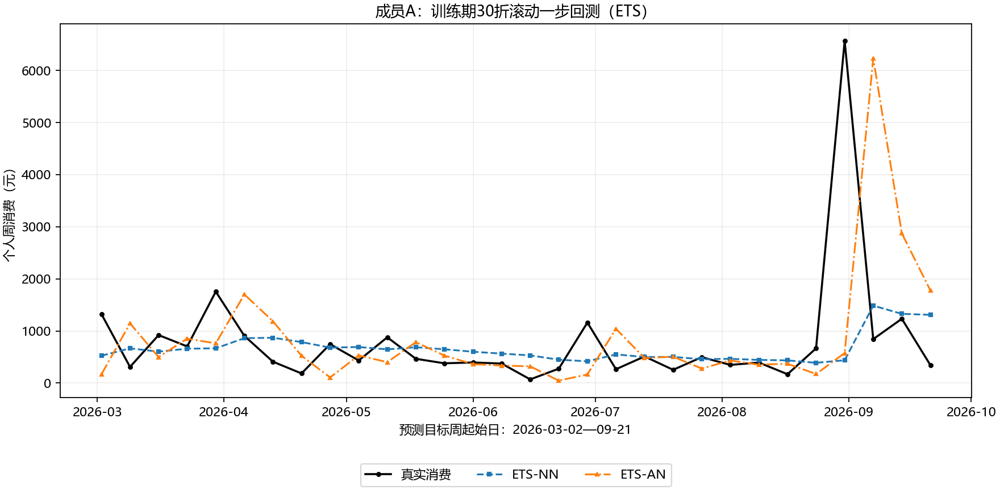
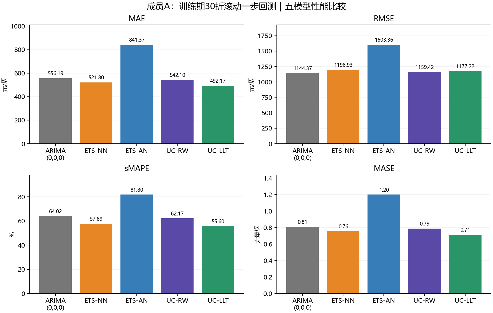
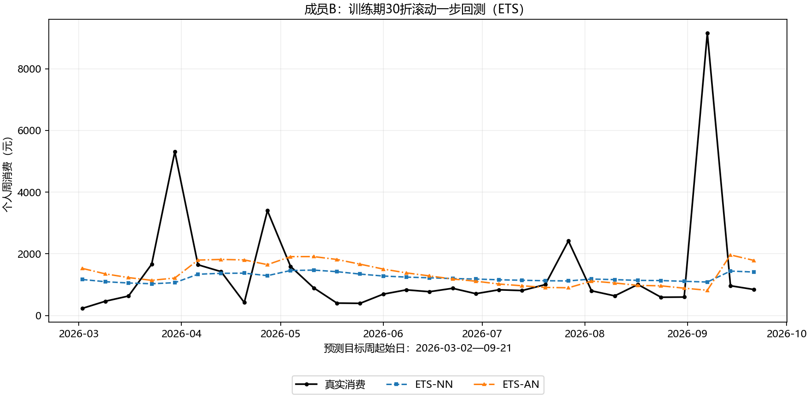
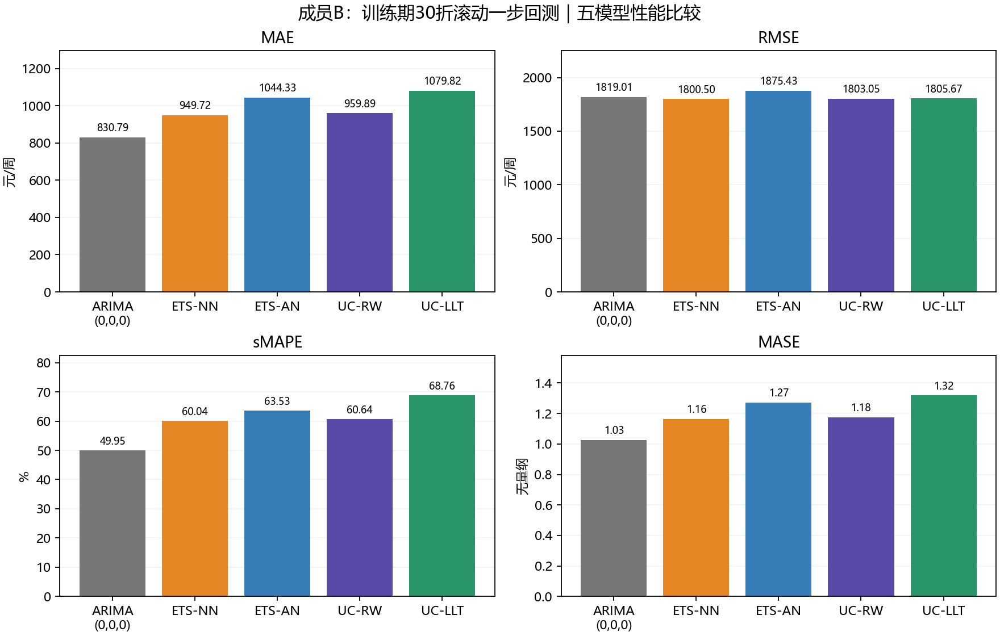
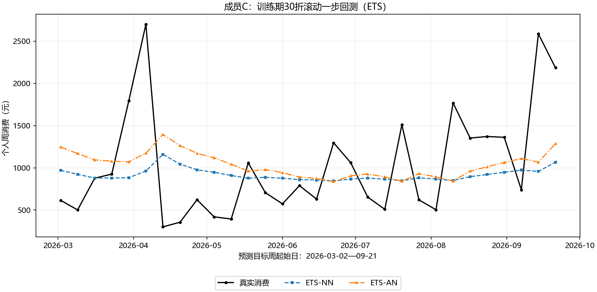
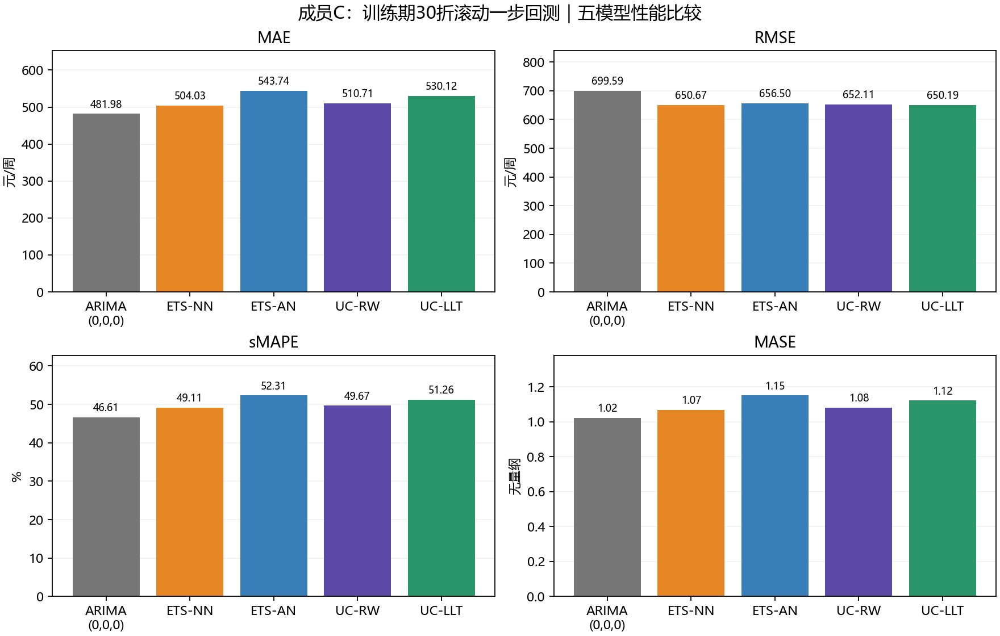

# 统一五模型训练期30折滚动一步回测

2026年11月24日｜目标周：2026-03-02—2026-09-21（周末截至09-27）｜每人成员内部比较

## 结论与范围

已补跑ABC三人的原尺度ETS-NN、ETS-AN，各30折，共180次CML估计，正式估计耗时72.67秒。直接复用新版SSM的180条UC预测及90条历史均值预测，得到450条统一明细。每成员每模型30条均通过核验。本轮没有重新运行UC、均值基线、最后四周或任何显著性检验。

| Person | Model | N | MAE | RMSE | sMAPE | MASE |
| --- | --- | --- | --- | --- | --- | --- |
| A | ARIMA(0,0,0) | 30 | 556.1883 | 1,144.3701 | 64.0151 | 0.8074 |
| A | ETS-NN | 30 | 521.7968 | 1,196.9312 | 57.6928 | 0.7554 |
| A | ETS-AN | 30 | 841.3728 | 1,603.3617 | 81.7967 | 1.1989 |
| A | UC-RW | 30 | 542.0996 | 1,159.4192 | 62.1718 | 0.7867 |
| A | UC-LLT | 30 | 492.1741 | 1,177.2227 | 55.5971 | 0.7138 |
| B | ARIMA(0,0,0) | 30 | 830.7947 | 1,819.0063 | 49.9455 | 1.0254 |
| B | ETS-NN | 30 | 949.7203 | 1,800.4951 | 60.0357 | 1.1639 |
| B | ETS-AN | 30 | 1,044.3281 | 1,875.4304 | 63.5332 | 1.2723 |
| B | UC-RW | 30 | 959.8915 | 1,803.0506 | 60.6447 | 1.1757 |
| B | UC-LLT | 30 | 1,079.8228 | 1,805.6674 | 68.7646 | 1.3181 |
| C | ARIMA(0,0,0) | 30 | 481.9792 | 699.5889 | 46.6055 | 1.0243 |
| C | ETS-NN | 30 | 504.0258 | 650.6712 | 49.1071 | 1.0685 |
| C | ETS-AN | 30 | 543.7389 | 656.4980 | 52.3071 | 1.1514 |
| C | UC-RW | 30 | 510.7102 | 652.1143 | 49.6728 | 1.0824 |
| C | UC-LLT | 30 | 530.1237 | 650.1864 | 51.2608 | 1.1228 |

MAE、RMSE单位为元/周，sMAPE单位为%，MASE无量纲。最佳模型依指标而定，表中排序不构成统计显著性证据。ARIMA(0,0,0)是带估计常数的历史均值等价点预测，原名称“历史均值”保留在明细OriginalModel中，并非声称已获得同学独立ARIMA拟合导出。

成员A：统一后MAE最佳为UC-LLT（492.17元/周），历史均值MAE为556.19元/周。替换ETS前后五模型最佳未变，ETS家族内部最佳未变。

成员B：统一后MAE最佳为ARIMA(0,0,0)（830.79元/周），历史均值MAE为830.79元/周。替换ETS前后五模型最佳未变，ETS家族内部最佳未变。

成员C：统一后MAE最佳为ARIMA(0,0,0)（481.98元/周），历史均值MAE为481.98元/周。替换ETS前后五模型最佳未变，ETS家族内部最佳未变。

| 成员 | 替换前五模型最佳MAE | 统一后五模型最佳MAE | 旧ETS家族最佳MAE | 新ETS家族最佳MAE |
| --- | --- | --- | --- | --- |
| A | UC-LLT | UC-LLT | ETS-NN | ETS-NN |
| B | ARIMA(0,0,0) | ARIMA(0,0,0) | ETS-NN | ETS-NN |
| C | ARIMA(0,0,0) | ARIMA(0,0,0) | ETS-NN | ETS-NN |

旧ETS列仅指将Ariel已有ETS预测放入同一组已通过UC/均值候选后的事后排名，用于隔离ETS更新影响；不冒充当时报告使用的全部旧候选，也不将旧ECOTOOL UC纳入比较。

## 与Ariel原有180条预测逐折比较

| Person | Model | MaxAbsForecastDifference | MeanAbsForecastDifference | ArielMAE | UnifiedMAE | ArielRMSE | UnifiedRMSE |
| --- | --- | --- | --- | --- | --- | --- | --- |
| A | ETS-NN | 0.0000 | 0.0000 | 521.7968 | 521.7968 | 1,196.9312 | 1,196.9312 |
| A | ETS-AN | 0.0001 | 0.0000 | 841.3728 | 841.3728 | 1,603.3617 | 1,603.3617 |
| B | ETS-NN | 0.4181 | 0.1224 | 949.7456 | 949.7203 | 1,800.4560 | 1,800.4951 |
| B | ETS-AN | 0.9675 | 0.4823 | 1,044.2602 | 1,044.3281 | 1,875.3592 | 1,875.4304 |
| C | ETS-NN | 0.0000 | 0.0000 | 504.0258 | 504.0258 | 650.6712 | 650.6712 |
| C | ETS-AN | 0.0001 | 0.0000 | 543.7389 | 543.7389 | 656.4980 | 656.4980 |

全部180个旧目标真实值与正式数据一致。逐折差异详见ets_vs_ariel_180.csv，含两套预测、误差及差值；旧预测指标也用当前正式数据和逐折训练分母重算，并非直接复制旧汇总表。上表与排名共同说明统一版本后ETS家族和五模型内部结论是否改变。远端历史完整训练输入、初始化及工具箱指纹仍未提供，因此不能把差异唯一归因于某一个参数或数据周。本次新增结果具有完整正式输入、代码和依赖哈希，替代旧ETS作为后续统一检验来源。

## 数据、模型和泄漏控制

规范输入仍为根目录data/ABC_个人总支付_自然周.xlsx，逐文件SHA256与rolling_final4正式来源一致，且三人的新版UC保存108周训练快照逐值相同。每轮输入仅为前1—n周，n=78—107；目标为n+1，目标值只用于评分，不传入估计。ETS入口只读前108周，不读取最后四周金额。每轮重新调用modelETS(tr,[],NN/AN,1,CML)，使用训练原尺度；无异常删除、季节项、外生项、阻尼趋势或负预测截断。

ETS直接复用rolling_final4/src/ets/fit_ets_final4.m和隐藏窗口适配，默认估计/状态初始化沿用同一ECOTOOL二进制及可读依赖；没有复制数据或工具箱。逐折Alpha、Beta、参数向量、训练均值/样本标准差（仅记录、不用于变换）、优化文本状态、警告及耗时见ets_parameters.csv；完整180折优化文本集中保存在ets_optimizer.log。接口不提供数值退出码，ExitCodeFromText仅来自优化器消息标识，不把有限预测当作已收敛证明。

逐折文本状态分布：{'优化器文本报告局部最小值；退出码未暴露': 171, '优化器文本报告步长停止；退出码未暴露': 9}。未识别消息标识数：0；负预测数：0，全部按原值保留。

SSM与均值记录仅来自experiments/uc_ssm_rebuild/results/ABC/30折滚动一步预测.csv；源文件哈希、原名称、规范名称、来源路径、代码版本、数据版本、训练前缀哈希逐条保留。UC使用当轮标准化、三起点优化及预测/方差还原方法；已核验其原点参数台账和正退出标志，未混入output旧ECOTOOL UC或缩尾、季节实验结果。

## 图表：训练期30折回测

### 成员A

### 成员B

### 成员C

## 独立核验与旧字段修正

全量450条检查成员/模型覆盖、30个唯一原点、OriginWeek+1=TargetWeek、日期、实际金额、误差及训练期MASE分母；全部有限，无缺失和重复。每个成员同一原点五模型的训练前缀哈希一致。再从导出的450条数据，用独立逐条标量公式重算15组指标，与评价表最大差为5e-12。MASE分母为当轮训练mean(abs(diff(y)))，sMAPE为mean(200|e|/(|a|+|f|))、双零计0。

| Person | Weeks | DuplicateDates | DuplicateRows | LegacyDuplicateWeekField | SSMFull108MaxDifference |
| --- | --- | --- | --- | --- | --- |
| A | 112 | 0 | 0 | -108 | 0 |
| B | 112 | 0 | 0 | -108 | 0 |
| C | 112 | 0 | 0 | -108 | 0 |

旧版数据核验字段−108源于numel对日期金额二维矩阵计算元素数。本轮采用记录行数减唯一日期数，另核查完整记录去重数，均为0；不把相同金额的不同周误判为重复。旧实验文件及上一份核验报告均不修改，新报告明确记录错误及独立计算结果。

运行前后核对407个既有数据、结果和源码文件的SHA256，均未改变。最后四周仍只是补充实验，原固定原点预测、最后四周滚动预测、旧十月累计图均保留，未用旧均值图片替代本次统一图表。

## 文件与版本

起始代码提交：`1017cd3757c1e6fe592df24279d25ab9eadadf79`；Ariel比较提交：`f69ea4c27d261bc657d66b8e8e64f958abb0471f`。新代码及复用代码SHA256、正式输入哈希、ECOTOOL逐文件依赖及总体指纹、全部受保护文件哈希保存在results/provenance.json。MATLAB版本与运行耗时见results/ets_runtime.json。

运行异常：初次尝试在A/ETS-NN/原点78估计完成后，fprintf对MATLAB字符串进行整数格式化时报错，未保存该次参数/预测。修复仅涉及日志类型转换及逐折保存；最终重新运行并保留完整180折，此外有这1次未保留的初始估计尝试。失败消息及修复前后代码哈希保存在provenance.json，未隐瞒额外尝试，也未因此改变估计方法或选择测试误差更低的结果。

统一明细：results/unified_predictions_450.csv；指标表：results/metrics_15.csv；ETS参数：results/ets_parameters.csv；Ariel逐折差异及汇总：results/ets_vs_ariel_180.csv、ets_vs_ariel_summary.csv；独立核验：results/verification.json。

复现顺序（从项目根目录）：python experiments/unified_30fold_ets/prepare_provenance.py；matlab -batch "addpath('experiments/unified_30fold_ets'); run_ets_30"；python experiments/unified_30fold_ets/assemble_verify.py。已完成目录的准备及拟合入口会拒绝重复运行，防止误重复180次估计。核验汇总脚本仅重算本目录表图，不训练模型、不写入原实验。
