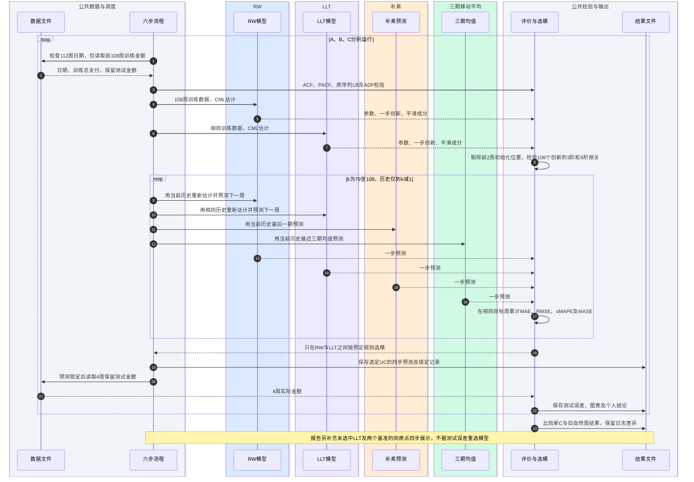
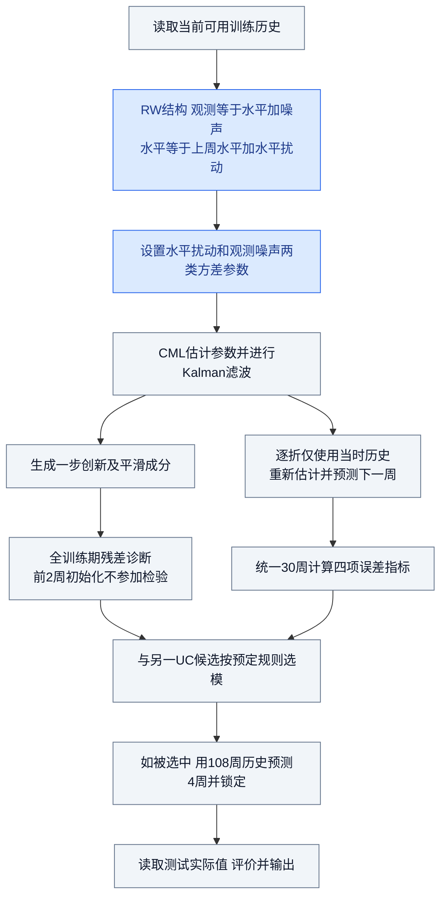
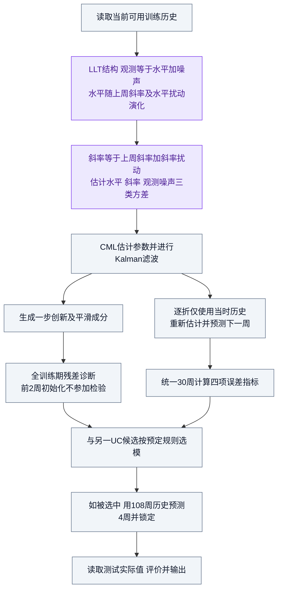
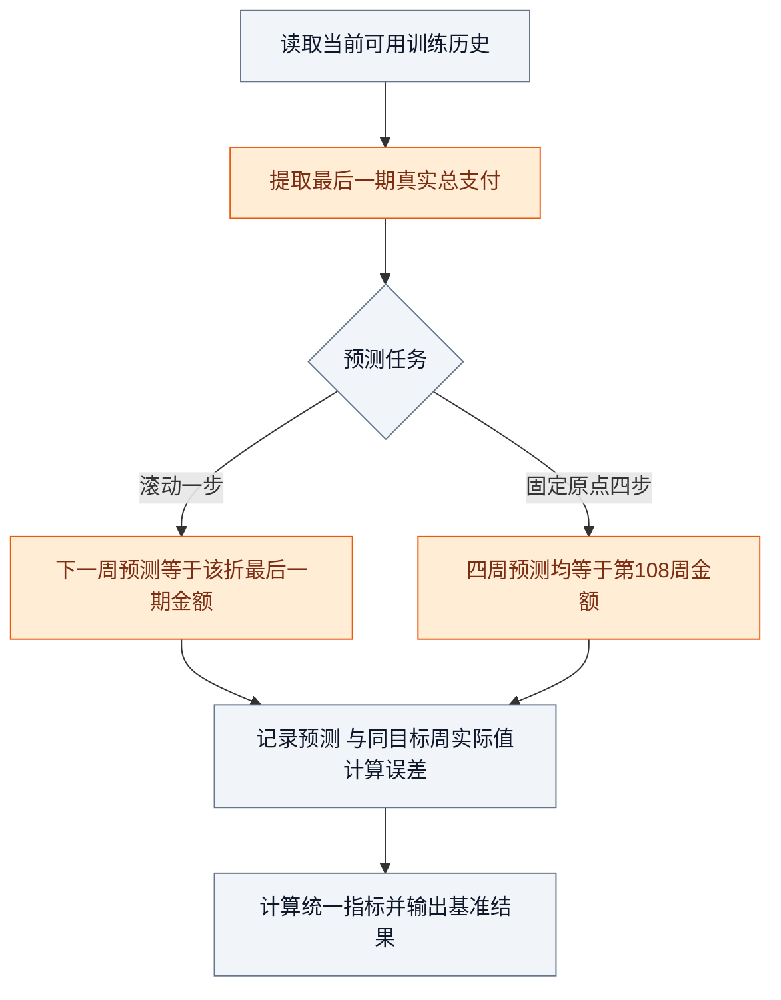
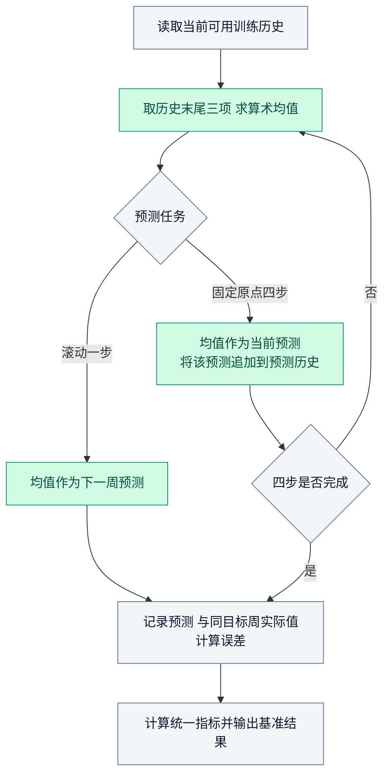

# UC 分析流程简述

UC（Unobserved Components，未观测成分）把观察到的总支付分为潜在消费水平、趋势变化和短期扰动。本项目只分析个人总支付，UC 候选是 **RW** 和 **LLT**；朴素预测与三期移动平均是比较基准，不属于 UC 模型。

三人独立运行同一程序，不把三人的序列拼接。每人 112 个完整自然周，前 108 周训练，最后 4 周保留测试。滚动验证从 78 周历史开始，共预测 30 个下一周；测试则固定在第 108 周，一次向前预测 4 周，不能逐周吸收测试真实值。

## 颜色约定

| 模块 | 颜色 | 在所有图中的含义 |
| --- | --- | --- |
| 公共模块 | 灰色 `#F1F5F9` | 数据检查、CML 估计和 Kalman 计算、检验、评价、选模、锁定与输出 |
| RW 专属模块 | 蓝色 `#DBEAFE` | 随机游走水平结构及其参数 |
| LLT 专属模块 | 紫色 `#EDE9FE` | 水平和斜率共同演化的结构及其参数 |
| 朴素专属模块 | 橙色 `#FFEDD5` | 用最后一个已知观测作预测 |
| 三期移动平均专属模块 | 绿色 `#D1FAE5` | 用最近三项均值预测；多步时递归追加预测值 |

颜色标明模块归属，并不代表模型优劣。公共模块在每张图中均使用相同的灰色。下列图使用 Mermaid，需在支持 Mermaid 的 Markdown 阅读器中打开。

## 总体 sequence 时序图

**选择规则：**若 RW、LLT 中只有一个模型在残差 3、6 阶检验中均未检出自相关，则选它；否则按 30 折滚动 MAE 优先、RMSE 次优排序。这里“通过检验”只是未检出指定滞后范围的相关性，不能证明模型完全正确。两个基准不参加 UC 内部选模，但其误差必须如实展示。

## RW 模型流程

RW 允许潜在水平逐周随机变化，另加观测噪声，不单独设置斜率或季节项。它不是朴素预测：RW 会通过状态估计平滑观测噪声，朴素预测直接使用最后一个支付金额。

RW 没有斜率；固定原点的多步点预测通常为相同水平。修正数据重跑后，B、C选择RW，A选择LLT；选择由各自训练诊断和滚动验证决定，不预设所有成员应有相同模型。

## LLT 模型流程

LLT 在水平之外增加可变化的斜率，允许消费水平沿趋势移动。其灵活性更高，也可能把短期波动误当成趋势，因此仍需按同一训练期诊断和滚动结果判断。

本次A选择LLT，B、C的LLT作为候选对照。报告中的四周测试结果不用于回头改变选模。当前ECOTOOL输出经核验可解释为趋势水平和不规则成分，未单独输出可直接作图的斜率序列，不能凭空添加斜率图。

## 朴素基准流程

固定原点四步预测不能改成逐周读取测试金额后再取上一周值；后一种做法属于不同预测任务，会产生不公平比较。

## 三期移动平均基准流程

三期指最近三周，不是最近三个月。四步递归只追加自己已经预测出的值，不能追加保留测试真实值。

## 如何读结果

MAE 看平均绝对偏差，RMSE 对大额错误更敏感；sMAPE 本项目采用 200 倍口径。MASE 在每个滚动折用该折训练期相邻变化的绝对值均值缩放，四周测试统一用 108 周训练尺度。四项指标均越小越好。

训练期的平滑成分和样本内拟合已使用整个训练区间，不能冒充逐折预测成绩。残差未检出自相关不等于正态，也不保证未来大额支付可预测。本项目未校准原生预测方差和多步尾部误差，因此不发布预测区间，不因异常候选删除观测。

本次四周测试覆盖 **2026-09-28 至 2026-10-25**，并非完整十月。新 C 的主要数值与旧自然周结果一致，但旧稳定性日志有 60 条索引异常、本次没有；这一差异已保留在新旧对比说明中。已有测试数据此前已经观察过，本次属于历史复现。

运行入口为根目录 `run_all_uc.m`；核心函数位于 `output/流程代码/`，个人结果位于 `output/A/`、`output/B/`、`output/C/`。A以新确认CSV的个人总支付列重建输入，原115,040.44元错误序列已弃用。完整结果解释见同目录Word报告及`新旧结果对比说明.md`。
