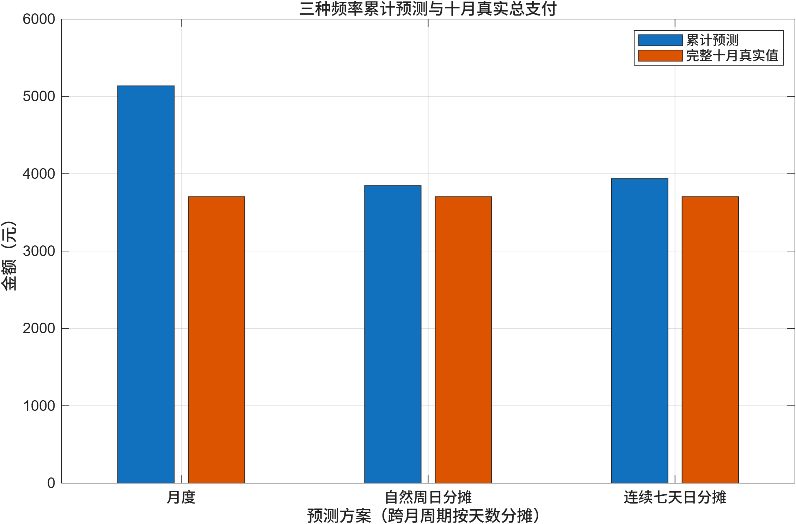
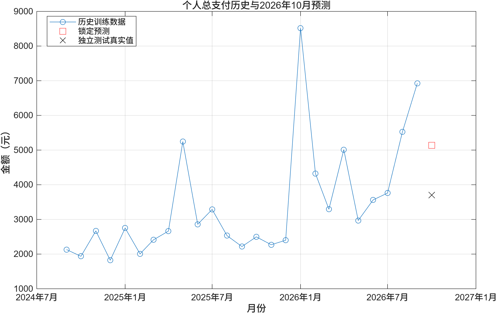
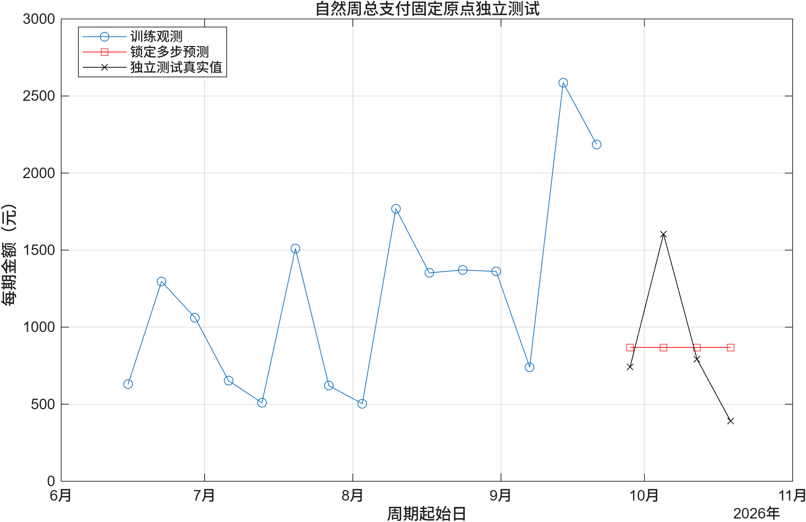
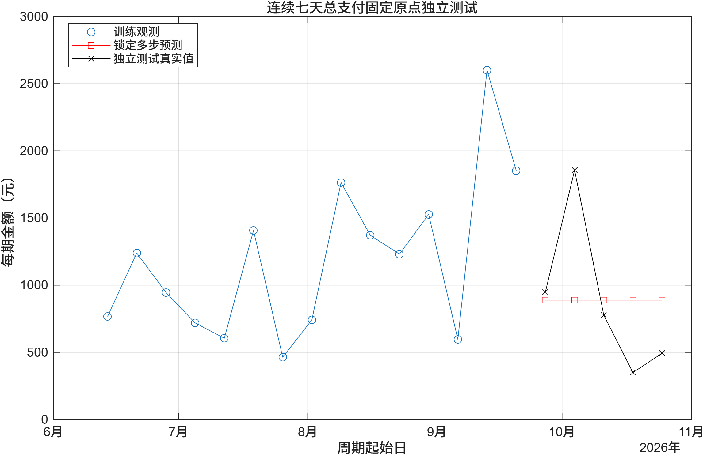

# 个人支出三种时间频率UC预测综合报告

2026-11-20｜月度、自然周、连续七天｜统计计算：MATLAB R2026a

## 研究目标与完整十月结论

目标是预测2026年10月累计个人总支付。三份数据来自同一支出的不同时间聚合，不是三个独立个体或三份独立验证。总支付为主要目标，常规支付仅作辅助，二者分别评价。原始CSV/XLSX未修改。

| 频率/方案 | UC模型 | 十月预测（元） | 十月真实（元） | 预测减真实 | 相对误差 |
| --- | --- | --- | --- | --- | --- |
| 月度 | LLT | 5135.97 | 3702.17 | 1433.80 | 38.73% |
| 自然周日分摊 | RW | 3846.23 | 3702.17 | 144.06 | 3.89% |
| 连续七天日分摊 | RW | 3936.84 | 3702.17 | 234.67 | 6.34% |

自然周改为完整十月优先，按用户最终要求允许五个相交周：第一周取4/7，中间三周各取1，最后一周取6/7。连续七天第一期取3/7，之后四期各取1。两者均为每期预测均匀日分摊，权重合计31/7；不是使用实际日支出占比校正。自然周第5步依据已锁定无漂移RW的恒定多步预测精确延长，未利用11月真实值。

自然周日分摊的本次十月误差最小，但不能由一个测试月证明其长期最优。更低周度RMSE也不能直接说明优于月度，因为时间单位、滚动目标月份与预测步长不同。

重要时间顺序：每种频率均先用训练期选模，重新拟合并锁定各保留周期预测，然后读取该频率测试金额。完整十月日分摊是用户在原测试已被观察之后提出的后续汇总口径；因此这是已锁定预测的描述性重表达，不应宣称为一项新的、从未见过测试值的独立验证。

<!-- pagebreak -->

## 数据、模型与统计解释

月度训练为2024-09至2026-09，共25个月。自然周训练为2024-09-02至2026-09-27，共108期；连续七天为2024-09-01至2026-09-26，共108期。两周数据保留跨9月底的完整周期；首尾不完整周期未直接混入UC估计。原有前四步已含数据组成核验、ACF/PACF、ADF、RW/LLT、参数/成分展示和创新残差诊断。本次核对训练MAT与Excel训练金额一致，并补齐第五、第六步与三频率汇总。

RW允许水平随机变化；LLT再加入变化的斜率。均未强加季节性。e为原金额尺度的一步创新，排除前2期初始化；comp前三列为平滑趋势、季节和不规则成分。平滑成分使用全训练期，不能冒充当时已知预测。py只含样本外预测。par是log10方差score，covpar为其协方差，10^par构造Q/R；标准误不能当作金额标准误。

现有四参数位置调用的估计表标记CML，而包装结构中的默认method标签可能为EML。stdpy可与状态矩阵条件预测协方差递推匹配，但与经验创新尺度明显不一致；核心modelUC0为P文件，无法完整核实全部估计分支。本报告不生成未经校准的95%预测区间，也不对月累计错误地把各周标准差直接相加。

原始Ljung-Box检验的零假设为指定滞后自相关均为零；ADF-ARD的零假设为存在单位根；模型残差Ljung-Box检验检验的是创新误差。均按0.05解释，未拒绝不等于证明零假设成立。参数已估计和有限样本限制p值精度。

| 频率 | 序列 | LB p(3) | LB p(6) | ADF p(0) | ADF p(1) |
| --- | --- | --- | --- | --- | --- |
| 月度 | 总支付 | 0.4748 | 0.8313 | 0.0462 | 0.2709 |
| 月度 | 常规支付 | 0.0041 | 0.0141 | 0.5873 | 0.7987 |
| 自然周 | 总支付 | 0.2195 | 0.3843 | 0.0010 | 0.0010 |
| 自然周 | 常规支付 | 0.0002 | 0.0000 | 0.0010 | 0.0010 |
| 连续七天 | 总支付 | 0.0041 | 0.0174 | 0.0010 | 0.0010 |
| 连续七天 | 常规支付 | 0.0000 | 0.0000 | 0.0010 | 0.0010 |

ADF结论可能随滞后改变；只有25个月的月度检验尤其缺乏稳定性。周数据增加了观测点，但没有增加独立的长期历史年份，不宜据此过度拟合季节或干预。

<!-- pagebreak -->

## 月度滚动验证与选择依据

前15个月起步，共10个扩展窗口一步目标月（2025-12至2026-09）。参数每折重新估计；MAE优先、RMSE辅助选择UC。已锁定模型为总支付LLT。

| 目标 | 模型 | N | MAE（元） | RMSE（元） | sMAPE% | MASE |
| --- | --- | --- | --- | --- | --- | --- |
| 总支付 | RW | 10 | 1679.76 | 2443.90 | 36.71 | 1.69 |
| 总支付 | LLT | 10 | 1455.24 | 2106.83 | 30.63 | 1.49 |
| 总支付 | 朴素 | 10 | 1918.31 | 2620.37 | 38.65 | 1.92 |
| 总支付 | 三月移动平均 | 10 | 1468.44 | 2320.42 | 30.29 | 1.51 |
| 常规支付 | RW | 10 | 1025.84 | 1297.48 | 29.76 | 1.95 |
| 常规支付 | LLT | 10 | 684.24 | 944.34 | 18.68 | 1.32 |
| 常规支付 | 朴素 | 10 | 697.37 | 880.51 | 19.45 | 1.36 |
| 常规支付 | 三月移动平均 | 10 | 778.55 | 991.36 | 21.31 | 1.50 |

MASE先用每折训练窗口相邻观测绝对变化的平均值缩放，再对各折误差取平均；不使用完整训练的未来尺度。sMAPE采用200×绝对误差/(预测绝对值+真实绝对值)。零分母按两者均为零处理。

总支付LLT的MAE、RMSE优于RW和朴素，MAE仅略优于移动平均；常规支付LLT的MAE最低，朴素的RMSE更低。LLT不能被视为全面优于简单基准。全部LLT滚动窗口有参数稳定性提示。

| 模型 | 有效创新数 | LB p(3) | LB p(6) |
| --- | --- | --- | --- |
| 总支付-RW | 23 | 0.9269 | 0.7918 |
| 总支付-LLT | 23 | 0.8920 | 0.4646 |
| 常规支付-RW | 23 | 0.3830 | 0.6754 |
| 常规支付-LLT | 23 | 0.6801 | 0.5909 |

上表p<0.05表示该候选在指定滞后范围检出显著自相关；其余候选仅为未检出，不能证明无偏、正态、参数稳定或样本外准确。连续七天常规支付RW的3阶残差检验拒绝原假设，LLT未拒绝，已纳入选模规则。完整参数与异常候选见附件CSV。

<!-- pagebreak -->

## 自然周滚动验证与选择依据

前78期起步（超过一年），以最后30期作为扩展窗口一步验证目标。各折重新估计RW/LLT，并加入上期朴素预测及最近三期移动平均。全部模型在同一30个目标期比较，未用未来信息补值。若拟合失败则保留失败记录并阻止不完整排名。选择规则：只有一个UC通过两阶残差诊断则优先它；否则按MAE、RMSE排序；参数不稳定提示另行披露。

| 目标 | 模型 | N | MAE（元） | RMSE（元） | sMAPE% | MASE |
| --- | --- | --- | --- | --- | --- | --- |
| 总支付 | RW | 30 | 481.94 | 681.09 | 46.82 | 1.02 |
| 总支付 | LLT | 30 | 549.52 | 658.89 | 52.85 | 1.16 |
| 总支付 | 朴素 | 30 | 500.58 | 742.04 | 46.21 | 1.07 |
| 总支付 | 三期移动平均 | 30 | 506.29 | 670.50 | 47.23 | 1.08 |
| 常规支付 | RW | 30 | 303.67 | 425.34 | 36.75 | 1.13 |
| 常规支付 | LLT | 30 | 335.86 | 389.96 | 40.40 | 1.24 |
| 常规支付 | 朴素 | 30 | 325.97 | 426.91 | 38.96 | 1.21 |
| 常规支付 | 三期移动平均 | 30 | 348.86 | 451.91 | 40.00 | 1.30 |

MASE先用每折训练窗口相邻观测绝对变化的平均值缩放，再对各折误差取平均；不使用完整训练的未来尺度。sMAPE采用200×绝对误差/(预测绝对值+真实绝对值)。零分母按两者均为零处理。

总支付、常规支付均选RW：它们的MAE低于LLT；LLT的RMSE较低，说明MAE/RMSE权衡不同，复杂性没有一致收益。RW相对朴素有改善，但sMAPE并非所有比较中最优。

| 模型 | 有效创新数 | LB p(3) | LB p(6) |
| --- | --- | --- | --- |
| 总支付-RW | 106 | 0.7703 | 0.9374 |
| 总支付-LLT | 106 | 0.9221 | 0.9797 |
| 常规支付-RW | 106 | 0.0712 | 0.1663 |
| 常规支付-LLT | 106 | 0.3024 | 0.6326 |

上表p<0.05表示该候选在指定滞后范围检出显著自相关；其余候选仅为未检出，不能证明无偏、正态、参数稳定或样本外准确。连续七天常规支付RW的3阶残差检验拒绝原假设，LLT未拒绝，已纳入选模规则。完整参数与异常候选见附件CSV。

<!-- pagebreak -->

## 连续七天滚动验证与选择依据

前78期起步（超过一年），以最后30期作为扩展窗口一步验证目标。各折重新估计RW/LLT，并加入上期朴素预测及最近三期移动平均。全部模型在同一30个目标期比较，未用未来信息补值。若拟合失败则保留失败记录并阻止不完整排名。选择规则：只有一个UC通过两阶残差诊断则优先它；否则按MAE、RMSE排序；参数不稳定提示另行披露。

| 目标 | 模型 | N | MAE（元） | RMSE（元） | sMAPE% | MASE |
| --- | --- | --- | --- | --- | --- | --- |
| 总支付 | RW | 30 | 426.51 | 592.53 | 42.32 | 1.09 |
| 总支付 | LLT | 30 | 467.08 | 581.36 | 45.68 | 1.19 |
| 总支付 | 朴素 | 30 | 483.26 | 700.22 | 45.30 | 1.23 |
| 总支付 | 三期移动平均 | 30 | 427.80 | 577.12 | 41.96 | 1.09 |
| 常规支付 | RW | 30 | 274.51 | 359.02 | 34.79 | 1.13 |
| 常规支付 | LLT | 30 | 269.94 | 326.02 | 33.33 | 1.11 |
| 常规支付 | 朴素 | 30 | 286.87 | 364.50 | 36.37 | 1.18 |
| 常规支付 | 三期移动平均 | 30 | 291.95 | 375.76 | 34.80 | 1.20 |

MASE先用每折训练窗口相邻观测绝对变化的平均值缩放，再对各折误差取平均；不使用完整训练的未来尺度。sMAPE采用200×绝对误差/(预测绝对值+真实绝对值)。零分母按两者均为零处理。

总支付选RW，常规支付选LLT。总支付RW的MAE最低，但移动平均的RMSE更低，且MAE与RW接近。常规支付LLT的MAE、RMSE优于RW和朴素；它仍有参数不确定性，不能只依据点估计下结论。

| 模型 | 有效创新数 | LB p(3) | LB p(6) |
| --- | --- | --- | --- |
| 总支付-RW | 106 | 0.1380 | 0.3596 |
| 总支付-LLT | 106 | 0.3133 | 0.5484 |
| 常规支付-RW | 106 | 0.0146 | 0.0813 |
| 常规支付-LLT | 106 | 0.2699 | 0.4589 |

上表p<0.05表示该候选在指定滞后范围检出显著自相关；其余候选仅为未检出，不能证明无偏、正态、参数稳定或样本外准确。连续七天常规支付RW的3阶残差检验拒绝原假设，LLT未拒绝，已纳入选模规则。完整参数与异常候选见附件CSV。

<!-- pagebreak -->

## 固定原点独立周期预测与十月累计

周模型在同一训练截止时点一次预测全部保留期，未滚动吸收测试观测。以下先展示完整周期上的总支付预测核验；自然周第5个跨11月周期仅用于十月日分摊，因没有完整周期真实值不追加其整周期误差。

| 频率 | 周期（月-日） | 步长 | 预测（元） | 实际（元） | 误差 |
| --- | --- | --- | --- | --- | --- |
| 自然周 | 09-28至10-04 | 1 | 868.50 | 742.30 | 126.20 |
| 自然周 | 10-05至10-11 | 2 | 868.50 | 1604.22 | -735.72 |
| 自然周 | 10-12至10-18 | 3 | 868.50 | 792.44 | 76.06 |
| 自然周 | 10-19至10-25 | 4 | 868.50 | 391.58 | 476.92 |
| 连续七天 | 09-27至10-03 | 1 | 888.96 | 949.55 | -60.59 |
| 连续七天 | 10-04至10-10 | 2 | 888.96 | 1856.25 | -967.29 |
| 连续七天 | 10-11至10-17 | 3 | 888.96 | 776.64 | 112.32 |
| 连续七天 | 10-18至10-24 | 4 | 888.96 | 349.15 | 539.81 |
| 连续七天 | 10-25至10-31 | 5 | 888.96 | 493.83 | 395.13 |

同周期实际合计与完整十月实际金额含义不同。自然周原四个保留完整周期累计覆盖9/28至10/25；连续七天五期覆盖9/27至10/31。本报告的首页十月表已按用户最终要求使用31天日分摊预测，与月度CSV提供的3,702.17元真实十月总支付统一评价。不能将自然周四个完整周期之和称为精确完整十月。

月度独立点预测为5,135.97元，高估1,433.80元，绝对相对误差38.73%。两种周度日分摊结果较接近本月真实值，但聚合可能抵消各周较大的正负误差；“总额接近”不代表每周预测准确。

<!-- pagebreak -->

## 异常影响、稳定性与局限

2026年1月月度总支付8,517.06元，非经常大额4,180.00元。总支付LLT该月约占滚动平方误差72.69%；常规支付与总支付分别建模有助于区分基础消费与大额偶发支出。所有正式评价保留原始观测。

各频率CSV提供保留完整评价与排除1月目标期的敏感性结果。周度敏感性以周期起始日在1月为定义，不等同于严格按交易日删除整个1月；这是事后解释，不能替代正式指标，也未用于选择模型。

参数不稳定提示规则为最大log10方差score标准误>10或绝对score>12，仅作数值筛查。滚动失败及每折标准误记录可追溯；没有用真实值填补失败预测。LLT可能将一次性高支付误解释为持续趋势，这与部分预测轨迹相容，但并非已识别的因果关系。

25个月月度样本、108个周周期和有限独立测试范围均不足以证明频率优劣。三种数据存在同源依赖，不能把三次结果当作三次独立试验。周度滚动目标30期、月度10期，覆盖时间不同，跨频率RMSE/MAE不得直接排名。

改进方向：延长观察历史；继续与朴素、移动平均比较；对事先已知大额计划增加外生信息；先解决预测方差尺度与跨期协方差，再研究月累计预测区间。均匀日分摊忽略周内消费集中，今后可在新的独立测试前以仅训练期的日信息预先定义分配权重。

本次未调整原始金额、未为提高显著性反复改阶数、未根据十月实际金额重新选择模型。结果MD、PDF、CSV、PNG均保留，源代码为MATLAB，PDF转换仅负责文档排版。

<!-- pagebreak -->

## 三种频率完整十月累计预测对比

<!-- pagebreak -->

## 月度最终预测

<!-- pagebreak -->

## 自然周固定原点预测

<!-- pagebreak -->

## 连续七天固定原点预测

