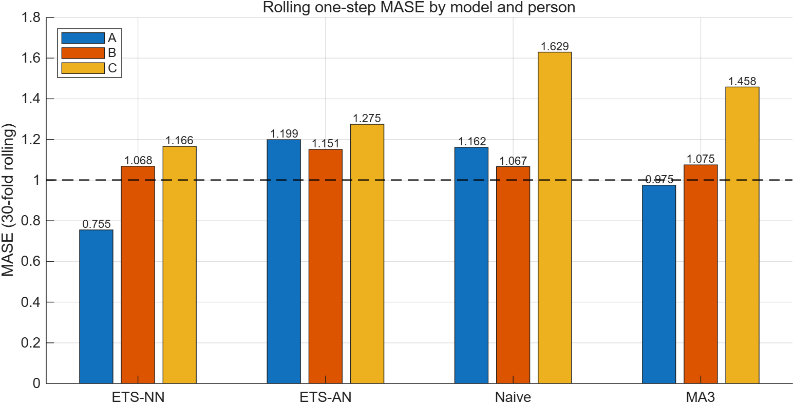
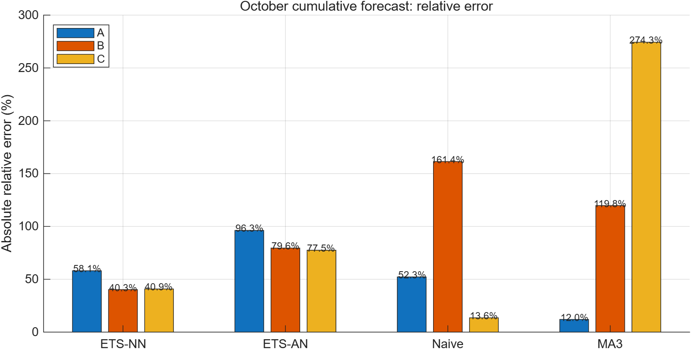
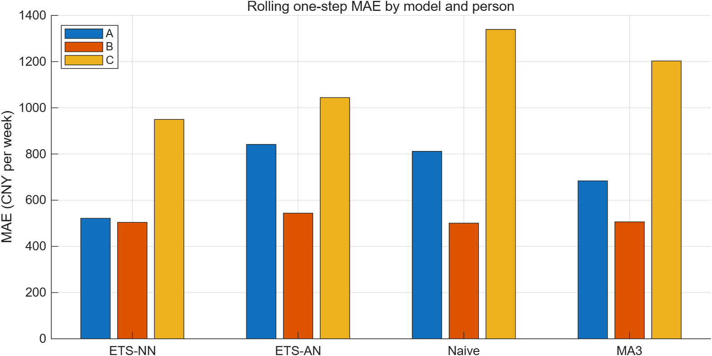

# 应用案例：消费序列的 ETS 预测与三模型对照

> 成员A（ETS）｜数据：三人自然周个人总支付｜协议对齐 UC 组员 v2
> 日期：2026-11-21

---

## 1. 实验要回答的问题

1. 把论文里的时间序列模型套到个人消费数据上，还能不能预测？
2. 三个人的消费数据，哪个更适合 ETS？
3. 在统一协议下，ETS 和 UC-RW 相比表现如何？
4. 滚动一步验证和最终多步预测，结论是否一致？

---

## 2. 实验逻辑

论文的做法是：**同一份预处理后的序列，喂给不同模型，用同一套指标比较**。
我们把它迁移到消费数据：

```text
统一数据口径（个人总支付）
        ↓
统一频率（自然周，周一至周日）
        ↓
统一验证协议（扩展窗口、30 折、一步预测）
        ↓
每个模型各自估计参数（参数不强行一致）
        ↓
滚动指标 + 最终五步预测 + 十月累计
```

**控制变量**：数据、频率、训练/测试范围、折数、预测步长、指标定义、是否加季节、是否做 Box-Cox、估计方法。
**不控制**：模型自身的参数（ARIMA 阶数、ETS 平滑参数、UC 方差）。

---

## 3. 数据与口径

| 项目 | 统一设置 |
|---|---|
| 目标 | `个人总支付_元`（毛额，不扣退款） |
| 频率 | 自然周（周一至周日，每期 7 天） |
| 训练 | 2024-09-02 ～ 2026-09-27，共 108 周 |
| 滚动 | 扩展窗口，训练 78～107 周，一步预测，共 30 折 |
| 最终预测 | 用全部 108 周重新估计，一次预测 5 周 |
| 季节项 | 不加 |
| Box-Cox | 不做 |
| 估计方法 | CML |
| 异常值 | 保留，不删不截尾 |

| 数据 | 自然周数 | 2026 年 10 月实际 |
|---|---|---|
| 成员A | 112 | 3,191.51 元 |
| 成员B | 112 | 3,702.17 元 |
| 成员C | 112 | 4,323.72 元 |

---

## 4. 结果

### 4.1 30 折滚动一步验证（MASE）

| 模型 | 成员A | 成员B | 成员C |
|---|---|---|---|
| **ETS-NN（仅水平）** | **0.755** | **1.068** | **1.166** |
| ETS-AN（带趋势） | 1.199 | 1.151 | 1.275 |
| 朴素（上期值） | 1.162 | 1.067 | 1.629 |
| 三期移动平均 | 0.975 | 1.075 | 1.458 |
| UC-RW（组员基准） | — | **1.020** | — |

### 4.2 完整指标（30 折）

| 数据 | 模型 | MAE | RMSE | sMAPE | MASE |
|---|---|---|---|---|---|
| A | ETS-NN | 521.80 | 1196.93 | 57.69% | 0.755 |
| A | ETS-AN | 841.37 | 1603.36 | 81.80% | 1.199 |
| B | ETS-NN | 504.03 | 650.67 | 49.11% | 1.068 |
| B | ETS-AN | 543.74 | 656.50 | 52.31% | 1.151 |
| B | UC-RW | 481.94 | 681.09 | 46.82% | 1.020 |
| C | ETS-NN | 949.75 | 1800.46 | 60.04% | 1.166 |
| C | ETS-AN | 1044.26 | 1875.36 | 63.53% | 1.275 |

### 4.3 最终五步预测与十月累计

| 数据 | 模型 | 十月累计预测 | 绝对误差 | 相对误差 |
|---|---|---:|---:|---:|
| A | ETS-NN | 5,046.08 | 1,854.57 | 58.11% |
| A | ETS-AN | 118.77 | 3,072.74 | 96.28% |
| A | 朴素 | 1,523.87 | 1,667.64 | 52.25% |
| A | 三期移动平均 | 3,574.71 | 383.20 | **12.01%** |
| B | ETS-NN | 5,193.29 | 1,491.12 | 40.28% |
| B | ETS-AN | 6,647.85 | 2,945.68 | 79.57% |
| B | 朴素 | 9,678.86 | 5,976.69 | 161.44% |
| B | 三期移动平均 | 8,137.28 | 4,435.11 | 119.80% |
| B | **UC-RW** | **3,846.23** | **144.06** | **3.89%** |
| C | ETS-NN | 6,090.46 | 1,766.74 | 40.86% |
| C | ETS-AN | 7,675.82 | 3,352.10 | 77.53% |
| C | 朴素 | 3,737.63 | 586.09 | **13.56%** |
| C | 三期移动平均 | 16,185.75 | 11,862.03 | 274.35% |

> 十月实际值：A 3,191.51；B 3,702.17；C 4,323.72。
> 合成规则：`4/7·f1 + f2 + f3 + f4 + 6/7·f5`。

---

## 5. 结论与解释

### 5.1 ETS-NN 始终优于 ETS-AN

三个人的数据上，仅水平的 NN 都优于带趋势的 AN：

- A：0.755 vs 1.199
- B：1.068 vs 1.151
- C：1.166 vs 1.275

**消费序列没有稳定趋势，强行估计趋势反而放大误差。**

### 5.2 三个人的数据难度不同

- A 最容易（MASE 0.755）
- B 中等（1.068）
- C 最难（1.166）

ETS 的表现高度依赖个人消费的规律性。

### 5.3 滚动成绩和十月单次预测排序不同

滚动最好的是 A 的 ETS-NN（0.755），但十月累计误差最大的是 A（58.11%）。
B 和 C 的十月误差都在 40% 左右，与滚动排序不一致。

**原因**：十月累计是从同一个原点做五步预测，结果对最后几周极其敏感；滚动是 30 次一步预测，更稳定。

### 5.4 与 UC-RW 的对照（B 数据）

| 任务 | ETS-NN | UC-RW |
|---|---|---|
| 30 折滚动 MASE | 1.068 | **1.020** |
| 十月累计相对误差 | 40.28% | **3.89%** |

**一步滚动两者接近；五步最终预测 UC-RW 明显更好。**

### 5.5 AN 会产生负预测

A 的 ETS-AN 五周预测为 558.8 → 308.9 → 59.1 → −190.8 → −440.7。
消费金额不可能为负，这是趋势项外推失效的直接证据。

---

## 6. PPT 可直接使用的表述

### 6.1 一句话结论

> 在自然周消费数据上，ETS 的"仅水平"设定（NN）在三人数据上都优于"带趋势"设定（AN）；一步滚动预测与 UC-RW 接近，但五步最终预测的稳定性明显不足。

### 6.2 适合放在页面上的要点

- 统一协议：自然周、108 周训练、30 折一步滚动、同一套 sMAPE/MASE
- ETS-NN 的 30 折 MASE：**A 0.755 / B 1.068 / C 1.166**
- 趋势项是负资产：AN 在三人数据上全部更差
- 滚动 ≠ 单次：十月累计对最后几周高度敏感
- 与 UC-RW（B 数据）对比：滚动 1.068 vs 1.020；十月 40.28% vs 3.89%

### 6.3 已生成的图（可直接插入 PPT）

**图 1：30 折滚动 MASE（模型 × 人）**



**图 2：十月累计相对误差（模型 × 人）**



**图 3：30 折滚动 MAE**



> 三张图都在 `results/figures/case_summary/`，白底 200 dpi，可直接拖进幻灯片。

### 6.4 讲稿衔接句

> "我们按 UC 组员的协议，把 ETS 应用到了三个人的消费数据上。结果很一致：只用水平的 ETS-NN 表现最好，加趋势反而更差。这说明个人消费的主要可预测成分是水平，而不是趋势。不过，滚动一步的成绩和十月五步的最终预测排序并不一致，这一点在解释结果时需要特别说明。"

---

## 7. 局限与注意事项

1. **十月结果已公开**，新增模型的比较属于事后对照实验，不能据此反复调参。
2. **样本只有 112 周**（约 2.2 年），无法可靠估计年度季节项。
3. **不同人的数据来源不同**：A 为支付宝+微信（自己账户），B/C 由各自账单汇总；绝对金额不可直接横比。
4. **CML 与 EML 差异明显**：月度 AN 在 EML 下 MASE 0.879，CML 下 1.565；报告中需注明实际使用的方法。
5. **AN 的负预测**需要截断到 0 后再解释，否则累计金额没有意义。
6. **模型参数不需要一致**，但调参范围、验证窗口和选择规则必须提前固定。
