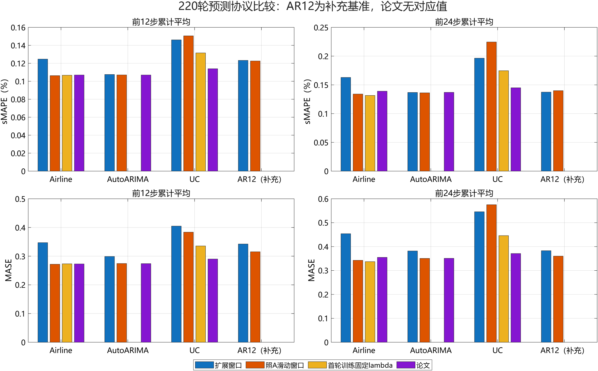

# 固定480个月滑动窗口实验

四模型主实验均完成220轮，每轮24步，共21120条预测。另有Airline、UC的首轮训练固定lambda补充实验，各220轮，不混入主实验。

## 协议与前视信息

每轮训练CO2(r:r+479)，目标CO2(r+480:r+503)，起点1998-02至2016-05，目标1998-03至2018-05。模型结构和估计方法沿用B/C，不调整阶数。Airline外部变换后使用modelTF；UC使用modelUC(ty, [], 'LLT12', 24)，二者均逆变换到ppm。AR12保持含截距OLS和递推。AutoARIMA使用modelAUTO(train,'s',[1 12],'nofs',24)，公开包装器默认boxcox=1，后端自动处理，直接取ppm预测，不重复变换或逆变换。加密后端无法逐行核查。

A脚本注释称0.2461来自初始480月，但A4实际在CO2(25:504)估计。按工具箱同一目标函数重算：CO2(1:480)得到-0.044042968750；CO2(25:504)得到0.246093750000，后者四舍五入为0.2461。故照A主实验可能含前视信息，尤其前24轮参数来源包含其训练期之后的观测；不能称为完全无信息泄漏。补充实验将lambda固定为首轮训练估计的完整精度值，AutoARIMA与AR12无需重跑。

## 年度累计汇总

单位：sMAPE为百分数；年度为前12、24步等权累计平均，绝非第12、24步点误差。差值为本实验减论文。AR12不是论文的自动AR，论文差值留空。

逐轮逐步先计算`sMAPE(r,h)=200*abs(actual-forecast)/(abs(actual)+abs(forecast))`，以及`MASE(r,h)=abs(actual-forecast)/scale(r)`；`scale(r)=mean(abs(train(13:end)-train(1:end-12)))`，只用当轮480个月原始ppm数据。先对220轮取平均，再对前12或24步取平均。各步轮数相同，因此等价于全部220乘h个误差的等权平均。

|模型|实验协议|1年sMAPE|2年sMAPE|1年MASE|2年MASE|与论文差异（s1/s2；M1/M2）|
|---|---|---:|---:|---:|---:|---|
|ETS|原A滑动480固定0.2461|0.116689|0.157911|0.297602|0.402345|-0.001311 / -0.010089；-0.001398 / -0.023655|
|ETS|此前六模型扩展窗口|0.127017|0.172504|0.352108|0.478765|+0.009017 / +0.004504；+0.053108 / +0.052765|
|SeasonalNaive|原A滑动480固定0.2461|0.547005|0.818179|1.381332|2.067852|+0.000005 / +0.000179；+0.000332 / -0.000148|
|SeasonalNaive|此前六模型扩展窗口|0.547005|0.818179|1.508542|2.259614|+0.000005 / +0.000179；+0.127542 / +0.191614|
|Airline|此前六模型扩展窗口|0.124667|0.162965|0.347179|0.454048|+0.017667 / +0.023965；+0.074179 / +0.099048|
|Airline|本次滑动480照A|0.106302|0.134026|0.271889|0.342785|-0.000698 / -0.004974；-0.001111 / -0.012215|
|Airline|滑动480首轮训练lambda|0.106728|0.131576|0.273279|0.337012|-0.000272 / -0.007424；+0.000279 / -0.017988|
|AutoARIMA|此前六模型扩展窗口|0.107575|0.136829|0.298894|0.381714|+0.000575 / -0.000171；+0.024894 / +0.030714|
|AutoARIMA|本次滑动480照A|0.107079|0.136126|0.274433|0.350616|+0.000079 / -0.000874；+0.000433 / -0.000384|
|UC|此前六模型扩展窗口|0.146095|0.196406|0.404781|0.545723|+0.032095 / +0.051406；+0.114781 / +0.174723|
|UC|本次滑动480照A|0.150557|0.224531|0.383600|0.575251|+0.036557 / +0.079531；+0.093600 / +0.204251|
|UC|滑动480首轮训练lambda|0.131543|0.174631|0.335526|0.445864|+0.017543 / +0.029631；+0.045526 / +0.074864|
|AR12|此前六模型扩展窗口|0.123253|0.137427|0.342453|0.382849|无论文对应模型|
|AR12|本次滑动480照A|0.122617|0.139957|0.315393|0.360212|无论文对应模型|

## 变化与论文接近程度

- Airline 前12步：sMAPE变化-0.018364，MASE变化-0.075290；MAE 0.476631 → 0.408644 ppm。固定旧预测换分母贡献-0.024549，再换预测贡献-0.050741。论文绝对差：sMAPE 0.017667 → 0.000698；MASE 0.074179 → 0.001111。
- Airline 前24步：sMAPE变化-0.028939，MASE变化-0.111263；MAE 0.623569 → 0.517563 ppm。固定旧预测换分母贡献-0.032168，再换预测贡献-0.079095。论文绝对差：sMAPE 0.023965 → 0.004974；MASE 0.099048 → 0.012215。
- AutoARIMA 前12步：sMAPE变化-0.000496，MASE变化-0.024460；MAE 0.413198 → 0.411490 ppm。固定旧预测换分母贡献-0.022831，再换预测贡献-0.001630。论文绝对差：sMAPE 0.000575 → 0.000079；MASE 0.024894 → 0.000433。
- AutoARIMA 前24步：sMAPE变化-0.000704，MASE变化-0.031098；MAE 0.526918 → 0.524672 ppm。固定旧预测换分母贡献-0.028567，再换预测贡献-0.002531。论文绝对差：sMAPE 0.000171 → 0.000874；MASE 0.030714 → 0.000384。
- UC 前12步：sMAPE变化+0.004463，MASE变化-0.021181；MAE 0.561807 → 0.579277 ppm。固定旧预测换分母贡献-0.032282，再换预测贡献+0.011101。论文绝对差：sMAPE 0.032095 → 0.036557；MASE 0.114781 → 0.093600。
- UC 前24步：sMAPE变化+0.028126，MASE变化+0.029528；MAE 0.758613 → 0.866049 ppm。固定旧预测换分母贡献-0.044134，再换预测贡献+0.073662。论文绝对差：sMAPE 0.051406 → 0.079531；MASE 0.174723 → 0.204251。
- AR12 前12步：sMAPE变化-0.000636，MASE变化-0.027060；MAE 0.472590 → 0.470261 ppm。固定旧预测换分母贡献-0.025460，再换预测贡献-0.001600。
- AR12 前24步：sMAPE变化+0.002530，MASE变化-0.022637；MAE 0.528713 → 0.539105 ppm。固定旧预测换分母贡献-0.028549，再换预测贡献+0.005912。

sMAPE绝对变化最大：Airline前24步，变化-0.028939个百分点。MASE绝对变化最大：Airline前24步，变化-0.111263。

两种指标方向是否一致：Airline前12步一致；Airline前24步一致；AutoARIMA前12步一致；AutoARIMA前24步一致；UC前12步不一致；UC前24步一致；AR12前12步一致；AR12前24步不一致；

上述分解采用先分母后预测的明确路径，属于算术分解，不能当成唯一因果归因。Airline、UC同时改变窗口和lambda策略，需结合首轮固定lambda补充结果判断，不能把全部差异都归因于训练窗口。AutoARIMA、AR12仅改变训练窗口。季节朴素预测仅由末12月决定，原A与扩展窗口sMAPE相同，其MASE变化完全来自分母。

与论文比较不存在一个全面占优的协议。照A设置下，Airline的两种年度指标均更接近论文；AutoARIMA的1年两指标及2年MASE更接近，但2年sMAPE反而略远。UC的两年两指标均更远，一年则sMAPE更远、MASE更近。首轮训练固定lambda补充实验中，UC的四个年度指标均比旧扩展窗口及照A主实验更接近论文，但仍未复现论文值；Airline的1年指标更贴近论文，而2年指标由照A固定0.2461更近。

从误差分解看，Airline的MASE改善主要来自预测绝对误差下降；AutoARIMA及AR12的MASE改善主要来自分母变化。UC两年预测误差上升的贡献超过分母增大带来的下降，所以两年MASE仍恶化；UC一年及AR12两年都出现sMAPE上升而MASE下降，不能将MASE下降直接解释为预测改善。

季节朴素使用滑动480月分母后的年度MASE为1.381332、2.067852，与论文1.381、2.068按三位小数一致，支持论文可能采用固定训练长度的分母。模型数值更接近论文属于额外相容证据，不能唯一确定作者的拟合窗口、变换、初值、估计器或异常值处理；朴素法也不能验证lambda。未进行显著性检验。

## 最优模型与参数的适用范围

在本次已比较的模型和协议中，以1年、2年累计sMAPE和MASE作描述性评价，Airline表现最好。需要无前视设置时，采用首轮训练固定lambda版本；不能将同一样本上的模型选择解释为独立验证的普遍最优，也不能称为已证明显著优于其他模型。

Airline结构为ARIMA(0,1,1)(0,1,1)的12个月季节模型，`(1-B)(1-B^12)z(t)=(1+ma1*B)(1+ma12*B^12)epsilon(t)`，`z=(y^lambda-1)/lambda`。lambda固定为-0.044042968750，两个MA系数每轮重新估计，不能用一组参数代表220轮。

|训练轮次|训练索引|ma1|ma12|
|---|---|---:|---:|
|1|CO2(1:480)|-0.406150009352|-0.901805543387|
|220|CO2(220:699)|-0.409586453156|-0.853916170110|

以上为滚动实验参数，不是用全部723个月拟合的部署模型；残差方差与参数标准误详见检查点内对应轮次的估计表。

## 版本、核验与复跑

MATLAB：26.1.0.3346908 (R2026a) Update 5；ECOTOOL：1.0。主实验拟合耗时2065.785秒；两模型补充耗时1286.217秒。参数、完整估计表、日志、实际输入、依赖路径和SHA256均在checkpoint.mat。UC包装器method可能显示EML，但实际位置调用后端的估计表应单独核对。核验PASS是数量、输入边界、数据尺度、导出一致性及公式正确性的检查，不证明加密优化器收敛。

Airline（照A）：估计表报告Estimation method: EXACT MAXIMUM LIKELIHOOD；日志含warning/maximum number/failed/not converge关键词的轮数0。关键词筛查不能证明或否定收敛。

AutoARIMA（照A）：估计表报告Estimation method: CONDITIONAL SUM OF SQUARES；日志含warning/maximum number/failed/not converge关键词的轮数0。关键词筛查不能证明或否定收敛。

UC（照A）：估计表报告Estimation method: CONDITIONAL SUM OF SQUARES；日志含warning/maximum number/failed/not converge关键词的轮数0。关键词筛查不能证明或否定收敛。

Airline（首轮训练lambda）：估计表报告Estimation method: EXACT MAXIMUM LIKELIHOOD；日志含warning/maximum number/failed/not converge关键词的轮数0。关键词筛查不能证明或否定收敛。

UC（首轮训练lambda）：估计表报告Estimation method: CONDITIONAL SUM OF SQUARES；日志含warning/maximum number/failed/not converge关键词的轮数0。关键词筛查不能证明或否定收敛。

本次2进程续跑墙钟耗时943.162秒（包括进程池启动，之前中断阶段另计）。

原A来源固定提交f8dabd8778ac9f277cbdd99cd7cfd9f94e513cf6，原B接口固定提交9225da80af22d5bbb2ddf6d727cc9db51a82968c，旧六模型结果来自本分支4e67c33的results/comparison。论文值复用该已核对的Table 4转录；A文档中的部分论文列曾串列，本实验使用原始CSV与统一转录，不采信其串列说明。所有旧成果保持原样。

先完成3轮并独立核验PASS后续跑；为降低内存压力将4个工作进程改为2个。第87轮AutoARIMA的元胞返回字段触发元数据构造错误，改为标量结构逐字段保存后从检查点继续，未修改模型或估计设置。所有此前已保存预测及其耗时在续跑结束后逐值检查不变。运行时间字段为最后一次续跑的墙钟耗时，逐模型累计成功拟合时间另列，不能将其混称为全流程墙钟时间。

首次运行时已执行run_bc_sliding480(3)及audit_bc_sliding480(3)。已有完整检查点时，以下命令仅跳过已完成拟合并重建导出与核验，不需要删除检查点。

```matlab
addpath('src');
run_bc_sliding480(220,2);
summarize_bc_sliding480;
audit_bc_sliding480(220);
```



## 交付范围与数据准备

原始MAT文件未纳入当前分支，克隆后必须先按[数据准备说明](../../../data/README.md)从固定Git对象恢复并核验文件SHA-256。汇总及独立核验还需要原A历史提交f8dabd8778ac9f277cbdd99cd7cfd9f94e513cf6的Git对象；首次运行前执行`git fetch origin Ariel`，不必切换分支。并行续跑需要Parallel Computing Toolbox，没有该工具箱可使用默认串行入口`run_bc_sliding480(220)`。

结果目录共10个文件：主实验checkpoint.mat、predictions.csv、metrics_by_horizon.csv、table4_comparison.csv、audit.txt、comparison.png，以及first_train_lambda_predictions.csv、first_train_lambda_metrics_by_horizon.csv、mase_decomposition.csv、experiment_summary.md。checkpoint.mat第1至4列依次为Airline、AutoARIMA、UC、AR12，第5至6列是首轮训练lambda的Airline、UC。主实验预测21120条、补充10560条，逐步指标分别96行和48行。

复核状态：本报告覆盖预测复现实验与协议比较，不代表PPT、演讲稿、Fig.3趋势复现或全项目课程交付均已验收。数据准备、核心公式、指标范围、模型参数、版本证据及复跑路径已列明；核验以audit.txt中最近一次实际执行结果为准。
