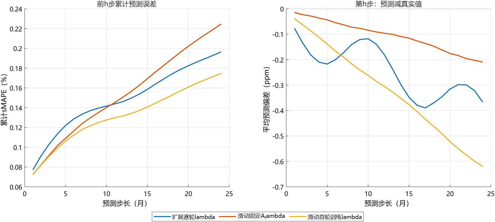

# UC与论文差异排查

本次只排查UC（LLT12）；AR12是补充模型，不能与论文的自动AR视为同一种模型。所有诊断均在独立目录进行，既有滚动结果未覆盖，未通过修改原模型来追赶论文数字。

## 已有220轮证据

|协议|前h步|sMAPE（%）|MASE|MAE（ppm）|预测减真实值的均值（ppm）|最差10轮占绝对误差比例|
|---|---:|---:|---:|---:|---:|---:|
|扩展逐轮lambda|12|0.146095|0.404781|0.561807|-0.157827|13.31%|
|扩展逐轮lambda|24|0.196406|0.545723|0.758613|-0.244462|15.58%|
|滑动固定A_lambda|12|0.150557|0.383600|0.579277|-0.057226|14.24%|
|滑动固定A_lambda|24|0.224531|0.575251|0.866049|-0.106328|16.74%|
|滑动首轮训练lambda|12|0.131543|0.335526|0.505623|-0.175591|13.92%|
|滑动首轮训练lambda|24|0.174631|0.445864|0.673823|-0.325932|15.75%|

论文UC前12、24步累计sMAPE为0.114、0.145，MASE为0.290、0.371。必须使用累计平均，不能把第24步的误差直接与论文2年行比较。此前独立核验已排除预测月份错位、重复逆变换和MASE公式错误；本次又独立重算现有逐轮指标。

固定480月窗口与原调用完全相同，只将lambda由0.2461改为首轮训练估计值，前24步sMAPE从0.224531降为0.174631；因此lambda选择是已验证的实质影响因素。原扩展窗口同时改变了窗口与逐轮lambda，不能仅据三组总误差把全部变化归于窗口。

固定A参数的整体有符号偏差反而比首轮训练lambda小，但绝对误差更大，说明正负误差会互相抵消。不能把全部差距解释为统一方向的低估，也不能据此直接给所有预测加常数修正。

旧UC预测不变、仅改用滑动窗口MASE分母时，两年MASE为0.501589；实际滑动固定A参数为0.575251，预测变化贡献+0.073662，分母变化贡献-0.044134。这说明差异不是只靠修正评价分母即可消除，原始ppm预测误差也确实上升。

固定A参数下最差两轮为第78、123轮，前24步平均绝对误差分别约4.555、4.378 ppm，且均为系统性低估；首轮训练lambda下，同轮sMAPE分别降为0.365217%、0.276291%。最差10轮仅占全部轮次的4.55%，却贡献约16.74%的绝对误差；但其余轮次仍贡献超过八成，不能解释成只有两个坏点。

|协议|预测增长代理最小值|最大值|增长代理误差的平均绝对值|
|---|---:|---:|---:|
|扩展逐轮lambda|-0.048971|0.549709|0.043788|
|滑动固定A_lambda|-0.114160|0.414585|0.058892|
|滑动首轮训练lambda|-0.071484|0.312891|0.040741|

增长代理单位为ppm/月，定义为预测或真实值的第二年均值减第一年均值再除12，不能直接称为UC潜在斜率参数。较大代理误差与长期趋势外推失准相容；不能单凭此诊断断言优化失败。

在上述问题轮次，lambda还会改变各成分相对方差和预测增长，不能只把Box-Cox视为一次不影响模型动态的单位换算。估计表的SCORE为对数方差参数，本机公开auxmodelUC.m使用10的SCORE次方构造方差；PARAM列显示0.00000只是四舍五入，不能据此断言方差为零或估计碰到边界。

|轮次|lambda|斜率方差/不规则方差|预测增长代理|真实增长代理|
|---|---:|---:|---:|---:|
|1|0.246100|0.664829|0.209544|0.109097|
|78|0.246100|0.475335|-0.111865|0.196181|
|123|0.246100|0.543803|-0.114160|0.162847|
|1|-0.044043|0.536464|0.202904|0.109097|
|78|-0.044043|0.000009|0.132459|0.196181|
|123|-0.044043|0.000017|0.142975|0.162847|
## 同输入接口及估计方法试验

选取轮次[1 78 123]：第1轮，加上固定A参数下平均绝对误差最大的两轮。后两轮是事后挑选的问题案例，不能把此抽样均值当作220轮估计或无偏排名。每个轮次比较两种固定lambda、五种调用方法，共30次拟合。

|轮次|lambda|调用|实际估计方法|前24步sMAPE|前24步MASE|相对原预测最大变化（ppm）|
|---|---:|---|---|---:|---:|---:|
|1|0.246100|原位置省略默认|Estimation method: CONDITIONAL SUM OF SQUARES|0.166994|0.489787|0.000000000|
|1|0.246100|位置显式CML|Estimation method: CONDITIONAL SUM OF SQUARES|0.166994|0.489787|0.000000000|
|1|0.246100|位置显式EML|Estimation method: EXACT MAXIMUM LIKELIHOOD|0.166994|0.489787|0.000000000|
|1|0.246100|名称显式CML|Estimation method: CONDITIONAL SUM OF SQUARES|0.166994|0.489787|0.000000000|
|1|0.246100|名称显式EML|Estimation method: EXACT MAXIMUM LIKELIHOOD|0.166994|0.489787|0.000000000|
|78|0.246100|原位置省略默认|Estimation method: CONDITIONAL SUM OF SQUARES|1.204226|3.099870|0.000000000|
|78|0.246100|位置显式CML|Estimation method: CONDITIONAL SUM OF SQUARES|1.204226|3.099870|0.000000000|
|78|0.246100|位置显式EML|Estimation method: EXACT MAXIMUM LIKELIHOOD|1.204226|3.099870|0.000000000|
|78|0.246100|名称显式CML|Estimation method: CONDITIONAL SUM OF SQUARES|1.204226|3.099870|0.000000000|
|78|0.246100|名称显式EML|Estimation method: EXACT MAXIMUM LIKELIHOOD|1.204226|3.099870|0.000000000|
|123|0.246100|原位置省略默认|Estimation method: CONDITIONAL SUM OF SQUARES|1.136635|2.802569|0.000000000|
|123|0.246100|位置显式CML|Estimation method: CONDITIONAL SUM OF SQUARES|1.136635|2.802569|0.000000000|
|123|0.246100|位置显式EML|Estimation method: EXACT MAXIMUM LIKELIHOOD|1.136635|2.802569|0.000000000|
|123|0.246100|名称显式CML|Estimation method: CONDITIONAL SUM OF SQUARES|1.136635|2.802569|0.000000000|
|123|0.246100|名称显式EML|Estimation method: EXACT MAXIMUM LIKELIHOOD|1.136635|2.802569|0.000000000|
|1|-0.044043|原位置省略默认|Estimation method: CONDITIONAL SUM OF SQUARES|0.159061|0.466303|0.000000000|
|1|-0.044043|位置显式CML|Estimation method: CONDITIONAL SUM OF SQUARES|0.159061|0.466303|0.000000000|
|1|-0.044043|位置显式EML|Estimation method: EXACT MAXIMUM LIKELIHOOD|0.159061|0.466303|0.000000000|
|1|-0.044043|名称显式CML|Estimation method: CONDITIONAL SUM OF SQUARES|0.159061|0.466303|0.000000000|
|1|-0.044043|名称显式EML|Estimation method: EXACT MAXIMUM LIKELIHOOD|0.159061|0.466303|0.000000000|
|78|-0.044043|原位置省略默认|Estimation method: CONDITIONAL SUM OF SQUARES|0.365217|0.944044|0.000000000|
|78|-0.044043|位置显式CML|Estimation method: CONDITIONAL SUM OF SQUARES|0.365217|0.944044|0.000000000|
|78|-0.044043|位置显式EML|Estimation method: EXACT MAXIMUM LIKELIHOOD|0.365217|0.944044|0.000000000|
|78|-0.044043|名称显式CML|Estimation method: CONDITIONAL SUM OF SQUARES|0.365217|0.944044|0.000000000|
|78|-0.044043|名称显式EML|Estimation method: EXACT MAXIMUM LIKELIHOOD|0.365217|0.944044|0.000000000|
|123|-0.044043|原位置省略默认|Estimation method: CONDITIONAL SUM OF SQUARES|0.276291|0.683962|0.000000000|
|123|-0.044043|位置显式CML|Estimation method: CONDITIONAL SUM OF SQUARES|0.276291|0.683962|0.000000000|
|123|-0.044043|位置显式EML|Estimation method: EXACT MAXIMUM LIKELIHOOD|0.276291|0.683962|0.000000000|
|123|-0.044043|名称显式CML|Estimation method: CONDITIONAL SUM OF SQUARES|0.276291|0.683962|0.000000000|
|123|-0.044043|名称显式EML|Estimation method: EXACT MAXIMUM LIKELIHOOD|0.276291|0.683962|0.000000000|

公开modelUC.m中，位置参数调用直接把已有实参传给modelUC0；省略method时，包装器返回的method仍写EML，而后端可能用CML/CSS。名称参数调用则把包装器补全的method、outlier、par0一起传给后端。本试验同时比较位置显式CML、位置显式EML和名称显式CML/EML；实际方法只看估计表，不以包装器字段为准。

本次30次拟合中，所有调用对相应原预测的最大差异均为0 ppm。因此，在所测三轮与两种lambda下，改成显式EML并没有改善预测，不能把CML/EML标签差异认定为主要原因，也没有依据为此直接重跑整套220轮。此结果不证明加密后端完全忽略method，只说明本次预测对这个开关不敏感。

论文给出的UC示例恰好也是省略method的位置调用，因此不能仅因本机实际为CSS，就断言是我们没有按示例运行，或断言论文Table 4必然使用EML。论文没有提供完整逐轮估计表及优化器轨迹，当前后端又是加密P代码。

## 已确认与仍待确认

已确认：lambda和训练策略能明显改变本样本结果；误差有长步长累积，偏差方向与集中程度见上表及逐步长CSV；AR12与论文AR定义不一致。实际接口默认存在方法字段与估计表不一致的现象。方法试验只能说明所选案例的敏感性，不能替代完整220轮方法对照。

尚不能确认：论文滚动实验采用哪种左边界、每轮lambda与估计方法；默认初值、局部最优或边界方差是否解释剩余差异。论文理论部分描述dummy季节项，案例部分却称trigonometric，并统一给出LLT12接口；单凭这些文字不能证明本机季节项与原作者不同，也不应擅自换成另一模型。没有原作者实际逐轮程序或同版可审查后端，就不能唯一归因于版本差异。

自定义par0的首个附加试验超过约3分钟仍未返回，已终止且未获得可用拟合。手册没有明确其数值尺度；不能将该次未完成试验当作优化失败、参数尺度错误或局部最优的证据，也未纳入上述30次有效试验。

建议保留所有已完成结果，把无前视固定lambda作为独立、可解释的协议。当前不优先仅为CML/EML标签再重跑220轮；应先向作者或同版参考实现确认实际滚动代码、季节项实现及初值定义。若未来开展方法对照，需预先固定同一窗口和lambda，不能按论文接近程度选参数。

来源：[原论文案例及Table 4](https://journals.plos.org/plosone/article?id=10.1371/journal.pone.0221238)，本机公开modelUC.m与checkInputs.m，以及既有两份检查点。MATLAB 26.1.0.3346908 (R2026a) Update 5；ECOTOOL 1.0。

