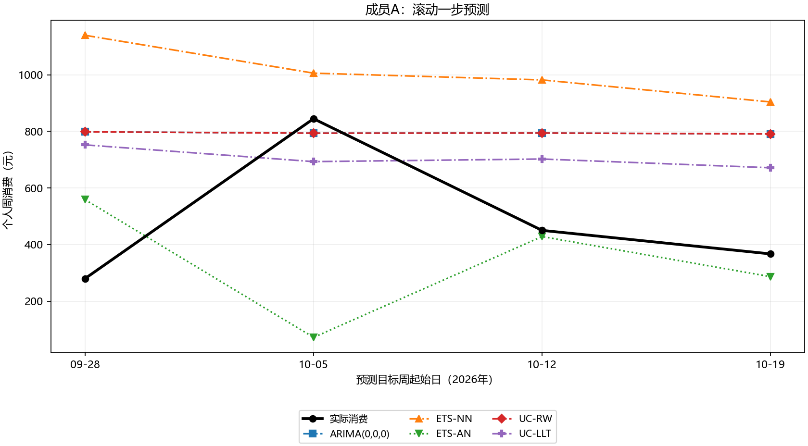
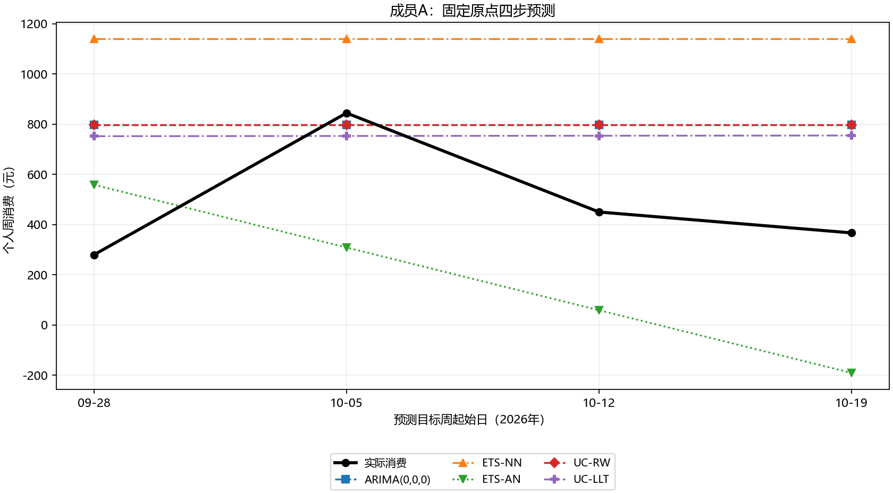
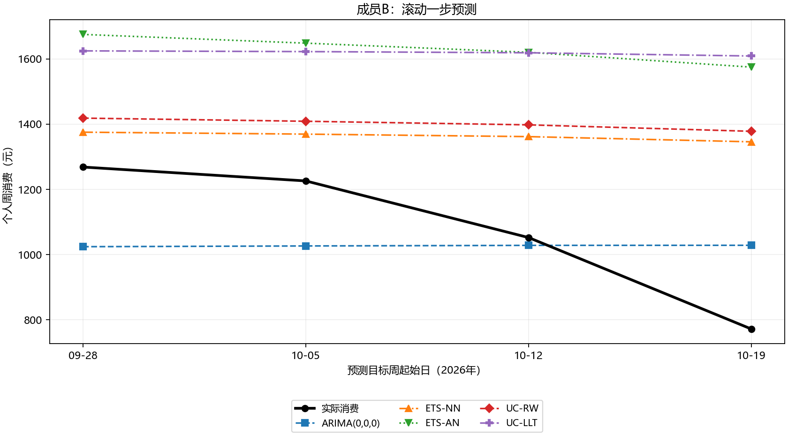
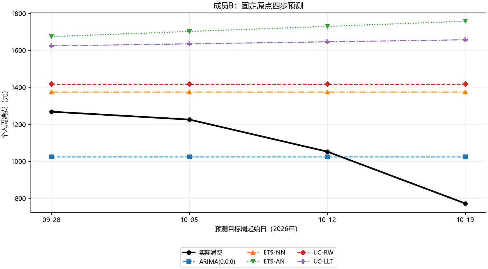
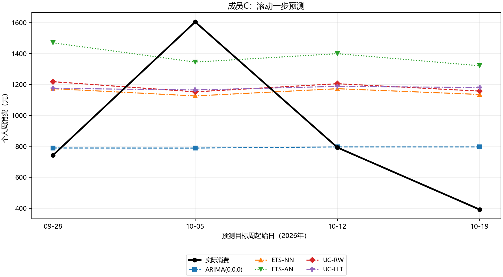
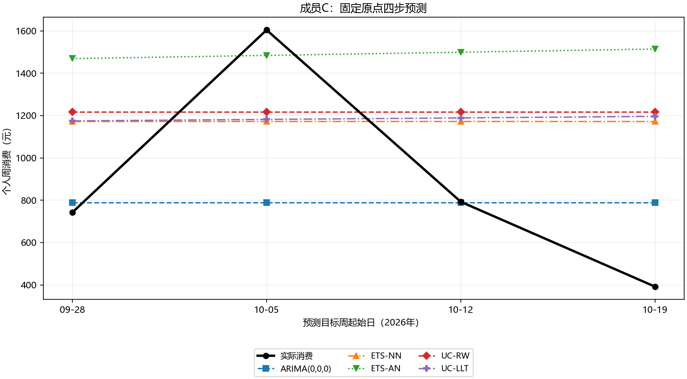

# 五模型最后四周滚动一步预测补充实验

2026年11月24日｜测试期：2026-09-28—2026-10-25｜金额单位：人民币元

## 主要结论

15组“成员×模型”中有12组的滚动MAE低于固定原点MAE。以下最佳模型仅按本次四周MAE作事后描述，不用于重新调参，也不代表统计显著性。

| 成员 | 固定原点最佳 | 固定MAE | 滚动最佳 | 滚动MAE | 均值MAE | 最佳变化 |
| --- | --- | --- | --- | --- | --- | --- |
| A | UC-LLT | 313.876 | ETS-AN | 288.406 | 334.287 | 是 |
| B | ARIMA(0,0,0) | 181.526 | ARIMA(0,0,0) | 181.020 | 181.020 | 否 |
| C | ARIMA(0,0,0) | 315.695 | ARIMA(0,0,0) | 317.710 | 317.710 | 否 |

## 数据身份与统一口径

| 成员 | 周数 | 112周合计 | 108周训练合计 | 四周实际合计 | 既有消费口径 |
| --- | --- | --- | --- | --- | --- |
| A | 112 | 88,167.330 | 86,225.260 | 1,942.070 | 个人总支付；未减退款 |
| B | 112 | 114,959.440 | 110,640.440 | 4,319.000 | 净消费、退款回冲原日（既有口径） |
| C | 112 | 88,773.970 | 85,243.430 | 3,530.540 | 原总支付、保留校园卡代理及已确认大额事件 |

三套数据均逐周核对本地原始来源，日期连续且唯一，未删除异常消费。五模型在同一成员内逐值使用相同输入。三人既有来源口径有差异：B保留既定净消费口径，并不把它重新命名为未经退款的总支付；跨人金额不可视为同口径消费水平排名。输入SHA256及原始来源SHA256见[data_audit.csv](data_audit.csv)。

Ariel的B脚本读取旧C标签目录、C脚本读取旧B标签目录；本实验不用这些旧路径，按本地已确认成员身份读取data/A、B、C。远端三份历史表的30个真实目标值各自与本地同名成员逐值一致，说明脚本已补偿旧标签互换；这些表不足以证明全部112周及估计版本一致，因此不直接复用远端预测。交叉核对见[remote_identity_audit.csv](remote_identity_audit.csv)。

## 扩展窗口协议与估计方法

训练长度依次为108、109、110、111周，目标依次为109—112周。每轮重新估计参数及滤波状态，只把截至训练末周的金额传入拟合函数。固定原点对照只用前108周，一次预测4周；第109周两协议来自同一次估计，逐值一致。没有运行30折或27原点回测。测试结果此前已公开，本实验属于事后补充实验。

ARIMA(0,0,0)为当轮训练均值，带估计常数；这是与ARIMA同学后续核对的明确实现。ETS沿用Ariel的modelETS(y,[],NN/AN,H,CML)，无变换的原尺度作为预先指定主方案。UC使用本地最新uc_ssm_rebuild的标准化、三个预设起点、对数方差边界[-18,6]、原优化容差及最大似然选择规则；方差乘训练样本标准差平方还原。UC固定原点预测已与新版已有结果逐值核对，未覆盖旧结果。

## 五模型滚动一步性能

| Person | Model | MAE | RMSE | sMAPE | MASE | ForecastTotal | ActualTotal | CumulativeAbsoluteError | SumWeeklyAbsoluteError |
| --- | --- | --- | --- | --- | --- | --- | --- | --- | --- |
| A | ARIMA(0,0,0) | 334.287 | 377.231 | 57.709 | 0.448 | 3,177.092 | 1,942.070 | 1,235.022 | 1,337.149 |
| A | ETS-NN | 522.181 | 577.752 | 74.298 | 0.699 | 4,030.792 | 1,942.070 | 2,088.722 | 2,088.722 |
| A | ETS-AN | 288.406 | 412.746 | 66.144 | 0.386 | 1,345.991 | 1,942.070 | 596.079 | 1,153.622 |
| A | UC-RW | 334.287 | 377.230 | 57.709 | 0.448 | 3,177.085 | 1,942.070 | 1,235.015 | 1,337.150 |
| A | UC-LLT | 295.068 | 317.092 | 53.391 | 0.395 | 2,819.230 | 1,942.070 | 877.160 | 1,180.270 |
| B | ARIMA(0,0,0) | 181.020 | 203.592 | 17.450 | 0.196 | 4,108.353 | 4,319.000 | 210.647 | 724.079 |
| B | ETS-NN | 283.361 | 338.003 | 24.738 | 0.308 | 5,452.443 | 4,319.000 | 1,133.443 | 1,133.443 |
| B | ETS-AN | 549.827 | 572.360 | 41.976 | 0.596 | 6,518.306 | 4,319.000 | 2,199.306 | 2,199.306 |
| B | UC-RW | 321.068 | 368.297 | 27.402 | 0.349 | 5,603.272 | 4,319.000 | 1,284.272 | 1,284.272 |
| B | UC-LLT | 538.910 | 571.183 | 41.287 | 0.585 | 6,474.638 | 4,319.000 | 2,155.638 | 2,155.638 |
| C | ARIMA(0,0,0) | 317.710 | 455.736 | 35.724 | 0.646 | 3,170.661 | 3,530.540 | 359.879 | 1,270.841 |
| C | ETS-NN | 508.149 | 527.196 | 54.025 | 1.035 | 4,606.543 | 3,530.540 | 1,076.003 | 2,032.597 |
| C | ETS-AN | 630.504 | 675.795 | 61.804 | 1.286 | 5,533.482 | 3,530.540 | 2,002.942 | 2,522.017 |
| C | UC-RW | 526.313 | 544.593 | 55.364 | 1.072 | 4,732.063 | 3,530.540 | 1,201.523 | 2,105.254 |
| C | UC-LLT | 513.983 | 538.167 | 54.284 | 1.047 | 4,707.203 | 3,530.540 | 1,176.663 | 2,055.931 |

MAE与RMSE单位为元/周；sMAPE为百分数，使用200×|误差|/(|实际|+|预测|)，双零计0。MASE每条预测除以当轮训练集mean(abs(diff(y)))后取均值；固定原点四条预测均用108周训练分母。ForecastTotal是四个完整周直接相加，不是按天折算的十月金额。CumulativeAbsoluteError=|预测总额−实际总额|；SumWeeklyAbsoluteError=Σ|逐周误差|，不能互换。

## 固定原点与滚动一步对比

| Person | Model | FixedMAE | RollingMAE | MAEImprovementPct | FixedRMSE | RollingRMSE | FixedCumulativeAbsoluteError | RollingCumulativeAbsoluteError |
| --- | --- | --- | --- | --- | --- | --- | --- | --- |
| A | ARIMA(0,0,0) | 336.019 | 334.287 | 0.515 | 380.144 | 377.231 | 1,251.458 | 1,235.022 |
| A | ETS-NN | 653.920 | 522.181 | 20.146 | 688.648 | 577.752 | 2,615.678 | 2,088.722 |
| A | ETS-AN | 440.914 | 288.406 | 34.589 | 455.266 | 412.746 | 1,206.113 | 596.079 |
| A | UC-RW | 336.018 | 334.287 | 0.515 | 380.143 | 377.230 | 1,251.453 | 1,235.015 |
| A | UC-LLT | 313.876 | 295.068 | 5.992 | 344.307 | 317.092 | 1,072.495 | 877.160 |
| B | ARIMA(0,0,0) | 181.526 | 181.020 | 0.279 | 202.938 | 203.592 | 221.206 | 210.647 |
| B | ETS-NN | 295.629 | 283.361 | 4.150 | 354.291 | 338.003 | 1,182.517 | 1,133.443 |
| B | ETS-AN | 636.575 | 549.827 | 13.627 | 675.093 | 572.360 | 2,546.299 | 2,199.306 |
| B | UC-RW | 338.740 | 321.068 | 5.217 | 390.986 | 368.297 | 1,354.960 | 1,284.272 |
| B | UC-LLT | 561.353 | 538.910 | 3.998 | 598.310 | 571.183 | 2,245.412 | 2,155.638 |
| C | ARIMA(0,0,0) | 315.695 | 317.710 | -0.638 | 454.010 | 455.736 | 373.376 | 359.879 |
| C | ETS-NN | 505.814 | 508.149 | -0.462 | 530.601 | 527.196 | 1,160.176 | 1,076.003 |
| C | ETS-AN | 669.067 | 630.504 | 5.764 | 758.695 | 675.795 | 2,436.080 | 2,002.942 |
| C | UC-RW | 528.444 | 526.313 | 0.403 | 556.633 | 544.593 | 1,341.212 | 1,201.523 |
| C | UC-LLT | 513.947 | 513.983 | -0.007 | 540.786 | 538.167 | 1,211.005 | 1,176.663 |

MAEImprovementPct为正表示改善。动态更新会改变可用信息集，因此该比较描述实际更新策略收益，不是纯粹固定参数的结构检验。A的固定原点ETS-AN第112周预测为负，保留原模型输出，没有事后截为零。最佳模型依指标而变：A滚动MAE以ETS-AN最低，滚动RMSE以UC-LLT最低；不得把一个指标的胜出泛化到全部指标。

## 水平和趋势更新的预测价值

成员A：ETS-NN/AN的滚动MAE为522.18/288.41元，UC-RW/LLT为334.29/295.07元；历史均值为334.29元。优于均值的动态候选：ETS-AN、UC-LLT。趋势候选应分别与同家族水平候选比较，不能仅从参数存在就断言趋势有价值。

成员B：ETS-NN/AN的滚动MAE为283.36/549.83元，UC-RW/LLT为321.07/538.91元；历史均值为181.02元。优于均值的动态候选：无。趋势候选应分别与同家族水平候选比较，不能仅从参数存在就断言趋势有价值。

成员C：ETS-NN/AN的滚动MAE为508.15/630.50元，UC-RW/LLT为526.31/513.98元；历史均值为317.71元。优于均值的动态候选：无。趋势候选应分别与同家族水平候选比较，不能仅从参数存在就断言趋势有价值。

状态与参数一起重估，本实验不能把收益单独归因于状态更新或参数更新。四周数据只能说明本次目标期的表现；不能据此宣称动态模型普遍有效、普遍无效或具有统计显著性。

## 实际消费与预测曲线

### 成员A

### 成员B

### 成员C

## ETS原尺度与标准化尺度一致性

| Person | Model | OriginWeek | RawAlpha | StandardAlpha | RawBeta | StandardBeta | MaxSmoothingDifference | MaxForecastDifference | MaxForecastRelativePct | RawConvergence | StandardConvergence | Consistent |
| --- | --- | --- | --- | --- | --- | --- | --- | --- | --- | --- | --- | --- |
| A | ETS-NN | 108 | 0.151 | 0.151 | — | — | 0.000 | 0.000 | 0.000 | 局部最小值（文本）；无数值退出码 | 局部最小值（文本）；无数值退出码 | True |
| A | ETS-AN | 108 | 0.663 | 0.663 | 0.176 | 0.176 | 0.000 | 0.000 | 0.000 | 局部最小值（文本）；无数值退出码 | 局部最小值（文本）；无数值退出码 | True |
| A | ETS-NN | 109 | 0.147 | 0.147 | — | — | 0.000 | 0.000 | 0.000 | 局部最小值（文本）；无数值退出码 | 局部最小值（文本）；无数值退出码 | True |
| A | ETS-AN | 109 | 0.665 | 0.665 | 0.177 | 0.177 | 0.000 | 0.000 | 0.000 | 局部最小值（文本）；无数值退出码 | 局部最小值（文本）；无数值退出码 | True |
| A | ETS-NN | 110 | 0.146 | 0.146 | — | — | 0.000 | 0.000 | 0.000 | 局部最小值（文本）；无数值退出码 | 局部最小值（文本）；无数值退出码 | True |
| A | ETS-AN | 110 | 0.665 | 0.665 | 0.174 | 0.174 | 0.000 | 0.000 | 0.000 | 局部最小值（文本）；无数值退出码 | 局部最小值（文本）；无数值退出码 | True |
| A | ETS-NN | 111 | 0.145 | 0.145 | — | — | 0.000 | 0.000 | 0.000 | 局部最小值（文本）；无数值退出码 | 局部最小值（文本）；无数值退出码 | True |
| A | ETS-AN | 111 | 0.665 | 0.665 | 0.174 | 0.174 | 0.000 | 0.000 | 0.000 | 局部最小值（文本）；无数值退出码 | 局部最小值（文本）；无数值退出码 | True |
| B | ETS-NN | 108 | 0.041 | 0.041 | — | — | 0.000 | 2.047 | 0.149 | 局部最小值（文本）；无数值退出码 | 局部最小值（文本）；无数值退出码 | False |
| B | ETS-AN | 108 | 0.105 | 0.105 | 0.008 | 0.008 | 0.000 | 0.335 | 0.019 | 局部最小值（文本）；无数值退出码 | 局部最小值（文本）；无数值退出码 | False |
| B | ETS-NN | 109 | 0.041 | 0.041 | — | — | 0.000 | 2.009 | 0.147 | 局部最小值（文本）；无数值退出码 | 局部最小值（文本）；无数值退出码 | False |
| B | ETS-AN | 109 | 0.103 | 0.103 | 0.008 | 0.008 | 0.000 | 0.291 | 0.018 | 步长停止（文本）；无数值退出码 | 步长停止（文本）；无数值退出码 | False |
| B | ETS-NN | 110 | 0.041 | 0.041 | — | — | 0.000 | 1.987 | 0.146 | 局部最小值（文本）；无数值退出码 | 局部最小值（文本）；无数值退出码 | False |
| B | ETS-AN | 110 | 0.101 | 0.101 | 0.008 | 0.008 | 0.000 | 0.322 | 0.020 | 局部最小值（文本）；无数值退出码 | 局部最小值（文本）；无数值退出码 | False |
| B | ETS-NN | 111 | 0.040 | 0.040 | — | — | 0.000 | 2.035 | 0.151 | 局部最小值（文本）；无数值退出码 | 局部最小值（文本）；无数值退出码 | False |
| B | ETS-AN | 111 | 0.100 | 0.100 | 0.008 | 0.008 | 0.000 | 0.349 | 0.022 | 局部最小值（文本）；无数值退出码 | 局部最小值（文本）；无数值退出码 | False |
| C | ETS-NN | 108 | 0.070 | 0.070 | — | — | 0.000 | 0.007 | 0.001 | 局部最小值（文本）；无数值退出码 | 局部最小值（文本）；无数值退出码 | True |
| C | ETS-AN | 108 | 0.150 | 0.150 | 0.004 | 0.004 | 0.000 | 1.479 | 0.098 | 局部最小值（文本）；无数值退出码 | 局部最小值（文本）；无数值退出码 | False |
| C | ETS-NN | 109 | 0.065 | 0.065 | — | — | 0.000 | 0.009 | 0.001 | 局部最小值（文本）；无数值退出码 | 局部最小值（文本）；无数值退出码 | True |
| C | ETS-AN | 109 | 0.132 | 0.132 | 0.004 | 0.004 | 0.000 | 0.622 | 0.046 | 局部最小值（文本）；无数值退出码 | 局部最小值（文本）；无数值退出码 | False |
| C | ETS-NN | 110 | 0.069 | 0.069 | — | — | 0.000 | 0.006 | 0.001 | 局部最小值（文本）；无数值退出码 | 局部最小值（文本）；无数值退出码 | True |
| C | ETS-AN | 110 | 0.136 | 0.136 | 0.004 | 0.004 | 0.000 | 0.688 | 0.049 | 局部最小值（文本）；无数值退出码 | 局部最小值（文本）；无数值退出码 | False |
| C | ETS-NN | 111 | 0.065 | 0.065 | — | — | 0.000 | 0.008 | 0.001 | 局部最小值（文本）；无数值退出码 | 局部最小值（文本）；无数值退出码 | True |
| C | ETS-AN | 111 | 0.126 | 0.126 | 0.004 | 0.004 | 0.000 | 0.450 | 0.034 | 局部最小值（文本）；无数值退出码 | 局部最小值（文本）；无数值退出码 | False |

核验采用严格诊断阈值：平滑参数差≤0.001且还原预测最大差≤0.10元。参数和预测均使用完整精度API值，未使用显示表四舍五入参数做判断。12/24组符合严格阈值，最大平滑参数差为1.96e-08，最大预测差为2.04699333元，最大相对预测差为0.1512%。这说明参数估计基本一致，但预测流程没有完全保持尺度等变。

部分预测差异超过严格诊断阈值，不能笼统称所有结果完全一致。仍保留预先指定原尺度主结果，不按测试误差选择版本。额外采用仅除标准差、以及减均值后除标准差两种变换进行训练内诊断，结果见ets_affine_diagnostic.csv：两种变换还原预测的最大差仅0.00003064元，但都与原尺度存在差异。因此差异不主要来自减均值，也不是明显不同的平滑参数局部最优。MATLAB调用追踪确认预测经过fisET、auxmodelESSS及kfiniet；可读源码显示auxmodelESSS返回空P0，fisET和kfiniet对空P0使用固定1e5单位阵，而非随数据方差一起缩放。由这些证据推断，固定有限初始协方差在不同金额单位下改变初始相对权重，是本次尺度差异的主要机制。modelETS0为P-code，其内部完整控制流不可读，故保留这一解释的推断性质，不改动工具箱初始化来追求测试误差。

标准化只使用当轮训练均值和样本标准差，之后还原预测；它不构成新增预测变量。原尺度与标准化的目标函数绝对大小不可直接比较，尺度变换会按标准差平方改变条件平方和。收敛信息来自优化器文本；接口没有提供数值退出标志，不能仅由有限参数推断收敛。

## 参数、估计异常与可复现性

最终正式运行估计耗时75.77秒，MATLAB 26.1.0.3346908 (R2026a) Update 5。远端Ariel提交为`f69ea4c27d261bc657d66b8e8e64f958abb0471f`。必要ETS调用已选择性提取并去除G盘路径，本地ECOTOOL工具箱复用，不复制大型数据或工具箱。

UC共24次估计，退出标志≤0的主结果有0次，靠近方差边界的主结果有0次。边界与参数协方差不可精确计算提示可识别性限制，不能据此删除大额消费或调参追求更低测试误差。各起点是否缺少协方差及退出标志见每位成员UC多起点.csv；MATLAB警告见matlab.log。

逐轮参数及方差见[all_parameters.csv](all_parameters.csv)，ETS level为α、slope为β，完整原始与标准化估计表和优化过程保存在各成员目录。UC Parameters是标准化对数方差，VarianceYuan2依次为RW的水平/观测方差或LLT的水平/斜率/观测方差。ARIMA参数为窗口均值，VarianceYuan2为高斯MLE残差方差。

独立Python核验了全部120条预测的训练边界、真实金额、误差和MASE分母、60条均值/动态参数记录数量、24组尺度核验数量、同原点第109周一致性及UC固定原点与已有结果一致性，并从原始来源重算112周金额。报告与CSV由同一份未经四舍五入的预测生成。

复现：在项目根目录执行`matlab -batch "addpath('rolling_final4'); run_final4"`，随后执行`python rolling_final4/summarize_verify.py`。ECOTOOL依赖内部结果控件，适配函数保留隐藏控件并禁止显示或激活；计算与绘图均在后台完成。初次正式计算耗时74.53秒；为满足无弹窗要求，第一次纯文本替代因P-code依赖控件而失败，随后改用隐藏控件并成功重算。最终正式估计及额外尺度诊断均未运行旧回测。源代码哈希与数据版本见[provenance.json](provenance.json)。
